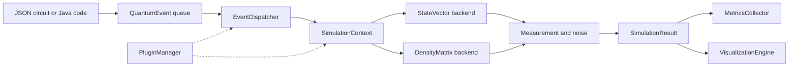

# QForge: Event-Driven Quantum Circuit Simulator in Java

**QForge is an open source quantum computing library written in pure Java 17, with no native
dependencies.** It simulates quantum circuits with a state vector or a density matrix, applies
realistic quantum noise (depolarizing, dephasing, amplitude damping), measures arbitrary Hermitian
observables, and ships runnable implementations of Grover's algorithm, the Quantum Fourier
Transform, quantum phase estimation, VQE, QAOA, Trotterized time evolution, the Shor code, quantum
walks, a quantum neural network, and a quantum kernel classifier.

[](https://adoptium.net/)
[](LICENSE)
[](https://maven.apache.org/)
[](CHANGELOG.md)
[](docs/08-development.md)
[](https://github.com/CharafeddineMechalikh/QForge/actions/workflows/ci.yml)
[](docs/08-development.md#coverage)
[](docs/08-development.md#coverage)
[](docs/02-architecture.md)
[](https://charafeddinemechalikh.github.io/QForge/)

```bash
git clone https://github.com/CharafeddineMechalikh/QForge.git
cd QForge
mvn -o compile
java -cp "target/classes;lib/*" example.QuantumAlgorithmsDemo ALL
```

No GPU, no C++ toolchain, no Python environment. One JDK and Maven are enough.

## Contents

- [Why QForge](#why-qforge)
- [Quick start](#quick-start)
- [Architecture](#architecture)
- [Documentation](#documentation)
- [Features](#features)
- [Quantum algorithms](#quantum-algorithms)
- [Programmatic use](#programmatic-use)
- [JSON circuit and configuration](#json-circuit-and-configuration)
- [FAQ](#faq)
- [Requirements and build](#requirements-and-build)
- [Project layout](#project-layout)
- [Contributing](#contributing)
- [Roadmap](#roadmap)
- [Limitations](#limitations)
- [Citation](#citation)
- [License](#license)

## Why QForge

| Reason | What it means in practice |
| --- | --- |
| Real quantum noise | Kraus-operator channels, deterministic on the density matrix, quantum trajectories on the state vector |
| Two exact backends | `STATE_VECTOR` up to 30 qubits, `DENSITY_MATRIX` up to 12 qubits |
| Observable-driven measurement | Projective collapse, eigenvalues, expectation value, variance, standard error |
| Time-ordered execution | Circuits are scheduled `QuantumEvent` objects, so mid-circuit measurement and feed-forward are natural |
| Algorithm reference code | Ten algorithm demos, each with a quantitative pass criterion and a test |
| JSON first | Circuits and noisy configurations are plain JSON files that may contain comments |
| Extensible | Plugin API, observer callbacks, custom gates, custom noise channels |
| Visualized | Java2D state renderings, density matrices, circuit diagrams, timelines, animated GIFs |
| Documented | Nine guides plus full Javadoc on every public type in the simulator and the examples |
| Self-contained math | Complex arithmetic, tensor products, and eigen routines live in-repo, with no numerical library dependency |

## Quick start

Run a JSON-defined Bell circuit:

```bash
java -cp "target/classes;lib/*" example.CircuitRunner bell
```

Expected output, with the timing lines omitted. The two equal amplitudes are the Bell state:

```text
[OK] SIMULATION COMPLETED SUCCESSFULLY

[PLOT] Results:
  Runtime: 47 ms

[LAB] Quantum State:
  StateVector[2 qubits, dim=4]:
  |0>: 0.707107 (p=0.5000)
  |11>: 0.707107 (p=0.5000)

[TARGET] Measurement Probabilities:
  |00>: 0.5000 (50.0%)
  |11>: 0.5000 (50.0%)
```

Run all algorithm demos, or one of them (`GROVER`, `QFT`, `QPE`, `VQE`, `QNN`, `QSVM`,
`SHOR_CODE`, `QAOA`, `TROTTER`, `QUANTUM_WALK`):

```bash
java -cp "target/classes;lib/*" example.QuantumAlgorithmsDemo ALL
java -cp "target/classes;lib/*" example.QuantumAlgorithmsDemo VQE
```

Each demo prints `SUCCESS` or `FAILED` with the numbers behind the verdict. A `FAILED` line is a
real result, not a broken installer.

On Linux or macOS replace the `;` classpath separator with `:`.

## Architecture

Circuits enter as timed events. The dispatcher orders them by scheduled time, then by priority,
then by construction sequence, and hands each one to the context, which mutates the quantum state.
Observers, metrics, and visualization attach to that pipeline without changing it.



Full details, including the lifecycle state machine and the event ordering rules, are in
[docs/02-architecture.md](docs/02-architecture.md).

## Documentation

The guides are numbered in reading order. [docs/README.md](docs/README.md) has the full map, and the
same guides are published as a website at
[https://charafeddinemechalikh.github.io/QForge/](https://charafeddinemechalikh.github.io/QForge/).

| # | Guide | Covers | Read time |
| --- | --- | --- | --- |
| 1 | [Getting started](docs/01-getting-started.md) | Tutorial: install, build, run demos, first circuit, JSON loading | 10 min |
| 2 | [Architecture](docs/02-architecture.md) | Lifecycle, event ordering, dispatch pipeline, state representations | 15 min |
| 3 | [Configuration](docs/03-configuration.md) | `SimulationConfig` fields, validation, noise profiles, resource limits | 10 min |
| 4 | [Gates and circuits](docs/04-gates-and-circuits.md) | Gate catalog, qubit ordering, custom gates, circuit JSON | 12 min |
| 5 | [Measurement and noise](docs/05-measurement-and-noise.md) | Collapse, observables, Kraus channels, trajectories, fidelity | 12 min |
| 6 | [Algorithms](docs/06-algorithms.md) | Grover, QFT, QPE, VQE, QNN, QSVM, Shor code, QAOA, Trotter, walks | 15 min |
| 7 | [Extending QForge](docs/07-extending.md) | Plugins, observers, custom gates and noise, feed-forward control | 12 min |
| 8 | [Development](docs/08-development.md) | Repo layout, tests, Javadoc, conventions, releases | 8 min |

API reference: run `mvn javadoc:javadoc`, then open `target/site/apidocs/index.html`.

## Features

### Backends

| Backend | State size | Qubit ceiling | Best for |
| --- | --- | --- | --- |
| `STATE_VECTOR` | `2^n` complex amplitudes | 30, limited by heap | Pure states, algorithms, larger circuits |
| `DENSITY_MATRIX` | `2^n x 2^n` complex matrix | 12 | Noise, mixed states, decoherence studies |

A 12-qubit density matrix alone is about 256 MiB. `SimulationConfig.validate()` estimates the
memory requirement before the simulation starts, so an impossible configuration fails early instead
of exhausting the heap mid-run.

### Gates

`H`, `X`, `Y`, `Z`, `S`, `T`, `RX`, `RY`, `RZ`, `P`, `CNOT`, `CZ`, `CPHASE`, `SWAP`, `Toffoli`,
multi-controlled `Z`, and controlled `SWAP`. Arbitrary local unitaries go through `MultiQubitGate`
or a custom gate factory you register yourself.

Gate matrices use the convention **control qubits first, then target qubits**, and qubit `0` is the
most significant bit of a basis index. `QuantumGate.getMatrixQubitIndices()` returns exactly this
ordering.

### Measurement

- Computational-basis and general Hermitian observable measurement.
- Projective state collapse after destructive measurement, including partial measurement of a
  subset of qubits.
- Non-destructive measurement.
- Counts, outcome probabilities, eigenvalues, expectation value, variance, standard error.
- Mid-circuit measurement updates the state before later gates run.

### Noise

- Depolarizing, dephasing, and amplitude damping, each with correct Kraus operators for one or
  several target qubits.
- Density-matrix mode applies the deterministic channel `sum K rho K^dagger`.
- State-vector mode uses quantum trajectories: one Kraus operator is sampled and the state is
  renormalized, so results are stochastic per run.
- A `NoiseProfile` in `SimulationConfig` is applied after every gate; manual `NoiseModel` events can
  also be scheduled at a chosen time.
- Fidelity and trace distance are computed from the density matrices rather than placeholders.

### Other APIs

- JSON configuration and circuit loading, with unknown fields ignored and comments accepted.
- `SimulationObserver` callbacks and a populated `MetricsCollector` (state updates, operations,
  fidelity, distance, measurements, throughput).
- Plugin API exposed through `QuantumSimulator.getPluginManager()`, with lifecycle and hook
  dispatch.
- Java2D visualization: Bloch-style state rendering, density matrices, circuit diagrams, event
  timelines, purity plots, animated GIFs.

## Quantum algorithms

Every demo is runnable through `example.QuantumAlgorithmsDemo` and is covered by the test suite.
The criteria below are the ones the code actually checks.

| Selector | Circuit | Qubits | What it verifies |
| --- | --- | --- | --- |
| `GROVER` | Search for `\|111>` in a 3-qubit space | 3 | Target probability is the unique maximum and beats uniform by 0.1, with `max(1, floor(pi/4 * sqrt(2^n)))` iterations |
| `QFT` | Fourier transform of `\|000>` | 3 | Every basis probability is within 0.01 of `1/8` |
| `QPE` | Phase estimation of the `T` gate | 4 | Estimate equals `0.125` with probability above 0.99 |
| `VQE` | H2 in a 2-qubit parity mapping | 2 | Energy within 1 mHartree of exact diagonalization |
| `QNN` | 2-qubit variational classifier, 60 epochs | 2 | 100 percent accuracy on the four training samples |
| `QSVM` | ZZ feature map, swap-test kernel, kernel perceptron | 5 | Training and test predictions all correct |
| `SHOR_CODE` | 9-qubit encoding of logical `\|0>` | 9 | Probability mass above 0.999 on the eight codewords |
| `QAOA` | MaxCut on a triangle, one layer, fixed angles | 3 | Prints the state and the expected cut size (0.5258 of 2); the angles are not optimized |
| `TROTTER` | Heisenberg `XX + YY + ZZ`, 4 steps, `t = 0.5` | 2 | Trotter state matches the exact matrix-exponential evolution |
| `QUANTUM_WALK` | Continuous-time walk on a 3-node line | 3 | Probability above 0.1 on both neighbouring sites |

The Shor demo is encoding only (no syndrome extraction or recovery loop), and the QNN and QSVM code
is educational, not production machine learning. [docs/06-algorithms.md](docs/06-algorithms.md) gives the
formulas, the circuit builders, and the limits for each one. Every runnable example, with captured
output and diagrams, is indexed in [src/example/README.md](src/example/README.md).

## Programmatic use

```java
SimulationConfig config = new SimulationConfig();
config.setNumQubits(2);
config.setBackend(SimulationBackend.STATE_VECTOR);

QuantumSimulator simulator = new QuantumSimulator();
simulator.initialize(config);

Qubit q0 = simulator.getContext().getQubit(0);
Qubit q1 = simulator.getContext().getQubit(1);

simulator.scheduleEvent(new QuantumEvent.Builder("H")
    .withOperation(SingleQubitGate.createHadamard(q0))
    .withTargetQubits(q0)
    .build());
simulator.scheduleEvent(new QuantumEvent.Builder("CNOT")
    .withOperation(MultiQubitGate.createCNOT(q0, q1))
    .withTargetQubits(q1)
    .build());

SimulationResult result = simulator.run();
System.out.println(result.getFinalState());
```

## JSON circuit and configuration

A circuit file:

```json
{
  "name": "Bell State Circuit",
  "description": "Creates a Bell state",
  "gates": [
    {"id": "h0", "type": "H", "targetQubits": [0]},
    {"id": "cnot01", "type": "CNOT", "targetQubits": [1], "controlQubits": [0]}
  ]
}
```

A noisy configuration:

```json
{
  "numQubits": 2,
  "backend": "DENSITY_MATRIX",
  "noiseProfile": {
    "global_noise": {
      "depolarizing": 0.001
    },
    "qubit_noise": {
      "0": {
        "dephasing": 0.002
      }
    }
  },
  "maxSteps": 1000
}
```

A `maxSteps` value of `0` means unlimited. `SimulationConfig.loadFromFile()` ignores unknown fields,
accepts comments, and reads enum values case-insensitively, and `saveToFile()` writes a
round-trippable configuration.

## FAQ

**Is QForge a quantum computer emulator or a simulator?**
A simulator. It computes the exact state evolution of a circuit on a classical CPU. There is no QPU
backend.

**How many qubits can I simulate?**
Up to 30 with `STATE_VECTOR` and up to 12 with `DENSITY_MATRIX`, in practice limited by available
heap. Raise it with `-Xmx`, for example `-Xmx8g`.

**Does it support quantum noise?**
Yes: depolarizing, dephasing, and amplitude damping channels with Kraus operators, configurable per
qubit or globally through JSON and applied after every gate. On the state-vector backend noise is
sampled as quantum trajectories, so a single run is stochastic.

**Can I measure in the middle of a circuit?**
Yes. A mid-circuit measurement collapses the state and later gates act on the collapsed state, which
is what feed-forward experiments need.

**Is it OpenQASM compatible?**
Not yet. Circuits are built in Java or in the project's own JSON schema, with no QASM import or
export.

**Does it run on Windows, Linux, and macOS?**
Yes. It is plain Java, and the visualization writes PNG and GIF files through Java2D. There is no
interactive UI.

**Is this production grade?**
It is an educational and research-prototyping simulator. The math is exact for the supported
backends, but the density-matrix eigen routines are dense and the noise model is gate-based rather
than time-based. See [Limitations](#limitations).

**Which license applies?**
MIT. The full text is in [LICENSE](LICENSE); see [License](#license).

## Requirements and build

- JDK 17
- Maven 3.8 or newer

```bash
mvn -o compile
mvn -o test
```

The `-o` flag uses the local Maven cache; remove it if dependencies need to be downloaded. The
suite runs 338 tests across gates, measurement, noise, algorithms, JSON loading, metrics, plugins,
and VQE convergence.

Generate the API documentation:

```bash
mvn javadoc:javadoc
```

The HTML is written to `target/site/apidocs/index.html`. Every public type and member in the
simulator packages and the example programs is documented, and each package has a summary page. The
first run resolves the Javadoc plugin dependencies, so omit `-o` for that command unless they are
already cached.

## Project layout

```text
src/com/mechalikh/qforge/   core simulator, states, gates, noise, measurement, observers, plugins
src/example/                 demos, algorithm circuits, JSON resources
src/test/java/               JUnit 5 tests
docs/                        user and developer guides
```

The Maven coordinates are `com.mechalikh:qforge`; the Java packages are
`com.mechalikh.qforge.*`. The canonical algorithm entry point is
`example.QuantumAlgorithmsDemo`; older demo programs are kept as additional examples but overlap
with it.

## Contributing

See [CONTRIBUTING.md](CONTRIBUTING.md) for the full workflow and the detailed roadmap. In short:

1. Run `mvn -o test` before you start; the suite must stay green.
2. Add a JUnit test for every behavior change, following the conventions in
   [docs/08-development.md](docs/08-development.md).
3. Keep the documentation honest: if a feature is unimplemented, document that instead of implying
   support.
4. Open an issue first for anything larger than a bug fix.

## Roadmap

Checked items are implemented. Unchecked items are open, and the full list with known gaps lives in
[CONTRIBUTING.md](CONTRIBUTING.md#roadmap).

**Implemented**

- [x] Event-driven execution with `STATE_VECTOR` and `DENSITY_MATRIX` backends
- [x] Gate set with control-first matrix ordering, including Toffoli, multi-controlled `Z`, and
  controlled `SWAP`
- [x] Projective measurement with state collapse, observables, expectation values, and variance
- [x] Depolarizing, dephasing, and amplitude-damping noise with Kraus channels and JSON profiles
- [x] JSON configuration and circuit loading
- [x] Observer callbacks, metrics, and Java2D visualization
- [x] Plugin API with lifecycle hooks
- [x] Ten quantum algorithm demos with pass criteria
- [x] Javadoc for every public type and numbered guides `01` to `08`
- [x] 338-test JUnit 5 suite with 97.7 percent instruction and 91.8 percent branch coverage
- [x] JaCoCo coverage check that fails `mvn verify` below 90 percent instruction and branch coverage
- [x] Travis CI and Codacy configuration files, plus `CITATION.cff` and repository metadata
- [x] MIT license, declared in `pom.xml` and `CITATION.cff`

**Planned**

- [ ] Activate Travis CI and Codacy on their hosted services and turn on their badges
- [ ] Publish `com.mechalikh:qforge` to Maven Central or JitPack
- [ ] Import and export OpenQASM 2 and 3
- [ ] Add a Qiskit JSON adapter
- [ ] Add a stabilizer (Clifford) backend for thousands of qubits
- [ ] Add a tensor-network or matrix-product-state backend for low-entanglement circuits
- [ ] Add time-based noise: T1 and T2 relaxation, idle noise, crosstalk, and readout error
- [ ] Add error mitigation: zero-noise extrapolation and readout mitigation
- [ ] Make quantum trajectories reproducible with recorded seeds
- [ ] Cross-validate outputs against Qiskit and add property-based circuit tests
- [ ] Add JMH performance benchmarks to CI
- [ ] Add notebook integration and a step-through execution mode
- [ ] Add an interactive visualization UI
- [ ] Add BB84 and E91 protocol demos with eavesdropper models
- [ ] Enforce `timeoutSeconds`, wire the default control rules into the engine, and dispatch the
  declared observer callbacks
- [ ] Expose the quantum-walk `Graph` API and bundle JSON circuits for the `grover`, `qft`, and
  `teleport` names

## Limitations

- No OpenQASM import or export; circuits are built in Java or JSON.
- Noise in configuration mode is gate-based, not time-based idle noise.
- State-vector noise is trajectory-based and therefore stochastic.
- Multi-qubit depolarizing is limited to 4 target qubits because the channel requires `4^n - 1`
  Kraus operators; independent multi-qubit dephasing and damping are limited to 8 targets.
- Density-matrix simulation is exact but expensive, and the eigen routines are dense.
- Visualization uses Java2D and local PNG and GIF files; there is no interactive UI.
- No tensor-network, stabilizer, or path-integral backend.
- The configured `timeoutSeconds` value and the three default control rules are recorded but not
  enforced by the engine; see [docs/03-configuration.md](docs/03-configuration.md).

## Citation

If QForge helps your work, cite the repository:

```bibtex
@software{qforge2026,
  title   = {QForge: An Event-Driven Quantum Circuit Simulator in Java},
  author  = {Mechalikh, Charafeddine},
  year    = {2026},
  version = {1.1.0},
  url     = {https://github.com/CharafeddineMechalikh/QForge}
}
```

## Changelog

See [CHANGELOG.md](CHANGELOG.md) for release notes. This project adheres to
[Semantic Versioning](https://semver.org/spec/v2.0.0.html) and follows
[Keep a Changelog](https://keepachangelog.com/en/1.1.0/).

## License

QForge is open source software distributed under the MIT License. You may use, modify and
redistribute it, in source or binary form, as long as the copyright notice and the license text
travel with it. There is no warranty. The full text is in [LICENSE](LICENSE), the terms are also
declared in `pom.xml` and `CITATION.cff`, and `Copyright (c) 2026 Charafeddine Mechalikh` is the
notice to keep in copies.
