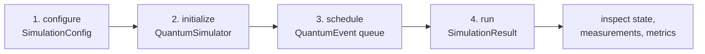

# Getting started

This guide takes you from an empty folder to a running quantum circuit simulation, first through
the command line and then through the Java API.

## Prerequisites

| Requirement | Version | Notes |
| --- | --- | --- |
| JDK | 17 | Uses `java.time.Instant`, records-free plain classes, and Java 17 language level in the compiler plugin |
| Maven | 3.8 or newer | Builds the sources in `src` and the tests in `src/test/java` |
| RAM | 1 GB or more heap | A 20-qubit state vector needs about 338 MB of amplitude storage |
| OS | Windows, Linux, macOS | Pure Java, no native libraries and no GPU required |

## 1. Build the project

```bash
git clone https://github.com/CharafeddineMechalikh/QForge.git
cd QForge
mvn -o compile
mvn -o test
```

The `-o` flag keeps Maven offline and uses the local cache. Drop it when a dependency is missing.
The current suite contains 338 tests across gates, measurement, noise, algorithms, JSON loading,
metrics, plugins and VQE convergence, and the Javadoc plugin requires one online run before it can
work offline.

## 2. Run the algorithm demos

```bash
java -cp "target/classes;lib/*" example.QuantumAlgorithmsDemo ALL
```

Use `:` instead of `;` in the classpath on Linux or macOS. The accepted selectors are `GROVER`,
`QFT`, `QPE`, `VQE`, `QNN`, `QSVM`, `SHOR_CODE`, `QAOA`, `TROTTER`, `QUANTUM_WALK`, and `ALL`.
Each demo prints a `SUCCESS` or `FAILED` line for the property it checks, so a demo that does not
reach its target says so instead of hiding the result.

## 3. Run a JSON circuit

```bash
java -cp "target/classes;lib/*" example.CircuitRunner bell
```

Expected output, with the timing lines omitted:

```text
[OK] SIMULATION COMPLETED SUCCESSFULLY

[PLOT] Results:
  Runtime: 47 ms

[LAB] Quantum State:
  StateVector[2 qubits, dim=4]:
  |0>: 0.707107 (p=0.5000)
  |11>: 0.707107 (p=0.5000)

[TARGET] Measurement Probabilities:
  |00>: 0.5000 (50.0%)
  |11>: 0.5000 (50.0%)
```

Two JSON files describe the circuit, and the runner reads both from the classpath or the working
directory:

- `src/example/config/bell_state_config.json` sets the qubit count, the backend and the noise.
- `src/example/circuits/bell_state_circuit.json` lists the gates.

Only the Bell pair ships both files. The `grover`, `qft` and `teleport` demo names are wired into
`CircuitRunner` but their circuit resources are not in the repository, so pass your own files for
those, or run the Java builders described in [Algorithms](06-algorithms.md).

You can also point the runner at any config and circuit pair:

```bash
java -cp "target/classes;lib/*" example.CircuitRunner my_config.json my_circuit.json
```

## 4. Write your first simulation in Java

A Bell state needs one simulator instance, two events, and one call to `run()`.

```java
import com.mechalikh.qforge.config.SimulationBackend;
import com.mechalikh.qforge.config.SimulationConfig;
import com.mechalikh.qforge.core.QuantumSimulator;
import com.mechalikh.qforge.core.SimulationResult;
import com.mechalikh.qforge.events.QuantumEvent;
import com.mechalikh.qforge.operations.MultiQubitGate;
import com.mechalikh.qforge.operations.SingleQubitGate;
import com.mechalikh.qforge.state.Qubit;

SimulationConfig config = new SimulationConfig();
config.setNumQubits(2);
config.setBackend(SimulationBackend.STATE_VECTOR);

QuantumSimulator simulator = new QuantumSimulator();
simulator.initialize(config);

Qubit q0 = simulator.getContext().getQubit(0);
Qubit q1 = simulator.getContext().getQubit(1);

simulator.scheduleEvent(new QuantumEvent.Builder("h0")
    .withOperation(SingleQubitGate.createHadamard(q0))
    .withTargetQubits(q0)
    .build());
simulator.scheduleEvent(new QuantumEvent.Builder("cnot01")
    .withOperation(MultiQubitGate.createCNOT(q0, q1))
    .withTargetQubits(q1)
    .build());

SimulationResult result = simulator.run();
System.out.println(result.getFinalState());
```

The four stages below are the whole programming model.



Points worth knowing from the start:

- The builder needs a unique event id per queue; reusing an id throws `IllegalArgumentException`.
- `withTargetQubits(...)` records which qubits the event touches. The gate itself carries the
  control and target assignment used by the backend.
- `run()` drains the queue, releases resources and returns the result. Calling `initialize` again
  on a running simulator throws `SimulationError`.
- The initial state is the all-zero computational basis state.

## 5. Add a measurement

Measurement is an operation like any other, so it is scheduled as an event and collapses the
state when it is destructive.

```java
import com.mechalikh.qforge.measurement.MeasurementOperator;
import com.mechalikh.qforge.measurement.Observable;
import com.mechalikh.qforge.measurement.MeasurementResult;

Observable z0 = Observable.pauliZ(q0);
MeasurementOperator measure = new MeasurementOperator("measure_q0", z0, 100, true);

simulator.scheduleEvent(new QuantumEvent.Builder("m0")
    .withOperation(measure)
    .withTargetQubits(q0)
    .build());

SimulationResult measured = simulator.run();
for (MeasurementResult mr : measured.getMeasurements()) {
    System.out.printf("expectation %f, most frequent outcome %d%n",
        mr.getExpectationValue(), mr.getMostFrequentOutcome());
}
```

`SimulationResult.getMeasurements()` returns every recorded result, and
`getMeasurement("measure_q0")` looks one up by observable name. See
[Measurement and noise](05-measurement-and-noise.md) for collapse semantics and the non-destructive
mode.

## 6. Read the metrics

```java
System.out.println(result.getMetrics());
System.out.println(result.getTotalRuntimeMs());
```

The map is populated by the metrics collector, so it carries real counters rather than
placeholders: `state_updates`, `events_scheduled`, `steps_executed`, `measurements`, `errors`,
`total_operations`, `operations_per_second`, `average_fidelity`, `last_state_distance`,
`simulation_duration_ms`, and one `operation_<name>_count` entry per operation type.

## 7. Next steps

- Choose a backend and set limits: [Configuration](03-configuration.md).
- Build bigger circuits: [Gates and circuits](04-gates-and-circuits.md).
- Run a published algorithm: [Algorithms](06-algorithms.md).
- Attach plugins and observers: [Extending QForge](07-extending.md).

## Troubleshooting

| Symptom | Cause | Fix |
| --- | --- | --- |
| `ClassNotFoundException: com.fasterxml...` | The library jars were left out of the classpath | Keep `lib/*` in the `-cp` argument, or run `mvn dependency:copy-dependencies` |
| `Invalid character in argument` or nothing runs on Linux | Windows classpath separator | Replace `;` with `:` |
| `Invalid simulation configuration` at `initialize()` | `validate()` failed: qubit count above the backend recommendation, memory estimate above `maxMemoryBytes`, or CPU limit above the machine count | Lower `numQubits`, raise the heap with `-Xmx`, or set larger `maxMemoryBytes` in the config |
| `Failed to apply configured noise` | A noise profile targets more qubits than the channel supports | 4 targets for multi-qubit depolarizing, 8 for dephasing and amplitude damping |
| Results change between runs with noise | State-vector noise samples one Kraus trajectory per run | Use `DENSITY_MATRIX` for the deterministic channel, or average many runs |
| Demo prints `FAILED` | The checked property did not hold | Read the line above it; the demos report negative results on purpose |
