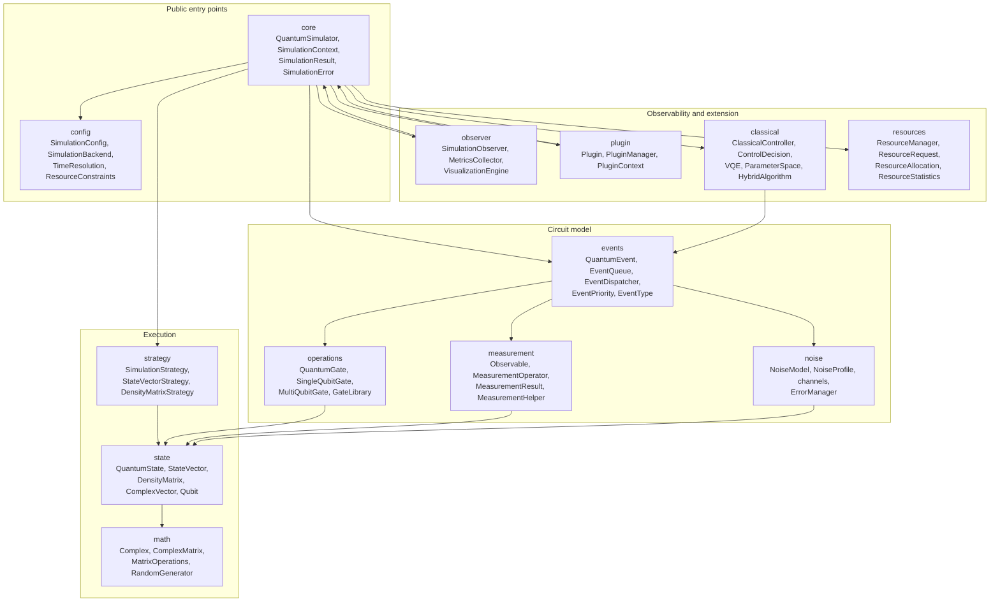
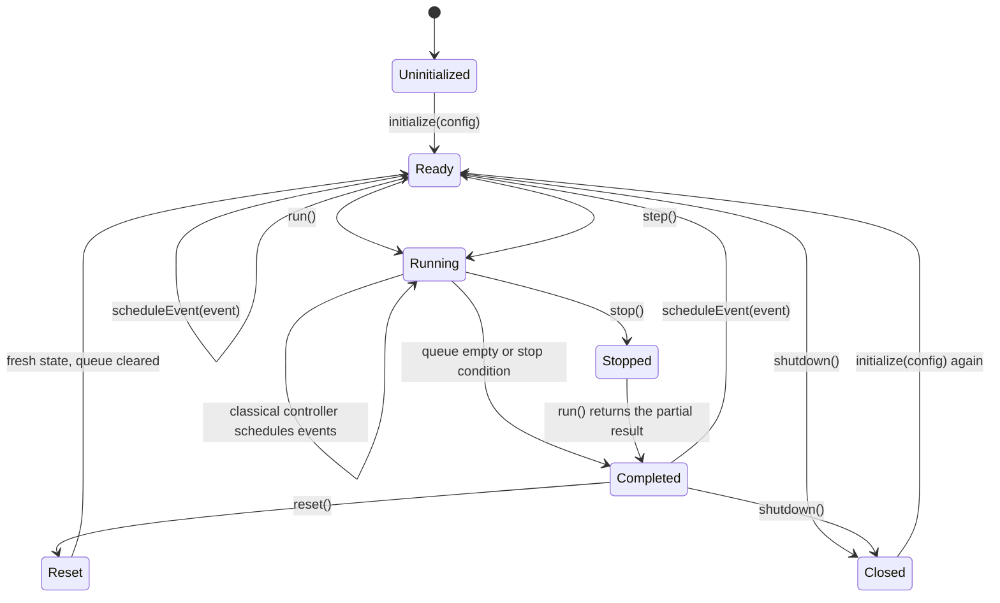
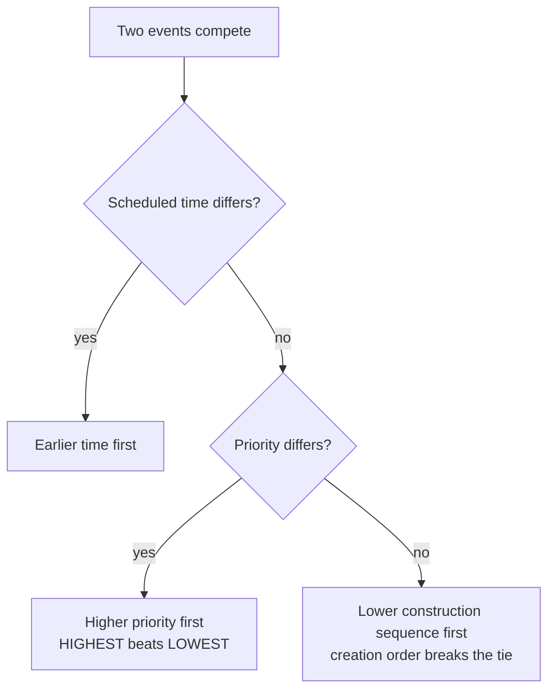
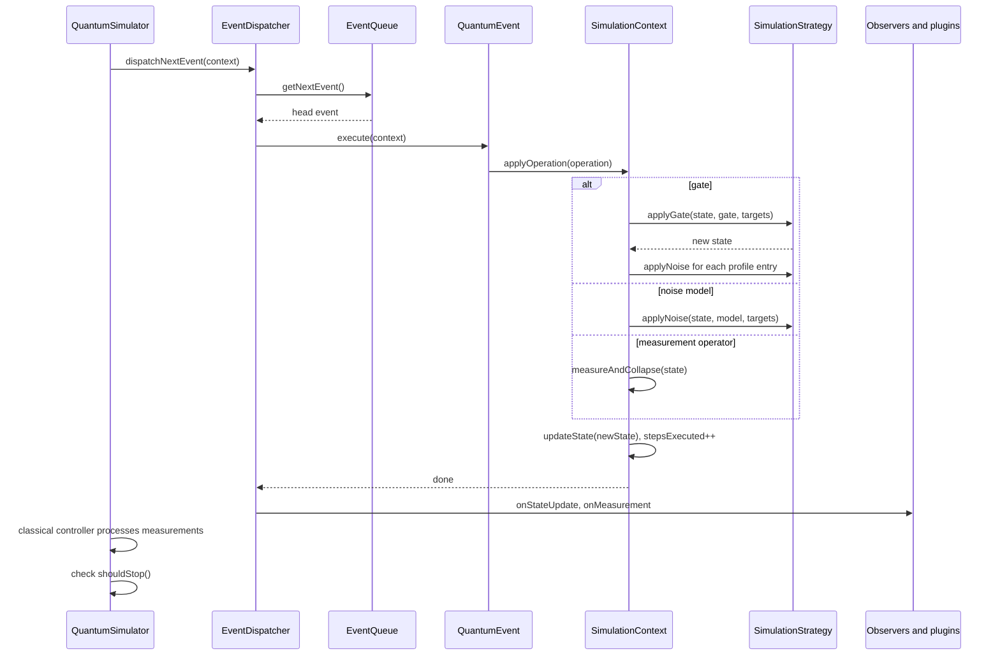
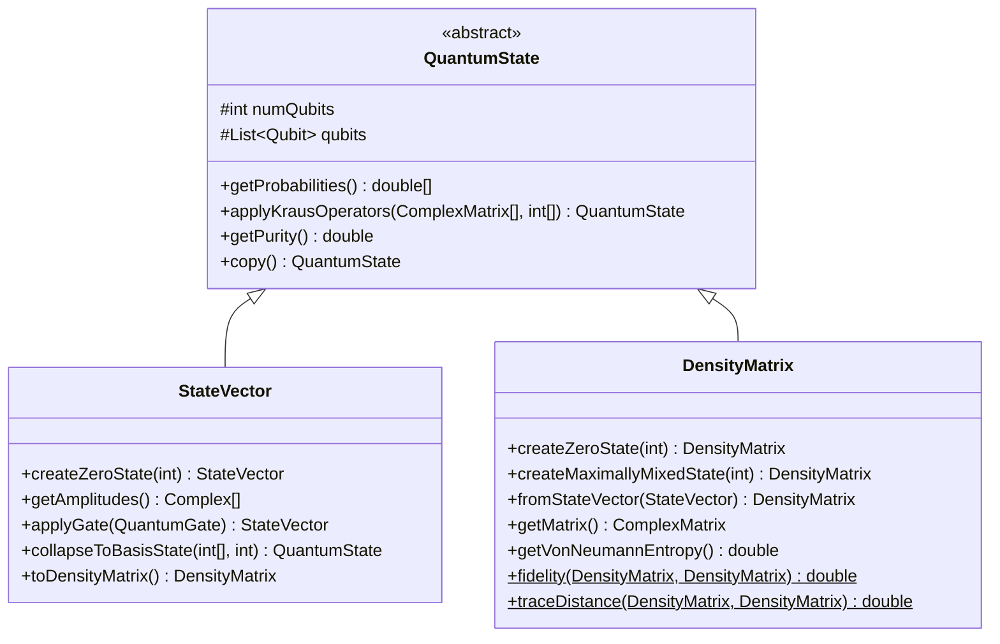

# Architecture

QuantLab is an event-driven simulator. Circuits are not compiled into a static instruction list;
they are collections of timed `QuantumEvent` objects that a dispatcher drains in order, applying
one operation to one state object at a time.

## Package map

| Package | Responsibility |
| --- | --- |
| `core` | Facade, run loop, context state, results, checked errors |
| `config` | Simulation parameters, backend choice, time unit, resource limits, JSON I/O |
| `events` | Timed event objects, the priority queue, the dispatcher |
| `operations` | Gate abstraction, standard gates, gate registry |
| `state` | State representations, qubit metadata, tensor and partial-trace math |
| `strategy` | Backend-specific application of gates, noise and measurement |
| `measurement` | Observables, sampling, projective collapse, statistics |
| `noise` | Kraus channels, per-qubit and global noise profiles, error bookkeeping |
| `observer` | Callback interface, metrics collection, Java2D visualization |
| `plugin` | Plugin contract, registry, JAR and directory loading |
| `classical` | Measurement-driven feed-forward control and variational loops |
| `resources` | Allocation tracking against the configured limits |
| `math` | Complex arithmetic, matrices, eigen-decomposition helpers, RNG |

## Simulator lifecycle

The stages map to concrete work:

1. `initialize(SimulationConfig)` validates the configuration, builds a `SimulationContext`, an
   `EventDispatcher`, a `ResourceManager`, a `MetricsCollector`, the strategy for the chosen
   backend, and a `ClassicalController` when classical control is enabled. It then creates the
   all-zero state and notifies observers and plugins.
2. `scheduleEvent(QuantumEvent)` pushes the event onto the queue and reports it to the metrics
   collector, the plugins and the observers.
3. `run()` dispatches one event per iteration until the queue is empty or a stop condition holds,
   then packages state, measurements, metrics and wall-clock runtime into a `SimulationResult`.
4. `shutdown()` unloads every plugin and releases the tracked allocations. The context survives, so
   the simulator can be re-initialized.

`step()` dispatches exactly one event and skips the start and end callbacks, the stop checks and
resource release. It exists for interactive or debug driving of the queue.

## Event ordering

The queue is ordered, not merely first-in-first-out. `QuantumEvent.compareTo` applies a
three-level cascade.

`EventPriority` runs `HIGHEST(0)`, `HIGH(1)`, `NORMAL(2)`, `LOW(3)`, `LOWEST(4)`, and a smaller
value wins. When a circuit is loaded from JSON by `CircuitRunner`, every gate is stamped 10
milliseconds after the previous one, so scheduling order and time order agree. When you build
events yourself with the same `Instant`, insertion order is what decides, which is why the
sequence counter matters.

Duplicate ids are rejected by the queue with `IllegalArgumentException`, and an event that was
already executed throws `IllegalStateException` if executed again.

## One dispatch, end to end

Three details of `SimulationContext.applyOperation` matter when you read results:

- Configured noise from `SimulationConfig.getNoiseProfile()` is applied after every gate. It is
  not applied after a noise event or after a measurement, so manual `NoiseModel` events are not
  double-noised.
- A global profile entry with no assigned qubits is expanded to one single-qubit application per
  qubit in the register, in qubit index order.
- Each step writes a fresh state object through `updateState`, records the step count as the
  `steps_executed` metric, and increments `operation_<name>_count`.

## Stop conditions

| Condition | Where it is checked | Effect |
| --- | --- | --- |
| Queue empty | `run()` loop guard | Normal completion |
| `context.requestStop()` | `SimulationContext.shouldStop()` after each event | Loop exits, partial result returned |
| `maxSteps` positive and reached | `SimulationContext.shouldStop()` | Loop exits at the step limit; `0` means unlimited |
| `stop()` called | `run()` loop guard on the running flag | Loop exits after the current event |
| `timeoutSeconds` | nowhere | Recorded and serialized, but not enforced |

The timeout field is validated and written to JSON, and no code path aborts a run on it. Treat it
as metadata until it is wired up.

## State representations

Qubit `0` is the most significant bit of the basis index. With three qubits, index `5` is `|101>`,
meaning qubit 0 in state 1, qubit 1 in state 0, qubit 2 in state 1. Amplitude arrays are ordered by
that index, so `getProbabilities()[i]` is the probability of the basis string of `i`.

### Backend comparison

| Property | `STATE_VECTOR` | `DENSITY_MATRIX` |
| --- | --- | --- |
| Storage | `2^n` complex amplitudes | `2^n x 2^n` complex elements |
| Memory estimate in `validate()` | 16 bytes per amplitude plus 1 KiB | 16 bytes per element plus 2 KiB |
| Recommended qubit ceiling | 30 (about 16 GiB) | 12 (about 256 MiB) |
| Pure states | Yes | Yes |
| Mixed states | No | Yes |
| Noise semantics | One Kraus operator sampled per application, then renormalized, so one stochastic trajectory | Full `sum K rho K dagger`, deterministic |
| Purity and entropy | Trivial purity of 1, von Neumann entropy of a pure state | Real values, used by metrics and plots |
| Backed by | `StateVectorStrategy` | `DensityMatrixStrategy` |

`SimulationConfig.validate()` rejects any configuration whose qubit count exceeds the backend
recommendation, so the ceilings are enforced at initialization rather than at allocation time.

## Threading and error model

- The run loop is single-threaded. `isRunning` is an `AtomicBoolean` so another thread can call
  `stop()`, but nothing else in the loop is synchronized and the classes make no thread-safety
  promise.
- Failures surface as the checked `SimulationError`, which always wraps the original cause.
  Argument problems raise unchecked `IllegalArgumentException` or `NullPointerException` instead.
- `QuantumEvent.EventExecutionException` wraps an operation failure inside the dispatcher; the
  dispatcher rethrows it while exception propagation is enabled, which is the default.

## Related guides

- [Configuration](03-configuration.md) for what `validate()` accepts.
- [Measurement and noise](05-measurement-and-noise.md) for collapse and trajectory semantics.
- [Extending QuantLab](07-extending.md) for plugins, observers and classical control.
