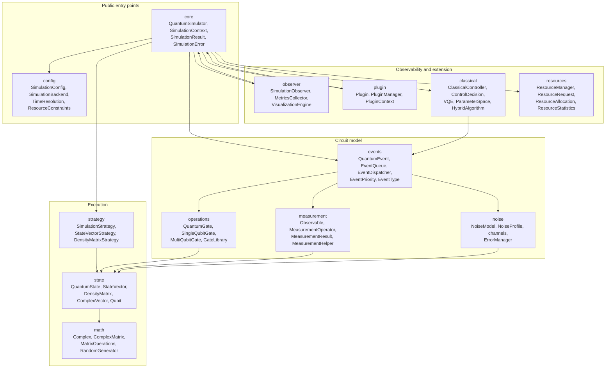
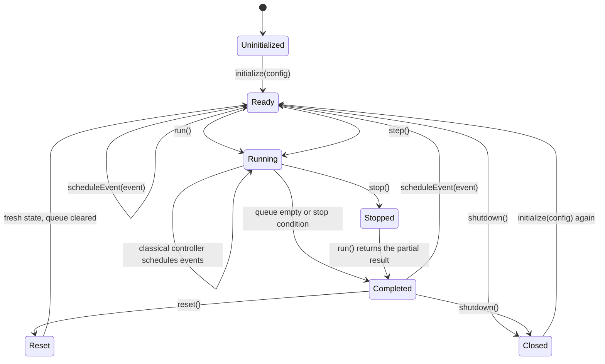
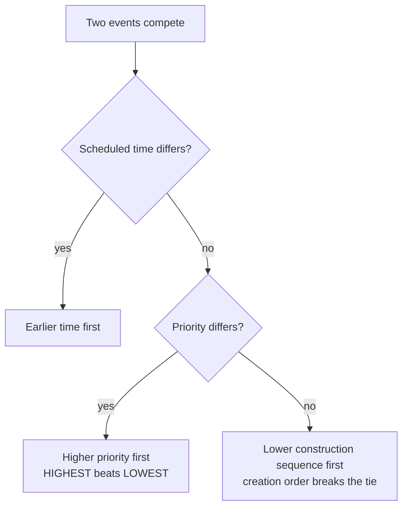
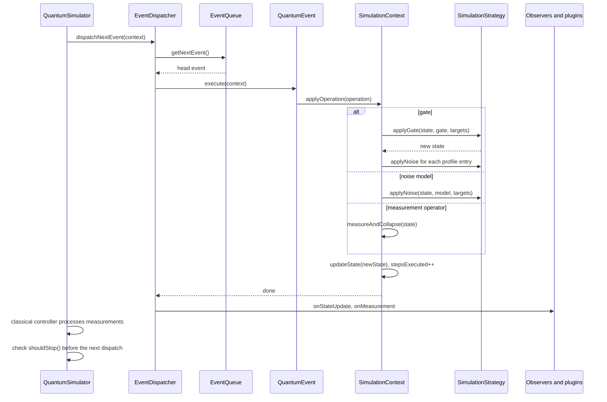
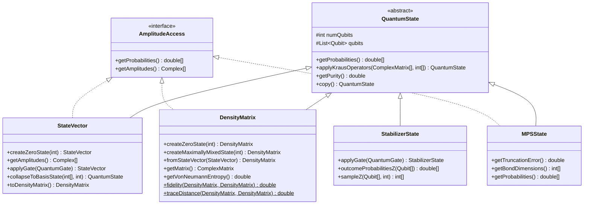
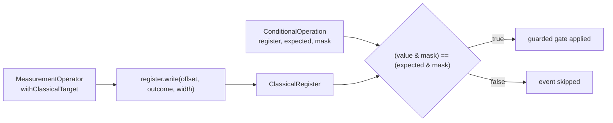

# Architecture

QForge is an event-driven simulator. Circuits are not compiled into a static instruction list;
they are collections of timed `QuantumEvent` objects that a dispatcher drains in order, applying
one operation to one state object at a time.

## Package map

| Package | Responsibility |
| --- | --- |
| `core` | Facade, run loop, context state, results, checked errors |
| `config` | Simulation parameters, backend choice, time unit, resource limits, JSON I/O |
| `events` | Timed event objects, the priority queue, the dispatcher |
| `operations` | Gate abstraction, standard gates, gate registry |
| `state` | State representations, qubit metadata, tensor and partial-trace math |
| `strategy` | Backend-specific application of gates, noise and measurement |
| `measurement` | Observables, sampling, projective collapse, statistics |
| `noise` | Kraus channels, per-qubit and global noise profiles, error bookkeeping |
| `observer` | Callback interface, metrics collection, Java2D visualization |
| `plugin` | Plugin contract, registry, JAR and directory loading |
| `classical` | Measurement-driven feed-forward control and variational loops |
| `resources` | Allocation tracking against the configured limits |
| `math` | Complex arithmetic, matrices, eigen-decomposition helpers, RNG |

## Simulator lifecycle

The stages map to concrete work:

1. `initialize(SimulationConfig)` validates the configuration, builds a `SimulationContext`, an
   `EventDispatcher`, a `ResourceManager`, a `MetricsCollector`, the strategy for the chosen
   backend, and a `ClassicalController` when classical control is enabled. It then creates the
   all-zero state and notifies observers and plugins.
2. `scheduleEvent(QuantumEvent)` pushes the event onto the queue and reports it to the metrics
   collector, the plugins and the observers.
3. `run()` dispatches one event per iteration until the queue is empty or a stop condition holds,
   then packages state, measurements, metrics and wall-clock runtime into a `SimulationResult`.
4. `shutdown()` unloads every plugin and releases the tracked allocations. The context survives, so
   the simulator can be re-initialized.

`step()` dispatches exactly one event and skips the start and end callbacks, the stop checks and
resource release. It exists for interactive or debug driving of the queue.

## Event ordering

The queue is ordered, not merely first-in-first-out. `QuantumEvent.compareTo` applies a
three-level cascade.

`EventPriority` runs `HIGHEST(0)`, `HIGH(1)`, `NORMAL(2)`, `LOW(3)`, `LOWEST(4)`, and a smaller
value wins. When a circuit is loaded from JSON by `CircuitRunner`, every gate is stamped 10
milliseconds after the previous one, so scheduling order and time order agree. When you build
events yourself with the same `Instant`, insertion order is what decides, which is why the
sequence counter matters.

Duplicate ids are rejected by the queue with `IllegalArgumentException`, and an event that was
already executed throws `IllegalStateException` if executed again.

## One dispatch, end to end

Three details of `SimulationContext.applyOperation` matter when you read results:

- Configured noise from `SimulationConfig.getNoiseProfile()` is applied after every gate. It is
  not applied after a noise event or after a measurement, so manual `NoiseModel` events are not
  double-noised.
- A global profile entry with no assigned qubits is expanded to one single-qubit application per
  qubit in the register, in qubit index order.
- Each step writes a fresh state object through `updateState`, records the step count as the
  `steps_executed` metric, and increments `operation_<name>_count`.

## Stop conditions

| Condition | Where it is checked | Effect |
| --- | --- | --- |
| Queue empty | `run()` loop guard | Normal completion |
| `context.requestStop()` | `SimulationContext.shouldStop()` before each dispatch | Loop exits, partial result returned |
| `maxSteps` positive and reached | `SimulationContext.shouldStop()` | Loop exits at the step limit; `0` means unlimited |
| `stop()` called | `run()` loop guard on the running flag | Loop exits after the current event |
| `timeoutSeconds` positive and elapsed | `SimulationContext.shouldStop()` | Loop exits with the events executed so far; `0` means no limit |

The limits are polled before an event is dispatched, so a run that is started after a limit has
already been reached returns without executing anything. The timeout measures wall clock time from
`initializeState()` or the last `reset()`, and it cannot interrupt an event that is already
running, only the ones still queued.

## State representations

Qubit `0` is the most significant bit of the basis index. With three qubits, index `5` is `|101>`,
meaning qubit 0 in state 1, qubit 1 in state 0, qubit 2 in state 1. Amplitude arrays are ordered by
that index, so `getProbabilities()[i]` is the probability of the basis string of `i`.

### Backend comparison

| Property | `STATE_VECTOR` | `DENSITY_MATRIX` | `STABILIZER` | `TENSOR_NETWORK` |
| --- | --- | --- | --- | --- |
| Storage | `2^n` complex amplitudes | `2^n x 2^n` complex elements | `2n` rows of `2n` bits (Aaronson-Gottesman tableau) | `n` tensors plus `n + 1` bond vectors |
| Recommended ceiling | 30 (about 16 GiB) | 12 (about 256 MiB) | 2000 | 100 at a modest bond dimension |
| Pure states | Yes | Yes | Yes, Clifford states only | Yes, up to truncation |
| Mixed states | No | Yes | No | No |
| Exact | Yes | Yes | Yes, for the Clifford group | Only when no Schmidt weight is discarded |
| Noise | Kraus channels, one trajectory per run | Full `sum K rho K dagger` | Rejected | Rejected |
| Gate set | Any supported gate | Any supported gate | `X`, `Y`, `Z`, `H`, `S`, `Sdg`, `CNOT`/`CX`, `CZ`, `SWAP`, `I` | One- and two-qubit gates |
| Measurement | Any observable | Any observable | Pauli `Z`, exact marginals for at most 16 qubits and sampling for at most 32 | Pauli `Z`; computational-basis sampling and collapse work at any size, exact dense probabilities at most 24 qubits |
| Truncation diagnostics | Not applicable | Not applicable | Not applicable | `MPSState.getTruncationError()` and `getBondDimensions()` |
| Backed by | `StateVectorStrategy` | `DensityMatrixStrategy` | `StabilizerStrategy` | `TensorNetworkStrategy` |

`SimulationConfig.validate()` rejects any configuration whose qubit count exceeds the backend
recommendation, so the ceilings are enforced at initialization rather than at allocation time.

Probability and fidelity metrics require dense access to the state. `StateVector`,
`DensityMatrix` and `MPSState` implement `AmplitudeAccess`, so the metrics collector reports
fidelity for them; a `StabilizerState` has no dense form and is skipped by the fidelity and
distance metrics instead of failing the run. The collector also skips a matrix product state
above 24 qubits, where it cannot form the probability vector, although
`TensorNetworkStrategy.calculateFidelity` and `MPSState.overlap` still contract the two tensor
chains at any size.

## Classical control and feed-forward

A measurement can write its outcome into a named `ClassicalRegister` declared on the configuration.
The packing is most significant bit first: measuring several qubits with
`withClassicalTarget("c", offset)` writes the first target at `offset`. Reading a register returns a
packed `long` whose bit `i` is register bit `i`.

`SimulationContext` resolves the condition when the event is dispatched, so a conditional event sees
every measurement that has already executed in that run. `ShotRunner` repeats the whole circuit in a
fresh simulator for each shot and aggregates the final register values, which is the execution model
needed for teleportation, repeat-until-success, and other protocols whose gates depend on their own
measurement outcomes.

## Threading and error model

- The run loop is single-threaded. `isRunning` is an `AtomicBoolean` so another thread can call
  `stop()`, but nothing else in the loop is synchronized and the classes make no thread-safety
  promise.
- Failures surface as the checked `SimulationError`, which always wraps the original cause.
  Argument problems raise unchecked `IllegalArgumentException` or `NullPointerException` instead.
- `QuantumEvent.EventExecutionException` wraps an operation failure inside the dispatcher; the
  dispatcher rethrows it while exception propagation is enabled, which is the default.

## Related guides

- [Configuration](03-configuration.md) for what `validate()` accepts.
- [Measurement and noise](05-measurement-and-noise.md) for collapse and trajectory semantics.
- [Extending QForge](07-extending.md) for plugins, observers and classical control.
