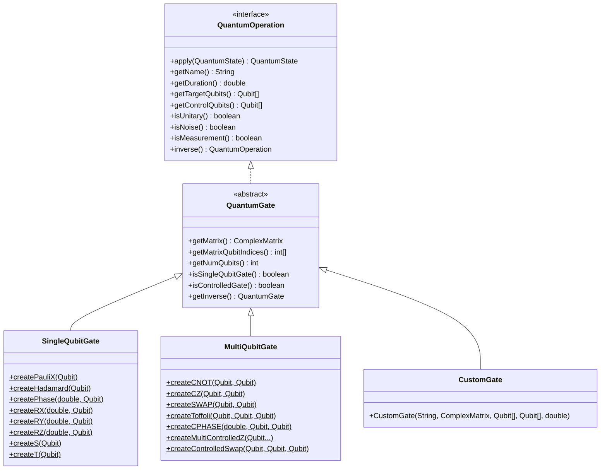
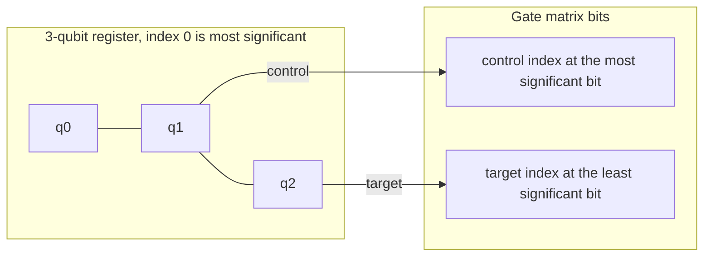
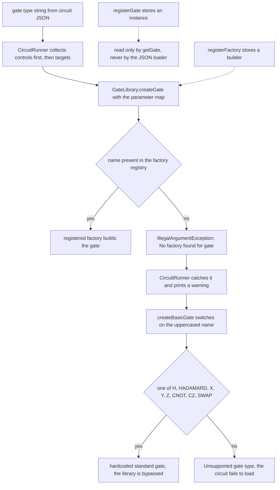
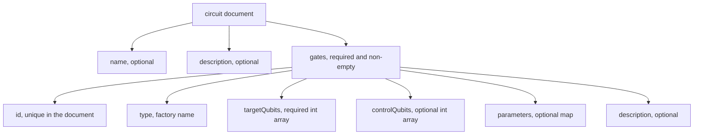

# Gates and circuits

Gates are pure data: a name, a unitary matrix, the qubits it touches, and a duration. The backend
does the linear algebra. This guide covers the catalog, the ordering convention that decides
whether a circuit is correct, and the JSON circuit format.

## Type hierarchy



`apply(QuantumState)` on a gate always throws `UnsupportedOperationException`. The strategy applies
the matrix, because the correct expansion depends on whether the state is a vector or a matrix.

## Qubit ordering convention

A gate matrix is indexed by its own qubits, ordered **controls first, then targets**, and the first
entry is the most significant bit of the matrix index. `QuantumGate.getMatrixQubitIndices()` returns
that order, and the strategies feed it to the state.



Concretely, `MultiQubitGate.createCNOT(control, target)` stores the 4x4 matrix

```text
     |00> |01> |10> |11>   (rows and columns are |control target>)
|00>  1   0    0    0
|01>  0   1    0    0
|10>  0   0    0    1
|11>  0   0    1    0
```

so bit `10` maps to `11`: control 1, target flipped. Two consequences:

- `createCNOT(q1, q0)` is a legitimate reversed CNOT. The qubit that appears first in the factory
  call becomes the most significant matrix bit, whatever its register index is.
- `SWAP` and `Toffoli` take their qubits in the order given by the factory signature, and
  `createSWAP(a, b)` lists both as targets in that order.

## Gate catalog

| Factory name | Java factory | Qubits | Parameters | Matrix notes |
| --- | --- | --- | --- | --- |
| `X` | `SingleQubitGate.createPauliX` | 1 target | none | Pauli X bit flip |
| `Y` | `SingleQubitGate.createPauliY` | 1 target | none | Pauli Y |
| `Z` | `SingleQubitGate.createPauliZ` | 1 target | none | Pauli Z phase flip |
| `H` | `SingleQubitGate.createHadamard` | 1 target | none | `1/sqrt(2)` on all entries, `+/-` in row 1 |
| `S` | `SingleQubitGate.createS` | 1 target | none | `createPhase(Math.PI / 2, ...)` |
| `T` | `SingleQubitGate.createT` | 1 target | none | `createPhase(Math.PI / 4, ...)` |
| `P` | `SingleQubitGate.createPhase` | 1 target | `angle` | diagonal `1, e^(i angle)` |
| `RX` | `SingleQubitGate.createRX` | 1 target | `angle` | `cos(a/2)`, `-i sin(a/2)` |
| `RY` | `SingleQubitGate.createRY` | 1 target | `angle` | real entries `+/- sin(a/2)` |
| `RZ` | `SingleQubitGate.createRZ` | 1 target | `angle` | diagonal `e^(-i a/2), e^(i a/2)` |
| `CNOT` | `MultiQubitGate.createCNOT` | 1 control, 1 target | none | 4x4 as above |
| `CZ` | `MultiQubitGate.createCZ` | 1 control, 1 target | none | diagonal `1, 1, 1, -1` |
| `CPHASE` | `MultiQubitGate.createCPHASE` | 1 control, 1 target | `angle`, default `Math.PI` | diagonal `1, 1, 1, e^(i angle)` |
| `SWAP` | `MultiQubitGate.createSWAP` | 2 targets | none | exchanges `|01>` and `|10>` |
| `Toffoli` | `MultiQubitGate.createToffoli` | 2 controls, 1 target | none | 8x8 CCX |
| `CSWAP` | `MultiQubitGate.createControlledSwap` | 1 control, 2 targets | none | Fredkin gate, 8x8 |
| multi-controlled Z | `MultiQubitGate.createMultiControlledZ` | n qubits, last is the phase target | none | diagonal with `-1` on the all-ones entry |

`P` and `CSWAP` have no `GateLibrary` factory entry, so they are reachable from Java but not from a
JSON circuit. `createMultiControlledZ` is the gate the Grover diffusion operator uses, which is why
exact amplitude amplification works without decomposing into one- and two-qubit gates.

Parameterized gates embed the angle in the name, so metrics keys follow suit. A `T` gate counts as
`operation_P(0.7853981633974483)_count`, and `RY(0.5)` as `operation_RY(0.5)_count`.

Default duration is `1.0` for single-qubit gates and `1.0` for the standard multi-qubit factories.
Duration is metadata for scheduling and reporting; it does not delay the run loop by itself, since
event order comes from the scheduled `Instant`.

## Building a circuit in Java

```java
import com.mechalikh.qforge.events.QuantumEvent;
import com.mechalikh.qforge.operations.MultiQubitGate;
import com.mechalikh.qforge.operations.SingleQubitGate;
import com.mechalikh.qforge.state.Qubit;

List<Qubit> register = Qubit.createQubits(3);  // labelled q0, q1, q2
Qubit[] q = register.toArray(new Qubit[0]);
Instant t0 = Instant.now();

List<QuantumEvent> circuit = new ArrayList<>();
circuit.add(new QuantumEvent.Builder("h0")
    .withScheduledTime(t0)
    .withOperation(SingleQubitGate.createHadamard(q[0]))
    .withTargetQubits(q[0])
    .build());
circuit.add(new QuantumEvent.Builder("ry1")
    .withScheduledTime(t0.plusMillis(10))
    .withOperation(SingleQubitGate.createRY(Math.PI / 4, q[1]))
    .withTargetQubits(q[1])
    .build());
circuit.add(new QuantumEvent.Builder("cx01")
    .withScheduledTime(t0.plusMillis(20))
    .withOperation(MultiQubitGate.createCNOT(q[0], q[1]))
    .withTargetQubits(q[1])
    .build());
circuit.add(new QuantumEvent.Builder("ccx012")
    .withScheduledTime(t0.plusMillis(30))
    .withOperation(MultiQubitGate.createToffoli(q[0], q[1], q[2]))
    .withTargetQubits(q[2])
    .build());

circuit.forEach(event -> {
    try {
        simulator.scheduleEvent(event);
    } catch (SimulationError e) {
        throw new IllegalStateException(e);
    }
});
```

`src/example/EventBuilderHelper.java` wraps this pattern: `createSingleQubitGate`, `createCNOT`,
`createCZ`, `createSWAP`, `createCPHASE`, plus `advanceTime(long)` and `resetTimer()` for a
monotonic internal clock. `src/example/CircuitFactory.java` provides
`createBellStateCircuit`, `createGroversSearchCircuit` and `createQuantumFourierTransform`.

### Inverses

`QuantumGate.getInverse()` returns a `CustomGate` whose matrix is the adjoint of the original, with
the same qubits and duration and a name suffixed by a dagger. For self-inverse gates such as `H`,
`X` and `CNOT` the adjoint equals the original matrix.

```java
QuantumGate inverse = MultiQubitGate.createCNOT(q[0], q[1]).getInverse();
```

### Custom gates

```java
import com.mechalikh.qforge.math.Complex;
import com.mechalikh.qforge.math.ComplexMatrix;
import com.mechalikh.qforge.operations.QuantumGate;

// The V gate, a square root of X: applying it twice performs a bit flip.
ComplexMatrix v = new ComplexMatrix(2, 2);
v.set(0, 0, new Complex(0.5, 0.5));
v.set(0, 1, new Complex(0.5, -0.5));
v.set(1, 0, new Complex(0.5, -0.5));
v.set(1, 1, new Complex(0.5, 0.5));

QuantumGate gate = new QuantumGate.CustomGate("V", v,
    new Qubit[]{ q[0] }, new Qubit[0], 1.0);
```

The constructor requires a square matrix of size `2^(controls + targets)`; it does not test
unitarity, so check `ComplexMatrix.isUnitary()` yourself before trusting a result.

### Registering a gate for JSON use

```java
import com.mechalikh.qforge.operations.GateLibrary;

GateLibrary library = config.getGateLibrary();
library.registerFactory("V", (params, qubits) -> {
    if (qubits.length != 1) {
        throw new IllegalArgumentException("V gate requires exactly 1 qubit");
    }
    return new QuantumGate.CustomGate("V", v, new Qubit[]{ qubits[0] }, new Qubit[0], 1.0);
});
```

A `GateLibrary` keeps two registries. `registerGate` stores a ready instance for `getGate(String)`,
`registerFactory` stores a builder for `createGate(String, Map, Qubit...)`, and `createGate` reads
only the factory registry. `getAvailableGates()` returns the union, and `clear()` restores the
standard factories while discarding custom ones.

A JSON circuit resolves its gate names through `createGate`, so the factory registry is the only one
that matters there, and a miss does not fail immediately:



Two consequences follow from that fallback. A custom name is not enough: without a factory the run
either loads the wrong gate, when the name collides with one of the eight hardcoded cases, or stops
with `Unsupported gate type`. And because `getAvailableGates()` lists the union of both registries,
a name can appear in that list and still be uncreatable. `RX`, `RY`, `RZ`, `CPHASE` and `Toffoli`
have factories but no hardcoded fallback, so a factory registered under one of those names is the
only way to reach it from JSON.

## Circuit JSON schema



| Field | Required | Notes |
| --- | --- | --- |
| `id` | yes | becomes the event id, so duplicates are rejected by the queue |
| `type` | yes | looked up in a fresh `GateLibrary`; `H`, `X`, `Y`, `Z`, `S`, `T`, `RX`, `RY`, `RZ`, `CNOT`, `CZ`, `SWAP`, `Toffoli`, `CPHASE`, plus registered factories |
| `targetQubits` | yes | indices must be within `numQubits`, checked before gate creation |
| `controlQubits` | no | indices are placed before the targets when the gate is built |
| `parameters` | no | `angle` for `RX`, `RY`, `RZ`, `CPHASE`; accepts numbers or numeric strings |
| `description` | no | copied to the event |

```json
{
  "name": "Three qubit GHZ",
  "description": "H, CNOT, CNOT",
  "gates": [
    { "id": "h0", "type": "H", "targetQubits": [0] },
    { "id": "c01", "type": "CNOT", "controlQubits": [0], "targetQubits": [1] },
    { "id": "c12", "type": "CNOT", "controlQubits": [1], "targetQubits": [2] },
    { "id": "r0", "type": "RZ", "targetQubits": [0], "parameters": { "angle": 0.7853981634 } }
  ]
}
```

Loading notes for `CircuitRunner`:

- Gates are stamped 10 milliseconds apart starting from the moment the file is read, so execution
  order matches file order regardless of priority.
- `type` is resolved through `GateLibrary`. If that lookup fails, a small built-in fallback handles
  `H`, `HADAMARD`, `X`, `Y`, `Z`, `CNOT`, `CZ` and `SWAP`, and anything else raises
  `Unsupported gate type`.
- Because the fallback and the library both build controls before targets, `CNOT` with
  `"controlQubits": [0], "targetQubits": [1]` is the standard ordering.
- Measurement is not part of this schema. Add measurement events in Java, see
  [Measurement and noise](05-measurement-and-noise.md).

## OpenQASM interchange

`QasmParser` reads OpenQASM 2.0 and a QASM 3.0 subset into a `QasmProgram`, and `QasmEmitter`
writes a program back to QASM 2.0.

```java
QasmParser parser = new QasmParser();
QasmProgram program = parser.parse(
    "OPENQASM 2.0;\n"
    + "include \"qelib1.inc\";\n"
    + "qreg q[2];\n"
    + "creg c[2];\n"
    + "h q[0];\n"
    + "cx q[0],q[1];\n"
    + "measure q[0] -> c[0];\n"
    + "if(c==1) x q[1];\n");

SimulationConfig config = new SimulationConfig();
config.setNumQubits(program.getNumQubits());
for (Map.Entry<String, Integer> register : program.getRegisters().entrySet()) {
    config.addClassicalRegister(register.getKey(), register.getValue());
}

QuantumSimulator simulator = new QuantumSimulator();
simulator.initialize(config);
for (QuantumOperation operation : program.getOperations()) {
    simulator.scheduleEvent(new QuantumEvent.Builder("qasm_" + operation.getName())
        .withScheduledTime(nextTimestamp())
        .withOperation(operation)
        .withTargetQubits(operation.getTargetQubits())
        .withControlQubits(operation.getControlQubits())
        .build());
}
double[] probabilities = simulator.run().getFinalState().getProbabilities();
String text = new QasmEmitter().emit(program);
```

Supported on import:

| Construct | Notes |
| --- | --- |
| `OPENQASM 2.0;`, `OPENQASM 3.0;` | optional `include "qelib1.inc"` or `"stdgates.inc"` |
| `qreg`, `creg`, `qubit[n]`, `bit[n]` | sizes must be integer literals |
| Gates | `x y z h s sdg t tdg id rx ry rz u1 u2 u3 cx cnot cz swap ccx cp cphase` |
| Custom `gate` definitions | expanded inline, recursion limit 32, cycles rejected |
| `measure` | single qubit or whole register |
| `if(c==N)` | whole-register comparison, braced form in version 3 |
| `barrier` | validated and discarded, the engine has no barrier |
| Parameters | decimal literals, `pi`, gate parameters, and `+ - * /` with parentheses |

Register-wide gate applications are expanded element by element and require equal widths.
`reset`, opaque gates, custom instructions, loops, and nested conditions are rejected with a
`QasmException` that names the offending token and position; nothing is silently dropped.

On export, `QasmEmitter` maps the canonical gate names to QASM: `X` to `x`, `CNOT` to `cx`,
`Toffoli` to `ccx`, parametric `RX`, `RY`, `RZ` keep their angles, a phase gate named `P(angle)`
becomes `u1(angle)`, and `ConditionalOperation` becomes `if(c==N)`. A gate whose name cannot be
expressed in QASM 2.0 raises `QasmException`. `QasmEmitter.Options` controls the `qelib1.inc`
header, the fractional digits of printed angles, and the trailing newline.

## Limits

| Limit | Where | Reason |
| --- | --- | --- |
| 30 qubits state vector, 12 density matrix, 2000 stabilizer, 100 tensor network | `SimulationConfig.validate()` | per-backend memory estimate and recommended ceiling |
| Stabilizer measurement: exact marginals for 16 targets, sampling for 32 | `StabilizerState` | cost of enumerating outcomes |
| Tensor-network dense access: 24 qubits | `AmplitudeAccess` capability | a `2^n` probability vector above that width is not materialised |
| Matrix size must match controls plus targets | `QuantumGate` constructor | expansion into the register |
| `Toffoli`, `CSWAP`, multi-controlled `Z` grow as `2^n` | factory methods | dense matrices, so keep them small |
| QASM import accepts a subset | `QasmParser` | unsupported statements are rejected, never ignored |

## Related guides

- [Architecture](02-architecture.md#event-ordering) for dispatch order.
- [Measurement and noise](05-measurement-and-noise.md) for what happens after the gates.
- [Algorithms](06-algorithms.md) for circuits assembled from these gates.
- New to the physics? [Superposition, gates and circuits](10-superposition-gates-and-circuits.md)
  explains why these gates rotate the state the way they do.
