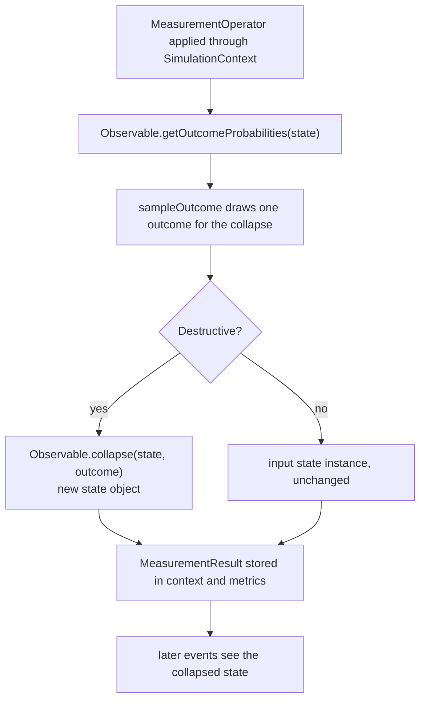
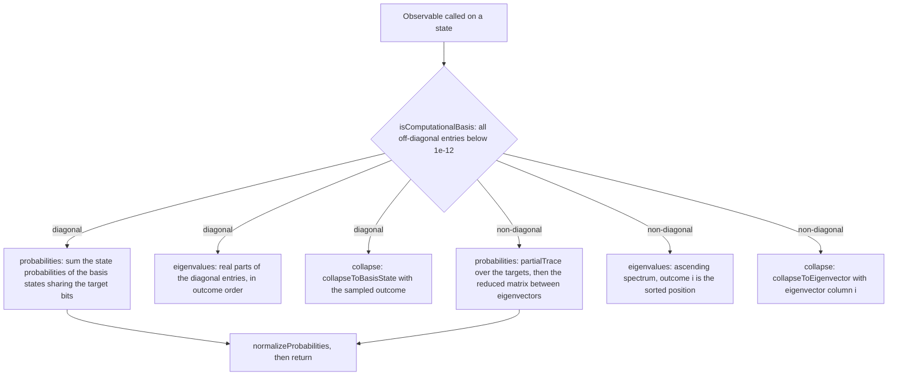
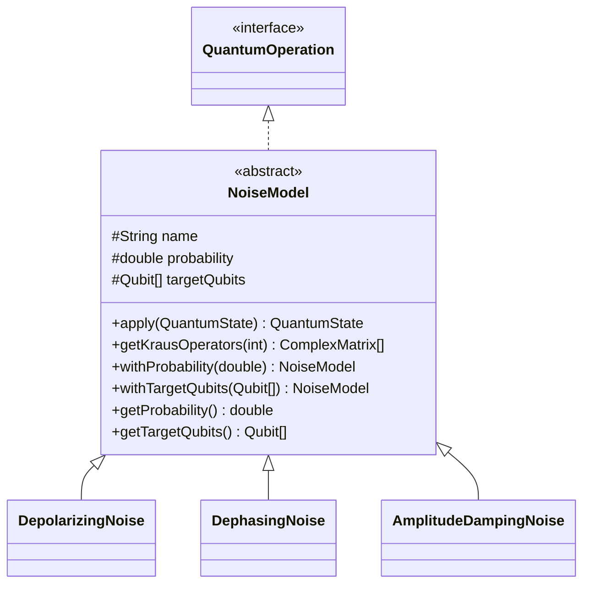
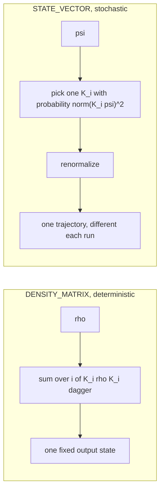
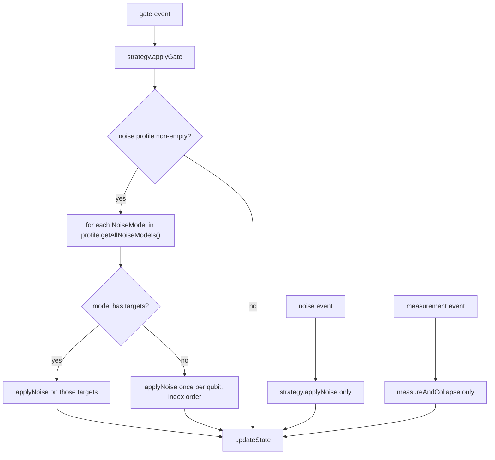
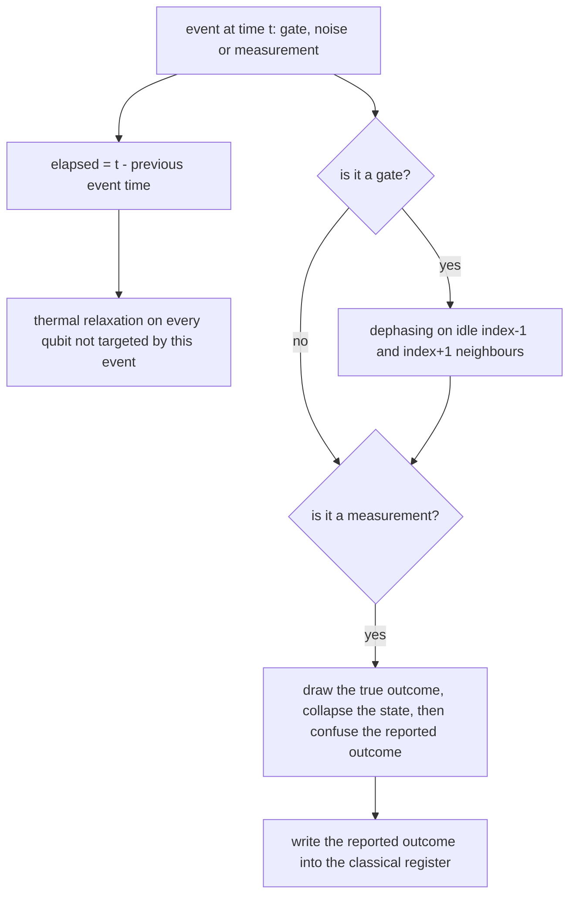

# Measurement and noise

Measurement turns amplitudes into numbers, and noise turns pure states into mixed ones. Both are
operations in QForge, so both are scheduled as events and both feed the same metrics pipeline.

## Measurement paths



| API | Collapses? | Works on | Use when |
| --- | --- | --- | --- |
| `MeasurementOperator(String, Observable, int shots, boolean destructive)` | only when `destructive` is `true` | any `QuantumState` | in-circuit measurement, mid-circuit feeds |
| `measurement.withClassicalTarget(name, offset)` | follows the operator's own `destructive` flag | any `QuantumState` | write the reported outcome into a classical register for feed-forward |
| `MeasurementOperator.measure(state)` | no | any `QuantumState` | statistics from a state you want to keep |
| `SimulationStrategy.measure(state, qubits, shots)` | no | the strategy state type | Pauli Z sampling without an observable object |
| `MeasurementHelper.measureInComputationalBasis(...)` | no | `StateVector` only | standalone sampling of a pure state |
| `Observable.measure(state)` | no | any `QuantumState` | single expectation value |
| `Observable.collapse(state, outcome)` | produces the collapsed state directly | any `QuantumState` | manual post-selection |

Because `destructive` defaults to `true` in the two-argument constructor, `new MeasurementOperator(observable, shots)`
always collapses. Pass the four-argument form with `false` to peek without destroying.

Two sampling details are worth knowing when results look odd:

- `measureAndCollapse` collapses onto the **first** sampled outcome. With `shots` equal to `0` it
  still draws one extra sample purely for the collapse, so the result has no counts while the state
  has nevertheless been projected.
- `MeasurementHelper` samples from one shared unseeded `Random`, so counts are not reproducible
  between runs. Probabilities computed from the state are exact; counts are not.

A matrix product state above 24 qubits cannot expose the full probability vector, so a
computational basis measurement on it takes a separate path. `MPSState.sampleComputationalBasis`
brings the chain into right canonical form and draws each qubit conditionally by tensor
contraction, and a destructive measurement projects the target tensors directly. The test collapse
still uses the true outcome, and readout confusion still applies to the reported bits. The
resulting `MeasurementResult` carries no exact probabilities on this path, so they are derived
from the sampled counts, and a single-qubit measurement with one shot reports probability one.
Non-diagonal observables need the reduced density matrix and remain limited to 24 qubits.

## Observables

`Observable` wraps a Hermitian matrix over a list of qubits, with the first qubit as the most
significant tensor factor.

One predicate decides both the cost and the meaning of every call: whether the operator is diagonal
in the computational basis. A Pauli `Z` or a `Z`-and-`I` string takes the cheap branch; `X`, `Y` and
a general Hamiltonian take the eigen branch.



The eigenvector columns and the sorted eigenvalues come from the same decomposition, so outcome
indices line up across the three calls. Nothing is cached between them, which is why an expectation
value over several qubits is the slow path.

| Factory | Result |
| --- | --- |
| `Observable.pauliX(q)`, `pauliY(q)`, `pauliZ(q)` | single-qubit Pauli, type `PAULI` |
| `Observable.pauliX(qubits)` and friends | tensor product over the listed qubits |
| `Observable.identity(q)` | identity observable, expectation always 1 |
| `Observable.fromString("XZI", qubits)` | Pauli string, whitespace, `*`, `,`, the tensor symbol and lowercase `x` are stripped |
| `Observable.projector(name, matrix, qubits)` | projection operator, type `PROJECTOR` |
| `new Observable(name, matrix, qubits, type)` | any Hermitian operator, including a Hamiltonian |

Useful methods: `measure` returns the expectation value, `measureMultiple(state, shots)` returns a
full `MeasurementResult`, `getOutcomeProbabilities` and `getOutcomeEigenvalues` give the exact
spectrum statistics, `sampleOutcome` draws once, `getProjector(i)` builds the projector for
eigenvalue index `i`, `tensorProduct(other)` and `partialTrace(qubitsToKeep)` compose observables,
and `isComputationalBasis()` reports whether the operator is diagonal in the computational basis.

`ObservableType` distinguishes `PAULI`, `PROJECTOR`, `HAMILTONIAN`, `DENSITY`, `IDENTITY`,
`COMPOSITE` and other cases; the type is metadata and does not change the mathematics.

## What a result reports

| Accessor | Meaning |
| --- | --- |
| `getOutcomeCounts()` | map from outcome index to how often it was sampled |
| `getOutcomeProbabilities()` | exact probabilities from the state, not the empirical frequencies |
| `getOutcomeEigenvalues()` | eigenvalue attached to each outcome index |
| `getExpectationValue()` | shots-weighted mean eigenvalue |
| `getVariance()`, `getStandardDeviation()` | spread of the sampled eigenvalues |
| `getStandardError()` | deviation divided by the square root of the shot count |
| `getConfidenceInterval(level)` | normal-approximation half-width at the requested level |
| `getMostFrequentOutcome()` | argmax of the counts |
| `getBitStringProbabilities()` | outcome index rendered as a bit string |
| `getEntropy()` | Shannon entropy of the outcome distribution, in bits |
| `combine(other)` | merged counts and statistics from two runs |
| `toHistogramString(bars)` | text histogram for logs |

`MeasurementResult.getProbability(outcome)` reads the exact distribution and `getCount(outcome)`
reads the sample, so a mismatch between them is shot noise rather than a bug.

## Noise channels

Every channel extends `NoiseModel`, which stores a name, a strength in `[0, 1]`, and the target
qubits, and supplies Kraus operators through `getKrausOperators(int numQubits)`.

| Channel | Single-qubit Kraus operators | Multi-qubit construction | Target limit |
| --- | --- | --- | --- |
| `DepolarizingNoise(p, ...)` | `sqrt(1-p) I`, plus `sqrt(p/(4^n-1))` times each non-identity Pauli string | direct Pauli-string enumeration | 4 qubits, because `4^n` operators |
| `DephasingNoise(p, ...)` | `sqrt(1 - p/2) I` and `sqrt(p/2) Z` | `independentKraus`, so `2^n` tensor products | 8 qubits |
| `AmplitudeDampingNoise(gamma, ...)` | `K0 = diag(1, sqrt(1-gamma))` and `K1 = sqrt(gamma)` times the operator `|0><1|` | `independentKraus`, so `2^n` tensor products | 8 qubits |

With `p` equal to the dephasing strength, the off-diagonal terms of a single qubit shrink by a
factor `1 - p`, which is the usual phase-damping convention.



`withProbability` and `withTargetQubits` return copies, so a profile entry is never mutated in
place. A model with no targets throws `IllegalStateException` on `apply`, which is why a global
profile entry is expanded per qubit before it is used.

## Backend semantics: the part that surprises people



Consequences:

- Run the same noisy circuit twice on `STATE_VECTOR` and you get two different final states. The
  ensemble of trajectories converges to the density-matrix answer, and the density-matrix run gets
  it in one shot.
- Purity and von Neumann entropy are meaningful on `DENSITY_MATRIX`. On `STATE_VECTOR` the purity
  stays 1 after a trajectory, so `average_fidelity` and `last_state_distance` are only informative
  in the mixed-state backend.
- Use `StateVector.toDensityMatrix()` when you want exact statistics from a pure state, and
  `DensityMatrix.toStateVector()` when you want the dominant eigenvector of a nearly pure matrix.
  The latter throws `IllegalStateException` unless purity indicates a pure state.

## Where noise is applied



The profile runs after every gate, once per model, in the order the profile reports. It does not
run after a noise event or after a measurement, so manual `NoiseModel` events are additive rather
than doubled. The profile itself has no idle term: it is gate-count based, which means a circuit
with more gates accumulates more error even if the scheduled times are identical. Idle relaxation
by elapsed time comes from the separate `DeviceNoiseModel` described below.

### Programmatic noise

```java
import com.mechalikh.qforge.noise.AmplitudeDampingNoise;
import com.mechalikh.qforge.noise.DepolarizingNoise;
import com.mechalikh.qforge.noise.DephasingNoise;
import com.mechalikh.qforge.noise.NoiseProfile;

NoiseProfile profile = new NoiseProfile("gate noise");
// A global entry carries no targets and is expanded per qubit at application time.
profile.addGlobalNoise("dephasing", new DephasingNoise(0.005));
profile.addNoise(q[0], new DepolarizingNoise(0.01, q[0]));
profile.addNoise(q[1], new AmplitudeDampingNoise(0.002, q[1]));
config.setNoiseProfile(profile);
```

Schedule a channel directly when you want noise at one point in the circuit instead of after every
gate:

```java
simulator.scheduleEvent(new QuantumEvent.Builder("damping")
    .withOperation(new AmplitudeDampingNoise(0.05, q[0]))
    .withTargetQubits(q[0])
    .build());
```

Useful `NoiseProfile` methods: `getTotalErrorProbability(qubit)` sums the strengths on one qubit,
`combine(other)` merges profiles, `getAffectedQubits()` lists the targeted qubits,
`toMap()` and `loadFromMap(...)` bridge to JSON, and `clearQubitNoise(qubit)` plus
`clearGlobalNoise()` reset parts of the profile.

## Device noise

A `NoiseProfile` describes gate noise. `DeviceNoiseModel` describes a device: relaxation times,
readout confusion, crosstalk, and a nominal gate duration. One model is attached with
`config.setDeviceNoise(model)`, or with the `deviceNoise` object in a JSON configuration.

| Field | Meaning | Applied to |
| --- | --- | --- |
| `t1_ns`, `t2_ns` | energy relaxation and coherence times, per qubit | every qubit that is idle between two scheduled events |
| `readout_p01` | probability of reading `1` for a prepared `0`, per qubit | computational-basis measurements |
| `readout_p10` | probability of reading `0` for a prepared `1`, per qubit | computational-basis measurements |
| `crosstalk_rate` | phase damping strength on neighbours of a gate | nearest neighbours of the gate's target and control qubits |
| `gate_time_ns` | nominal gate duration | exposed through `getGateTimeNanos()` for scheduling code; the engine itself does not alter timestamps |

The constructor validates the model: all arrays must have the same length, readout probabilities
must lie in `[0, 1]`, crosstalk must lie in `[0, 1]`, `gate_time_ns` cannot be negative, and a
positive `T2` cannot exceed `2 * T1`. `fromMap(...)` reads the same six JSON keys, pads short
arrays with zeros, and returns an inert model for a null or empty map.



### Thermal relaxation

`ThermalRelaxationModel` composes amplitude damping with pure dephasing over an exposure time `t`:

- amplitude damping probability `p = 1 - exp(-t / T1)`
- pure dephasing probability `p_phi = 1 - exp(-t / T_phi)`, where
  `1 / T_phi = 1 / T2 - 1 / (2 T1)`

The Kraus operators are the products of the two channels. A qubit with `T2 = T1` therefore keeps
no extra phase noise beyond what amplitude damping already causes, and a qubit with `T2 = 2 T1`
has `1 / T_phi = 0`, which is the physical coherence limit.

The exposure time is the difference between the timestamp of the current event and the timestamp of
the previous one, so put real times on your events when you want idle error to accumulate. The
first event has no previous timestamp and is not relaxed. Qubits targeted by the current event are
excluded, because their error is modelled by the gate itself.

### Crosstalk

After each gate, every qubit on the linear register adjacent to a target or control (index `i-1`
and `i+1`) that is not itself involved in the gate receives one `DephasingNoise(crosstalk_rate)`
application. Crosstalk is therefore local to the register ordering and per gate, not a function of
idle duration.

### Readout confusion

`ReadoutErrorModel` transforms the exact outcome distribution with the per-qubit confusion
probabilities and corrupts each sampled outcome independently. The order inside the measured
observable matters: the last target in the observable is the least significant bit of the outcome
index.

The split between true and reported outcomes is deliberate. The state collapses onto the true
sampled outcome (`MeasurementOutcome.getOutcome()`), while the reported result, its counts, and the
classical register all carry the confused outcome. A classical register models what the device
read out, not what the qubit actually did.

Readout error only applies to observables diagonal in the computational basis. A Pauli `X` or `Y`
measurement skips confusion, because the confusion matrix is defined for computational outcomes.

### Trajectories and device noise

On `STATE_VECTOR`, every relaxation and crosstalk channel samples one Kraus operator, so a single
run is one quantum trajectory. On `DENSITY_MATRIX`, channels are applied as a deterministic sum and
the state is the average over trajectories. The stabilizer and tensor-network backends do not
implement noisy channels, so use the first two backends when a device model is attached.

`ShotRunner` is the repeatable way to collect statistics for a device model: each shot
re-initializes the simulator with the same configuration, runs the circuit factory, and records
the final classical register values.

```java
SimulationConfig config = new SimulationConfig();
config.setNumQubits(2);
config.setBackend(SimulationBackend.STATE_VECTOR);
config.addClassicalRegister("c", 2);
config.setDeviceNoise(new DeviceNoiseModel(
    new double[]{50_000.0, 60_000.0},
    new double[]{70_000.0, 80_000.0},
    new double[]{0.01, 0.02},
    new double[]{0.03, 0.01},
    0.002,
    40.0));

Qubit q0 = new Qubit(0, "q0");
Qubit q1 = new Qubit(1, "q1");
ShotStatistics statistics = ShotRunner.run(config, () -> List.of(
    new QuantumEvent.Builder("h0")
        .withOperation(SingleQubitGate.createHadamard(q0)).withTargetQubits(q0).build(),
    new QuantumEvent.Builder("cx")
        .withOperation(MultiQubitGate.createCNOT(q0, q1)).withTargetQubits(q0, q1).build(),
    new QuantumEvent.Builder("m0")
        .withOperation(MeasurementOperator.computationalBasis(new Qubit[]{q0}, 1)
            .withClassicalTarget("c", 1))
        .withTargetQubits(q0).build(),
    new QuantumEvent.Builder("m1")
        .withOperation(MeasurementOperator.computationalBasis(new Qubit[]{q1}, 1)
            .withClassicalTarget("c", 0))
        .withTargetQubits(q1).build()
), 1000);
System.out.println(statistics.getCounts("c"));
```

The register offsets follow the QASM convention used by the parser: qubit `i` writes bit `i`, so
`q1` lands on offset 0 and `q0` on offset 1. A `ConditionalOperation` can then test the register
inside the same shot, which is how feed-forward protocols are built. See
[Classical control and feed-forward](02-architecture.md#classical-control-and-feed-forward) for the
event-time model and
[Configuration](03-configuration.md#classical-control) for the JSON form.

## Comparing states

| Metric | Formula in this codebase | Notes |
| --- | --- | --- |
| `DensityMatrix.fidelity(a, b)` | square of the sum of the square roots of the eigenvalues of `sqrt(a) sqrt(b)` Gram matrix | clamped to `[0, 1]`, needs equal qubit counts |
| `DensityMatrix.traceDistance(a, b)` | half the sum of the absolute eigenvalues of `a - b` | clamped to `[0, 1]` |
| `DensityMatrix.getVonNeumannEntropy()` | `-Tr(rho log rho)`, base 2 | in bits |
| `QuantumState.getPurity()` | `Tr(rho^2)` for a density matrix, `1.0` for a pure vector | detects mixedness |
| `SimulationStrategy.calculateFidelity(a, b)` | backend-specific, state vector uses the squared overlap, tensor network contracts the two MPS chains above 24 qubits | used by the metrics collector |

Eigenvalue-based metrics on larger registers are the slowest path in the simulator, since
`ComplexMatrix.eigenvalues()` runs an unoptimized decomposition on a `2^n x 2^n` matrix.

## Recipe: noisy Bell pair with statistics

```java
SimulationConfig config = new SimulationConfig();
config.setNumQubits(2);
config.setBackend(SimulationBackend.DENSITY_MATRIX);

NoiseProfile profile = new NoiseProfile();
profile.addGlobalNoise("depolarizing", new DepolarizingNoise(0.02));
config.setNoiseProfile(profile);

QuantumSimulator simulator = new QuantumSimulator();
simulator.initialize(config);

Qubit q0 = simulator.getContext().getQubit(0);
Qubit q1 = simulator.getContext().getQubit(1);

simulator.scheduleEvent(new QuantumEvent.Builder("h0")
    .withOperation(SingleQubitGate.createHadamard(q0)).withTargetQubits(q0).build());
simulator.scheduleEvent(new QuantumEvent.Builder("cx")
    .withOperation(MultiQubitGate.createCNOT(q0, q1)).withTargetQubits(q1).build());
simulator.scheduleEvent(new QuantumEvent.Builder("zz")
    .withOperation(new MeasurementOperator("zz",
        Observable.fromString("ZZ", new Qubit[]{ q0, q1 }), 1000, false))
    .withTargetQubits(q0, q1).build());

SimulationResult result = simulator.run();
DensityMatrix finalState = (DensityMatrix) result.getFinalState();
System.out.printf("purity %.6f, entropy %.6f bits%n",
    finalState.getPurity(), finalState.getVonNeumannEntropy());
System.out.println(result.getMeasurement("zz").toHistogramString(4));
```

On an ideal Bell pair the purity is 1 and the entropy is 0; depolarizing noise lowers both, and the
gap is deterministic instead of sampled because the backend is a density matrix.

## Related guides

- [Architecture](02-architecture.md#one-dispatch-end-to-end) for where the pipeline applies noise.
- [Configuration](03-configuration.md#noise-profile-formats) for JSON noise definitions.
- [Algorithms](06-algorithms.md) for circuits that report fidelity against an ideal state.
- [Entanglement, measurement and teleportation](11-entanglement-and-measurement.md) for the physics
  behind collapse, observables and shot noise.
- [Noise and error correction](12-noise-and-error-correction.md) for T1, T2 and why error
  correction needs entanglement.
