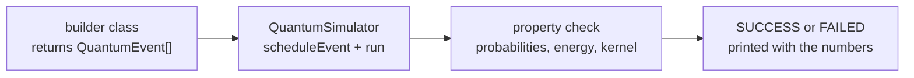
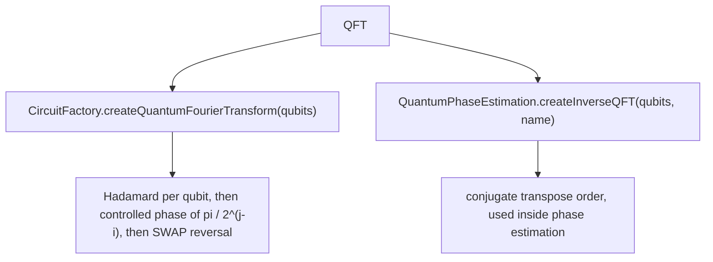
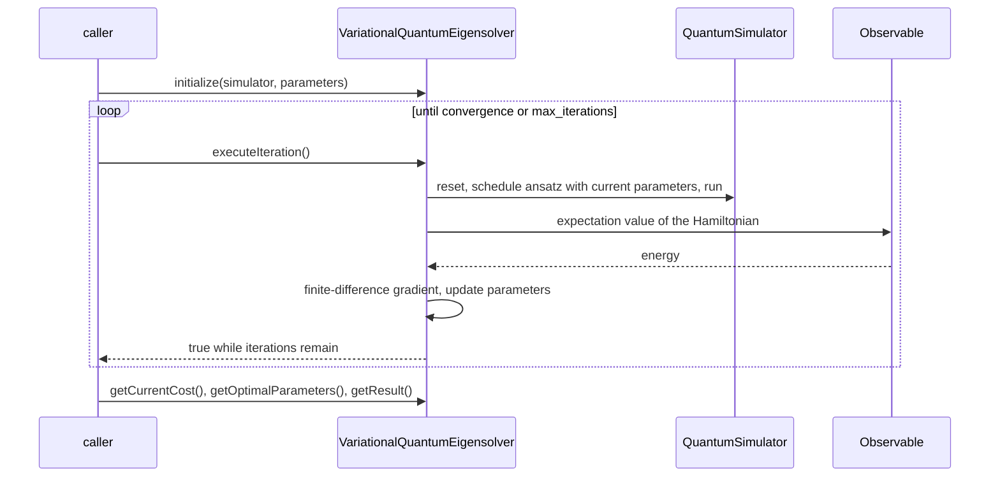

# Algorithms

Ten algorithm circuits ship as runnable demos, and every one of them checks a quantitative
property and prints `SUCCESS` or `FAILED`. A `FAILED` line is a real result, not a broken
installer: the demos keep honest negative checks rather than reporting a pass they did not earn.



## Demo commands

```bash
java -cp "target/classes;lib/*" example.QuantumAlgorithmsDemo ALL
java -cp "target/classes;lib/*" example.QuantumAlgorithmsDemo GROVER
```

| Selector | Circuit | Qubits | Backend | Pass criterion |
| --- | --- | --- | --- | --- |
| `GROVER` | Search for `|111>` in a 3-qubit space | 3 | state vector | target probability is the unique maximum and exceeds uniform by 0.1 |
| `QFT` | Quantum Fourier transform of `|000>` | 3 | state vector | every basis probability within 0.01 of `1/8` |
| `QPE` | Phase estimation of the `T` gate | 4 | state vector | estimate equals `0.125` with probability above 0.99 |
| `VQE` | H2 in a 2-qubit parity mapping | 2 | state vector | energy within 1 mHartree of exact diagonalization |
| `QNN` | 2-qubit variational classifier, 60 epochs | 2 | state vector | 100 percent accuracy on the four training samples |
| `QSVM` | ZZ feature map, swap-test kernel, kernel perceptron | 5 | state vector | training and test predictions all correct |
| `SHOR_CODE` | 9-qubit encoding of logical `|0>` | 9 | state vector | probability mass above 0.999 on the eight codewords |
| `QAOA` | MaxCut on a triangle, one layer | 3 | state vector | amplitude concentrated on maximum cuts |
| `TROTTER` | Heisenberg `XX + YY + ZZ`, 4 steps, `t = 0.5` | 2 | state vector | Trotter state matches the exact matrix-exponential evolution |
| `QUANTUM_WALK` | Continuous-time walk on a 3-node line | 3 | state vector | probability above 0.1 on both neighbouring sites |

`ALL` runs them in that order and prints a completion banner at the end.

## Grover search

`example.algorithms.GroversAlgorithm` builds the oracle and the diffusion operator as exact
multi-qubit gates, so amplitudes are amplified without decomposing into a one- and two-qubit gate
basis.

```java
Qubit[] qubits = Qubit.createQubits(3).toArray(new Qubit[0]);
QuantumEvent[] circuit = GroversAlgorithm.createGroversCircuit(qubits, 7); // marks |111>
```

| Method | Purpose |
| --- | --- |
| `createGroversCircuit(qubits, targetState)` | full circuit: Hadamards, then `max(1, floor(pi/4 * sqrt(2^n)))` rounds of marking oracle plus diffusion |
| `createSimpleGrovers2Qubit(qubits)` | two-qubit example used by the tests |
| `createDemoCircuit(qubits)` | the circuit used by the demo entry point |

The marking step conjugates `MultiQubitGate.createMultiControlledZ`, whose diagonal is `-1` only on
the all-ones entry, with `X` gates on the unmarked qubits, and the diffusion step mirrors that
construction around the uniform state.
`QuantumAmplitudeAmplification` is the more general form: `amplify(qubits, initializationCircuit,
oracleCircuit, iterations)`, `createMarkingOracle(...)`, `createSimplifiedDiffusion(...)` and
`calculateOptimalIterations(searchSpaceSize, numSolutions)`. Its `demoAmplitudeAmplification()`
method is a standalone demonstration that the `ALL` runner does not call.

## Quantum Fourier transform

Two implementations exist and they are not interchangeable:



`QuantumAlgorithmsDemo` uses the `CircuitFactory` version, which is the forward transform with the
final SWAP layer, so `|000>` maps to the uniform superposition. That is the demo that the `QFT`
selector runs. The JSON `qft` demo name has no bundled circuit file, see
[Getting started](01-getting-started.md#3-run-a-json-circuit).

## Phase estimation

```java
Qubit[] estimation = { new Qubit(0, "est0"), new Qubit(1, "est1"), new Qubit(2, "est2") };
Qubit eigen = new Qubit(3, "eigen");

// Prepare the eigenstate, then estimate
simulator.scheduleEvent(EventBuilderHelper.createSingleQubitGate(
    "X", SingleQubitGate.createPauliX(eigen), eigen));

QuantumEvent[] unitary = { EventBuilderHelper.createSingleQubitGate(
    "T", SingleQubitGate.createT(eigen), eigen) };

QuantumEvent[] circuit = QuantumPhaseEstimation.createPhaseEstimationCircuit(
    estimation, new Qubit[]{ eigen }, unitary, 3);
```

`precisionBits` must match the number of estimation qubits. The builder applies controlled powers
of the supplied unitary circuit, so a `T` gate on `|1>` yields the exact 3-bit estimate `0.001`
equal to `1/8`. The demo reads the estimate by dropping the least significant eigenstate bit from
the most probable basis index, which is why the register layout matters.

## Variational quantum eigensolver

`com.mechalikh.qforge.classical.VariationalQuantumEigensolver` is the real optimization loop, and
`example.algorithms.VQEAlgorithm` supplies the circuit builders and Hamiltonians.



```java
ComplexMatrix i2 = ComplexMatrix.identity(2);
ComplexMatrix z = ComplexMatrix.pauliZ();
ComplexMatrix x = ComplexMatrix.pauliX();

ComplexMatrix h2 = ComplexMatrix.identity(4).scale(-1.0523)
    .add(z.tensorProduct(i2).scale(0.3979))
    .add(i2.tensorProduct(z).scale(0.3979))
    .add(z.tensorProduct(z).scale(-0.0113))
    .add(x.tensorProduct(x).scale(0.1809));

Observable hamiltonian = new Observable(
    "H2", h2, qubits, Observable.ObservableType.HAMILTONIAN);

Map<String, Object> parameters = new HashMap<>();
parameters.put("max_iterations", 300);
parameters.put("learning_rate", 0.15);
parameters.put("momentum", 0.5);
parameters.put("convergence_threshold", 1e-8);

VariationalQuantumEigensolver vqe =
    new VariationalQuantumEigensolver(hamiltonian, Arrays.asList(qubits));
vqe.initialize(simulator, parameters);
while (vqe.executeIteration()) {
    // run to convergence or to the iteration cap
}
double energy = vqe.getCurrentCost();
```

The demo compares `energy` against `h2.eigenvalues()[0]` and needs an absolute error below `1e-3`
Hartree. `VQEAlgorithm` also offers `createVQECircuit(qubits, parameters, ansatzType)` with
`HardwareEfficient`, `UnitaryCoupledCluster` and `Chemistry` ansatz families, parameter keys named
`theta0`, `phi0`, `psi0` and so on, plus `getH2Hamiltonian(numQubits)`, `getLiHHamiltonian()`,
`estimateEnergy(...)` and `createMeasurementCircuit(...)`. The `get*Hamiltonian` helpers return a
`Map<String, Double>` of Pauli coefficients, which is a different representation from the
`Observable` the solver consumes.

Related classes in the same package: `ParameterSpace` for bounded and discrete parameter sets,
`HybridAlgorithm` for the quantum-classical loop contract, and the gradient descent optimizer used
by the solver.

## Machine learning demos

Both are educational implementations on four samples, not trained models.

```java
// QNN: angle encoding, then layers of RY rotations and controlled phases
Map<String, Double> weights = new LinkedHashMap<>();
weights.put("w0_0_rot", 0.31);   // layer 0, qubit 0 rotation
weights.put("w0_1_rot", -0.12);
weights.put("w0_0_1", 0.45);     // layer 0, qubit pair 0 and 1
QuantumEvent[] qnn = QuantumNeuralNetwork.createQNNCircuit(qubits, new double[]{0.2, 0.8}, weights, 2);

// QSVM: kernel between two data points through a swap test
QuantumEvent[] kernel = QuantumSVM.createQSVMKernelCircuit(
    new Qubit[]{ q0, q1 }, new Qubit[]{ q2, q3 },
    new double[]{0.1, 0.5}, new double[]{0.8, 0.5}, "ZZ");
```

| Detail | QNN | QSVM |
| --- | --- | --- |
| Encoding | one RY rotation per qubit | ZZ feature map, `createQSVMFeatureMap(qubits, dataPoint, "ZZFeatureMap")` |
| Trainable values | `w<layer>_<i>_rot` and `w<layer>_<i>_<j>` | kernel matrix entries |
| Optimizer in the demo | parameter-shift-free central differences, 60 epochs, learning rate 0.4 | kernel perceptron, at most 50 sweeps |
| Readout | probability mass of basis indices 2 and 3 | sign of `sum alpha_j y_j K(x_j, x)` |
| Kernel estimate | not used | swap test with one ancilla over two 2-qubit registers |

The comment inside `QuantumNeuralNetwork` says amplitude encoding; the code angle-encodes with
rotations. Trust the code.

## Error correction

```java
Qubit[] nine = Qubit.createQubits(9).toArray(new Qubit[0]);
QuantumEvent[] encode = QuantumErrorCorrection.createShorCode(nine);

Qubit[] data = { nine[0] };
Qubit[] ancilla = { nine[1], nine[2] };
QuantumEvent[] bitFlip = QuantumErrorCorrection.createBitFlipCode(data, ancilla);
QuantumEvent[] phaseFlip = QuantumErrorCorrection.createPhaseFlipCode(data, ancilla);
```

The demo encodes logical `|0>` and checks that the probability lands on the eight Shor codewords of
`(|000> + |111>)` tensor three, divided by `sqrt(8)`. Encoding circuits only: there is no syndrome
extraction or recovery step, so `SHOR_CODE` verifies the codeword structure rather than a correction
cycle. `EventType.ERROR_CORRECTION` and `EventType.RECOVERY` exist as event labels, and the
`ErrorManager` in `com.mechalikh.qforge.noise` tracks injected errors, but no demo closes the
correction loop.

## Hamiltonian simulation

```java
List<TrotterSimulation.HamiltonianTerm> terms = Arrays.asList(
    new TrotterSimulation.HamiltonianTerm("XX", new int[]{0, 1}, 1.0),
    new TrotterSimulation.HamiltonianTerm("YY", new int[]{0, 1}, 1.0),
    new TrotterSimulation.HamiltonianTerm("ZZ", new int[]{0, 1}, 1.0));

QuantumEvent[] circuit = TrotterSimulation.createTrotterCircuit(
    qubits, new TrotterSimulation.Hamiltonian(terms), 0.5, 4);
```

First-order product formula, `Delta t = time / trotterSteps`, with term types `I`, `X`, `Y`, `Z`,
`XX`, `YY` and `ZZ`. The demo compares the Trotter-evolved state against the exact evolution computed by
diagonalizing the Hamiltonian, so the failure mode it reports is Trotter error, not a wrong state.
`QuantumArithmetic` provides `createQuantumAdder(a, b, carry)` and
`createQuantumMultiplier(...)` as ripple-carry style building blocks; neither is exercised by the
demo runner.

## Quantum walks

```java
Qubit[] position = Qubit.createQubits(3).toArray(new Qubit[0]);
QuantumEvent[] walk = QuantumWalk.createContinuousTimeWalk(position, null, null, 1.0);
```

A `null` graph falls back to a line topology, which is exactly what the demo runs: start in the
middle site `|010>` and check that amplitude reaches `|001>` and `|011>`.

The `Graph` helper class, with `createLineGraph`, `createCycleGraph`, `createCompleteGraph`,
`createStarGraph`, `createBinaryTree`, `createRandomGraph`, `getAdjacencyMatrix`,
`getLaplacianMatrix`, `isConnected` and `bfs`, is declared as a package-private type in
`example.algorithms`. Code outside that package cannot build a `Graph`, so the practical options
are to pass `null` for the line topology, to add your builder inside `example.algorithms`, or to
promote the class to `public`. The discrete-time walk with a coin qubit is a parameter of the same
method rather than a separate builder, and the demo leaves the coin unset.

## Performance notes

| Cost | Driver |
| --- | --- |
| State allocation | `2^n` amplitudes, or `4^n` matrix elements |
| Gate application | `O(2^n)` per gate on a state vector |
| Multi-qubit depolarizing | `4^n` Kraus operators, capped at 4 targets |
| Fidelity and trace distance | eigenvalue decomposition of a `2^n x 2^n` matrix |
| VQE and QNN gradient steps | one full simulation per parameter per finite-difference step, twice for central differences |

That last row explains the runtimes: the QNN demo evaluates 60 epochs times 4 samples times 6
parameters times 2 shift points, so it performs on the order of a few thousand circuit runs of 2
qubits each. Keep registers small when you replicate those loops.

## Related guides

- [Gates and circuits](04-gates-and-circuits.md) for the gates these builders emit.
- [Measurement and noise](05-measurement-and-noise.md) for adding decoherence to an algorithm.
- [Development](08-development.md) for the tests that lock these behaviors.
