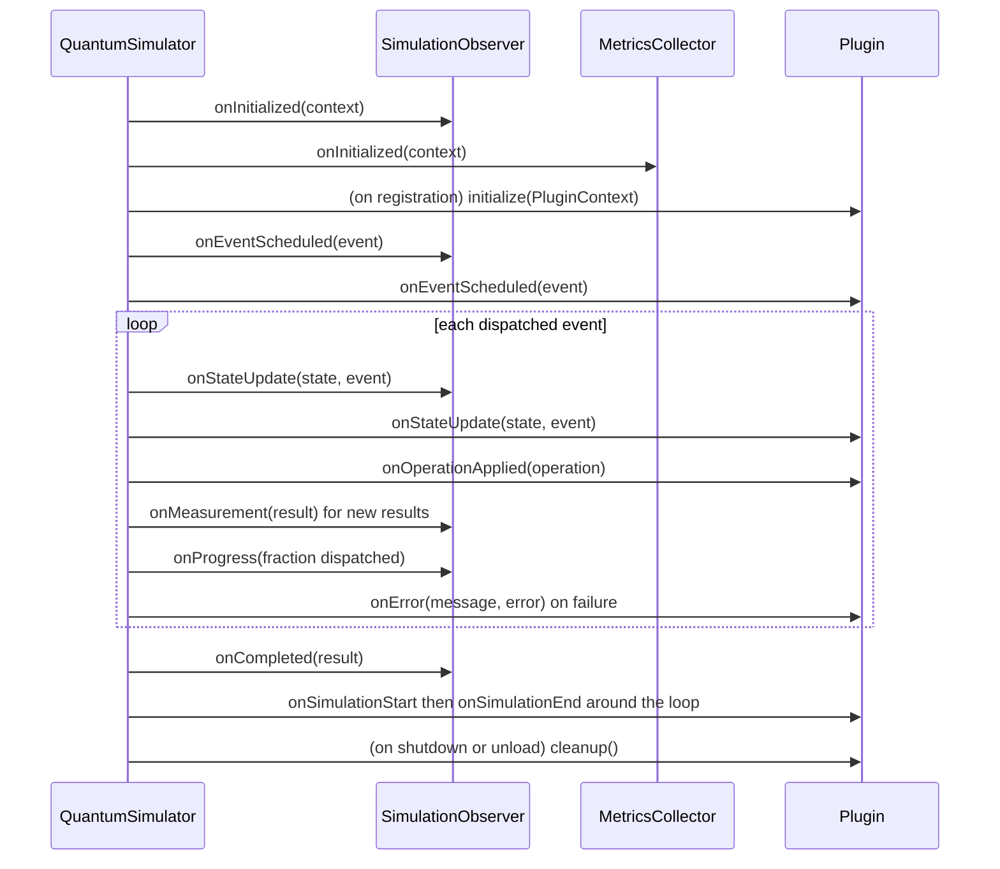
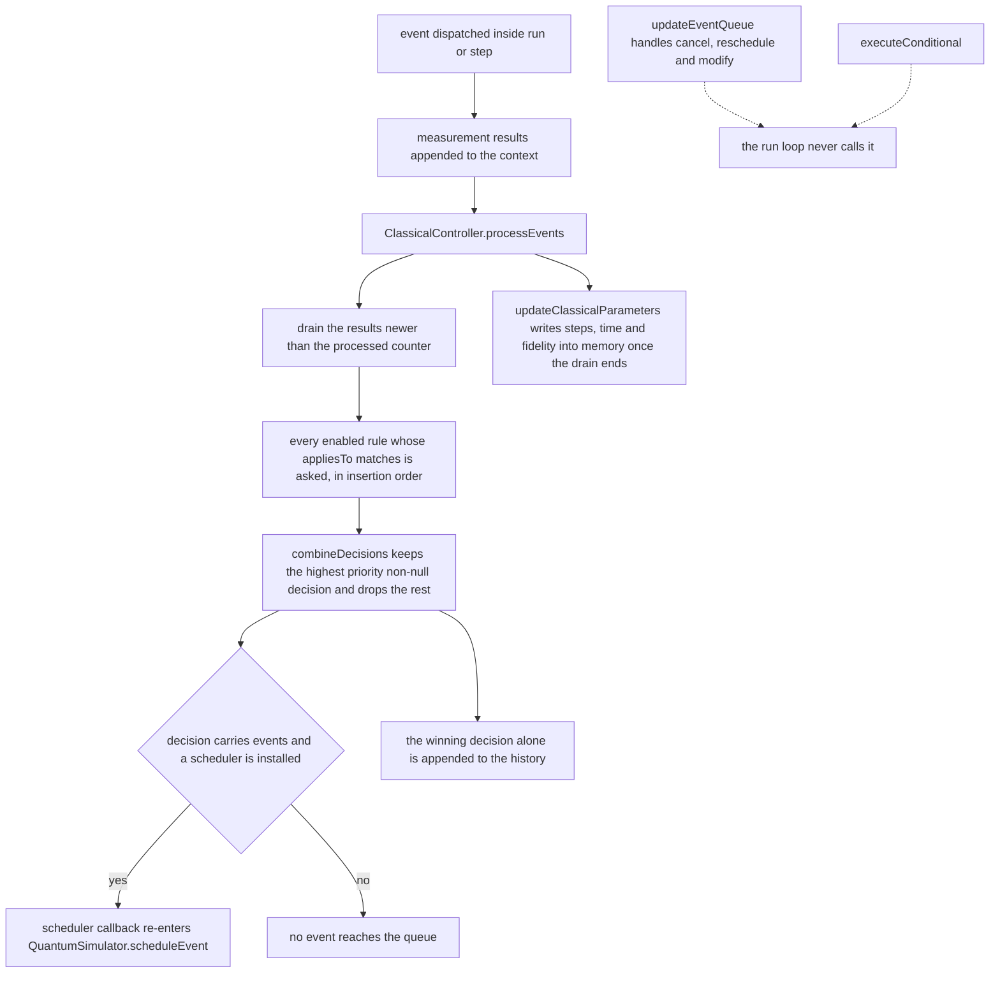

# Extending QForge

Four extension seams exist, and they differ in how much of the engine they can reach:

| Seam | Reach | Persistence |
| --- | --- | --- |
| `SimulationObserver` | every lifecycle callback the facade emits | in-process only |
| `Plugin` | start, end, scheduling, state update, operation, error | in-process, or loaded from JAR or directory |
| `GateLibrary` factory or `QuantumGate.CustomGate` | the gate set, including JSON circuits | per configuration |
| `ClassicalController.ControlRule` | decisions after a measurement, can schedule events | per simulator instance |

## Observers



```java
import com.mechalikh.qforge.core.SimulationResult;
import com.mechalikh.qforge.core.SimulationContext;
import com.mechalikh.qforge.events.QuantumEvent;
import com.mechalikh.qforge.observer.SimulationObserver;
import com.mechalikh.qforge.state.QuantumState;

simulator.addObserver(new SimulationObserver() {
    @Override
    public void onStateUpdate(QuantumState state, QuantumEvent event) {
        System.out.printf("%s -> purity %.4f%n", event.getId(), state.getPurity());
    }

    @Override
    public void onCompleted(SimulationResult result) {
        System.out.println("steps " + result.getMetric("steps_executed"));
    }
});
```

Which callbacks actually fire, stated precisely so you do not build on silence:

| Callback | Fired by `QuantumSimulator` |
| --- | --- |
| `onInitialized` | yes, during `initialize` |
| `onEventScheduled` | yes, during `scheduleEvent` |
| `onStateUpdate` | yes, after each dispatched event in `run()` and `step()` |
| `onMeasurement` | yes, for results recorded during each event |
| `onProgress` | yes, once per dispatched event in `run()`; the value is the fraction of known events already dispatched |
| `onCompleted` | yes, at the end of `run()` |
| `onReset` | yes, during `reset()` |
| `onError` | yes, when `initialize`, `step` or `run` fails, just before the `SimulationError` is thrown |
| `onSimulationPaused` | yes, from `pause()` |
| `onSimulationResumed` | yes, from `resume()` |
| `onSimulationStopped` | yes, from `stop()` while a run is active |

The interface holds only callbacks the engine can raise. Configuration changes, resource accounting
and checkpoints have no engine support and are not part of it.

`pause()` stops `run()` after the current event: the remaining events stay queued, the call returns
the partial result, and a later `run()` continues from the queue. `reset()` clears the paused flag.
A run ended by `maxSteps` or `timeoutSeconds` returns the partial result too; inspect
`simulator.getContext().shouldStop()` to tell that apart from an exhausted queue.

### Metrics collection

`MetricsCollector` is itself an observer, installed by `initialize` and reachable through
`simulator.getContext().getMetrics()`.

| Method | Output |
| --- | --- |
| `getAllMetrics()` | live map with the keys listed in [Getting started](01-getting-started.md#6-read-the-metrics) |
| `getOperationCounts()` | per-operation-name counts |
| `getErrorCounts()` | per-error-type counts |
| `getMeasurementHistory()` | timestamp, observable name, expectation, variance, shots per measurement |
| `getStateHistory()` | timestamp, qubit count, purity, state type per update |
| `recordMetric(name, value)` | add your own series |
| `recordFidelity(value)` | feeds `current_fidelity` and `average_fidelity` |
| `generateReport()` | `SimulationReport` with metrics, counts, start and end times, `getDuration()`, `getThroughput()`, `toSummaryString()` |
| `reset()` | back to the default zeroed set |

The history lists are bounded, so a long run reports the tail rather than everything.

## Plugins

The plugin contract is `com.mechalikh.qforge.plugin.Plugin`: `initialize`, `cleanup`, `getName`,
`getVersion`, `getDescription`, plus the default hooks `onSimulationStart`, `onSimulationEnd`,
`onStateUpdate`, `onEventScheduled`, `onOperationApplied` and `onError`.

```java
import com.mechalikh.qforge.events.QuantumEvent;
import com.mechalikh.qforge.plugin.Plugin;
import com.mechalikh.qforge.plugin.PluginContext;
import com.mechalikh.qforge.state.QuantumState;

public class ParityMonitor implements Plugin {
    private int events;

    @Override public String getName() { return "ParityMonitor"; }
    @Override public String getVersion() { return "1.0"; }
    @Override public String getDescription() { return "Counts dispatched events"; }

    @Override public void initialize(PluginContext context) {
        context.logInfo("monitor armed");
    }

    @Override public void cleanup() {
        System.out.println("dispatched " + events);
    }

    @Override public void onStateUpdate(QuantumState state, QuantumEvent event) {
        events++;
    }
}
```

```java
simulator.getPluginManager().registerPlugin(new ParityMonitor());
```

`registerPlugin` calls `initialize` immediately with a context built from the plugin's own name and
version, and the directory string is empty. Registration rejects a duplicate name with
`IllegalStateException`. Hooks that throw are caught by the manager and printed to standard error,
so a failing plugin cannot abort a run.

### Loading from disk

`PluginManager.loadPlugin(path)` accepts a directory or a JAR.

| Form | Required metadata | Optional | Defaults |
| --- | --- | --- | --- |
| directory | `plugin.properties` with `plugin.class` | `plugin.name`, `plugin.version` | name is the directory name, version is `1.0.0` |
| JAR | manifest attribute `Plugin-Class` | `Plugin-Name`, `Plugin-Version` | passed to the context unchanged |

```properties
# my-plugin/plugin.properties
plugin.class=com.example.ParityMonitor
plugin.name=ParityMonitor
plugin.version=1.0
```

The class must have a public no-arg constructor and implement `Plugin`; otherwise `loadPlugin`
raises `PluginException`. Each loaded plugin gets its own `URLClassLoader` over the JAR or directory,
with the manager's class loader as parent, so plugin code can always see the simulator API.
`setPluginClassLoader` changes that parent.

`src/example/plugins/` holds the worked examples: `SafePlugin` (an abstract base that wraps
`initialize` and `cleanup` so a subclass cannot leave the plugin half-built, with `safeInitialize`
and `safeCleanup` hooks), `PluginSystemExample`, `EnhancedPluginManager`, `PluginTester` and
`RunPluginExample`.

### Manager API

| Method | Effect |
| --- | --- |
| `listPlugins()` | registered names |
| `getPlugin(name)` / `getPlugin(name, Class)` | lookup, the second form casts |
| `getPluginsByType(Class)` | all plugins assignable to a type |
| `unloadPlugin(name)` / `unloadAll()` | calls `cleanup()`, returns whether the name was present |
| `addPluginListener` / `removePluginListener` | `onPluginLoaded` and `onPluginUnloaded` callbacks |
| `initializePlugins(context)` / `cleanupPlugins(context)` | dispatch `onSimulationStart` and `onSimulationEnd`; called by `run()` |
| `notifyEventScheduled`, `notifyStateUpdate`, `notifyOperationApplied`, `notifyError` | dispatch the matching hooks; called by the facade |

`supportsExtension` and `getExtension` are part of the interface but the manager never calls them.
The example code invokes them directly on a plugin instance, so treat them as an application-level
convention rather than a dispatch mechanism.

## Custom gates

See [Gates and circuits](04-gates-and-circuits.md#custom-gates) for `QuantumGate.CustomGate` and
`GateLibrary.registerFactory`. A factory is the only way to make a new gate available to JSON
circuits, and `config.getGateLibrary()` is the library `CircuitRunner` consults only when it builds
a fresh `GateLibrary` internally. That means a custom factory registered on your configuration is
not visible to `CircuitRunner` unless you load the circuit yourself.

## Custom noise

Subclass `NoiseModel` and supply a complete Kraus set for `n` targets:

```java
import com.mechalikh.qforge.math.Complex;
import com.mechalikh.qforge.math.ComplexMatrix;
import com.mechalikh.qforge.noise.NoiseModel;
import com.mechalikh.qforge.state.Qubit;

public class BitFlipNoise extends NoiseModel {
    public BitFlipNoise(double probability, Qubit... targets) {
        super("BitFlipNoise", probability, targets);
    }

    @Override
    public ComplexMatrix[] getKrausOperators(int numQubits) {
        if (numQubits != getTargetQubits().length) {
            throw new IllegalArgumentException("Operator count must match targets");
        }
        ComplexMatrix[] single = {
            ComplexMatrix.identity(2).scale(Math.sqrt(1.0 - getProbability())),
            ComplexMatrix.pauliX().scale(Math.sqrt(getProbability()))
        };
        return independentKraus(single, numQubits);
    }

    @Override
    public NoiseModel withProbability(double newProbability) {
        return new BitFlipNoise(newProbability, getTargetQubits());
    }

    @Override
    public NoiseModel withTargetQubits(Qubit[] newTargetQubits) {
        return new BitFlipNoise(getProbability(), newTargetQubits);
    }
}
```

`independentKraus` builds the `2^n` tensor products and refuses more than eight qubits. Verify
completeness yourself: the set must satisfy `sum K_i^dagger K_i = I`, and a wrong set produces a
state whose trace drifts, which `DensityMatrix.isPositive()` and the purity metric will show.

Add instances to a profile with `NoiseProfile.addNoise(qubit, model)` or
`addGlobalNoise(name, model)`. JSON loading does not know your type unless you map it in
`NoiseProfile.loadFromMap`, so custom channels are a Java-side feature today.

## Classical feed-forward control

Mid-circuit feed-forward is a supported engine path. Declare a classical register on the
configuration, point a measurement at it, and schedule a `ConditionalOperation` that tests the
register in the same shot:

```java
config.addClassicalRegister("alice", 2);

MeasurementOperator measure = MeasurementOperator.computationalBasis(new Qubit[]{ q0 }, 1)
    .withClassicalTarget("alice", 0);
MeasurementOperator measureBell = MeasurementOperator.computationalBasis(new Qubit[]{ q1 }, 1)
    .withClassicalTarget("alice", 1);

ConditionalOperation correctX = new ConditionalOperation(
    SingleQubitGate.createPauliX(bob), "alice", 2L, 2L);
```

`ShotRunner.run(config, factory, shots)` repeats the circuit with a fresh simulator per shot and
returns the per-shot register values plus a histogram. The event-time model and the register
packing are described in
[Architecture](02-architecture.md#classical-control-and-feed-forward), and a complete measured
protocol is in
[the teleportation README](https://github.com/CharafeddineMechalikh/QForge/blob/main/src/example/algorithms/teleportation/README.md).
The protocol itself is explained in
[Entanglement, measurement and teleportation](11-entanglement-and-measurement.md#teleportation-move-a-state-with-two-bits).

## Rule-based controller

The `ClassicalController` below is a separate, older extension mechanism. Enable it with
`config.setClassicalControlEnabled(true)`, then replace the placeholder rules.

```java
import com.mechalikh.qforge.classical.ClassicalController;
import com.mechalikh.qforge.classical.ControlDecision;
import com.mechalikh.qforge.measurement.MeasurementResult;

ClassicalController controller = simulator.getClassicalController();

controller.addRule(new ClassicalController.ControlRule() {
    @Override public boolean appliesTo(MeasurementResult m) {
        return m.getObservableName().equals("q0_Z");
    }

    @Override
    public ControlDecision evaluate(MeasurementResult m, Map<String, Object> memory) {
        if (m.getMostFrequentOutcome() == 1) {
            Qubit target = (Qubit) memory.get("correction_target");
            QuantumEvent correction = new QuantumEvent.Builder("correct")
                .withOperation(SingleQubitGate.createPauliX(target))
                .withTargetQubits(target)
                .build();
            return ControlDecision.createScheduleDecision("flip back", 200, correction);
        }
        return null;
    }

    @Override public String getName() { return "ConditionalX"; }
    @Override public boolean isEnabled() { return true; }
    @Override public void setEnabled(boolean enabled) { }
    @Override public int getPriority() { return 200; }
});

controller.storeInMemory("correction_target", simulator.getContext().getQubit(0));
```

The controller runs after every dispatched event during `run()`. `processEvents` drains the
measurements appended since its previous call, evaluates the enabled rules in insertion order, and
forwards every non-null event carried by the winning decision through the scheduler installed by
`initialize`, which is why a rule can extend the run.



`combineDecisions` sorts the collected decisions by their own priority and returns only the first, so
a lower priority answer is discarded rather than merged, and `getDecisionHistory()` shows only the
winners. Three caveats follow from that implementation:

- Only the events on a decision matter on the live path. `updateEventQueue` does interpret
  `CANCEL_EVENT`, `RESCHEDULE_EVENT` and `MODIFY_PARAMETERS`, but the simulator never calls it, so a
  decision with `SCHEDULE_EVENT` semantics and a null event has no effect beyond the history entry.
- `executeConditional` is likewise not part of the run loop; call it yourself when you want the
  `Condition` comparison machinery.
- `processEvents` also writes `simulation_steps`, `simulation_time` and `current_fidelity` into
  classical memory after each pass, and the processed-measurement counter never resets, so clearing
  the context measurements does not make old results reconsidered.

Decisions are recorded in `getDecisionHistory()` and counted by `getDecisionCount()`; rules can read
and write `storeInMemory` and `getFromMemory`, and `ControlDecision` also offers
`createScheduleDecisions`, `createCancelDecision` and a `Builder` with action, events, event id, new
time and parameters.

## Visualization

`VisualizationEngine` implements `SimulationObserver`, so it is an observer you add:

```java
import com.mechalikh.qforge.observer.VisualizationEngine;

VisualizationEngine viz = new VisualizationEngine(500, "./out/visualizations");
simulator.addObserver(viz);
simulator.run();
```

| Output | When |
| --- | --- |
| `final_state.png` | `generateSummaryVisualizations(result)` with a non-null final state |
| `event_timeline.png` | same call, only when the event history is non-empty |
| `metrics_plot.png` | same call, only when the state history is non-empty |
| `<name>.gif` | `generateAnimation(name, frameDelay)` |

`renderState`, `renderStateVector` and `renderDensityMatrix` return `BufferedImage` objects for
embedding, and `saveImage(image, filename)` writes a PNG under the output directory. The default
directory is `./visualizations/` and folders are created on demand. Java2D only: there is no
interactive window and no WebGL.

## Related guides

- [Architecture](02-architecture.md#package-map) for where each seam sits.
- [Measurement and noise](05-measurement-and-noise.md) for Kraus semantics your channel must satisfy.
- [Development](08-development.md) for tests and the Javadoc build.
