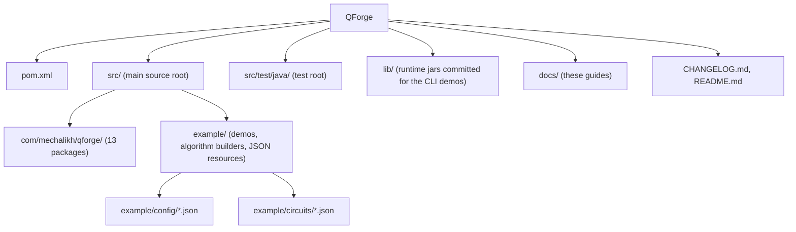

# Development

How to build, test, document and release QForge, and the conventions the codebase follows.

## Repository layout



Maven maps `src` to the main source root and `src/test/java` to the test root, which is unusual:
production code sits at `src/com/...` rather than `src/main/java/com/...`. The resources block
copies every `**/*.json` and `**/*.properties` under `src` into `target/classes`, which is why
`CircuitRunner` can find `example/config/bell_state_config.json` on the classpath.

| Path | Contents |
| --- | --- |
| `src/com/mechalikh/qforge/` | the library: `core`, `config`, `events`, `operations`, `state`, `strategy`, `measurement`, `noise`, `observer`, `plugin`, `classical`, `resources`, `math` |
| `src/example/` | runners, `algorithms`, `plugins`, `visualization`, JSON resources |
| `src/test/java/com/mechalikh/qforge/` | JUnit 5 tests and `TestSupport` |
| `lib/` | `jackson-annotations`, `jackson-core`, `jackson-databind` |
| `target/`, `bin/`, `output/` | build and demo artifacts, git-ignored |

The compiler plugin excludes `test/**` from the main compile so the test tree under `src` is not
picked up twice, and the Javadoc plugin applies the same exclusion through
`sourceFileExcludes`.

## Build commands

| Task | Command |
| --- | --- |
| Compile | `mvn -o compile` |
| Test | `mvn -o test` |
| Package classes and resources | `mvn -o package` |
| API documentation | `mvn javadoc:javadoc` (online for the first run) |
| All demos | `java -cp "target/classes;lib/*" example.QuantumAlgorithmsDemo ALL` |
| One demo | `java -cp "target/classes;lib/*" example.QuantumAlgorithmsDemo VQE` |
| JSON circuit | `java -cp "target/classes;lib/*" example.CircuitRunner bell` |
| Headless visuals | `java -cp "target/classes;lib/*" example.visualization.RunVisualizations` |

Use `:` instead of `;` between classpath entries on Linux and macOS. Demo images land in
`visualizations/` relative to the working directory.

## Dependencies

| Artifact | Version | Scope | Used for |
| --- | --- | --- | --- |
| `com.fasterxml.jackson.core:jackson-databind` | 2.13.3 | compile | JSON config, circuit and result serialization |
| `com.fasterxml.jackson.core:jackson-core` | 2.13.3 | compile | parser features, including comment tolerance |
| `org.slf4j:slf4j-api` and `slf4j-simple` | 1.7.36 | compile and runtime | declared, no source imports it |
| `org.apache.commons:commons-math3` | 3.6.1 | compile | declared, no source imports it |
| `org.jetbrains:annotations` | 23.0.0 | compile | declared, no source imports it |
| `org.junit.jupiter:junit-jupiter-api` and `junit-jupiter-engine` | 5.8.2 | test | the test suite |

## Test suite

338 tests, all passing on the current tree.

| Class | Tests | Covers |
| --- | --- | --- |
| `GateTest` | 8 | single- and multi-qubit matrices, control ordering, adjoint inverses |
| `NoiseTest` | 8 | Kraus completeness, trajectory versus deterministic channels, profile JSON |
| `AlgorithmTest` | 7 | Grover amplification, QFT uniformity, phase estimation, walk spreading |
| `MeasurementTest` | 7 | probabilities, collapse, expectation values, partial measurement |
| `JsonConfigTest` | 5 | config round-trip, unknown fields, comments, validation failures |
| `MetricsTest` | 3 | counters, fidelity and distance metrics, report generation |
| `QuantumSimulationTest` | 2 | end-to-end Bell state, event ordering |
| `VqeTest` | 1 | convergence of the H2 loop against exact diagonalization |
| `PluginTest` | 1 | registration, hook dispatch, cleanup on shutdown |
| `MeasurementCoverageTest` | 46 | observables, partial collapse, sampling statistics, helpers |
| `StateCoverageTest` | 35 | vector and density-matrix arithmetic, gates, collapse, fidelity |
| `MathCoverageTest` | 35 | complex arithmetic, matrices, eigen decomposition, parameters |
| `StrategyExtraCoverageTest` | 25 | backend guards, measurement results, fidelity, entropy, clone |
| `NoiseCoverageTest` | 24 | noise profiles, Kraus channels, error reports, statistics |
| `ClassicalCoverageTest` | 24 | VQE, controls, decision rules, event-driven classical actions |
| `NoiseCoreExtraCoverageTest` | 21 | noise model edges, error reports and profiles, simulator guards |
| `ObserverCoverageTest` | 15 | metrics, reports, visualization images and history limits |
| `EventsCoverageTest` | 14 | event ordering, queue accounting, dispatcher lifecycles |
| `PluginCoverageTest` | 13 | JAR and directory loading, metadata validation, hooks |
| `MathExtraCoverageTest` | 11 | eigen decomposition internals, complex parsing, matrix square root |
| `CoreMarginCoverageTest` | 9 | dispatch lifecycles, observables, parameter guards, error wrapping |
| `CoreCoverageTest` | 9 | configuration, time resolutions, context, simulator lifecycle |
| `ResourcesCoverageTest` | 8 | constraint validation, allocation and release accounting |
| `OperationsCoverageTest` | 7 | gate construction, matrix copies, gate library |

`TestSupport` holds shared helpers such as `event(id, operation, qubits...)`. Tests are plain JUnit
5 with no mocks: they drive the real dispatch path, because a stubbed simulator would not detect a
broken pipeline.

### Coverage

JaCoCo 0.8.13 is bound to the `test` phase and writes `target/site/jacoco/index.html` and
`target/site/jacoco/jacoco.csv`. The `example` package is excluded, because those classes are
runnable demos rather than library code. A `check` rule fails `mvn verify` when instruction or
branch coverage drops below 90 percent. Print the totals from the CSV:

```bash
awk -F, 'NR>1 {im+=$4; ic+=$5; bm+=$6; bc+=$7} END {printf "instruction %.1f%%, branch %.1f%%\n", 100*ic/(ic+im), 100*bc/(bc+bm)}' target/site/jacoco/jacoco.csv
```

On the current tree that command reports 97.7 percent instruction coverage and 91.8 percent branch
coverage over 97 classes. No coverage service is connected, so the README badges carry that
measurement as static Shields images dated 2026-10-25; update both badges when the number moves.

### Adding a test

1. Put it in `src/test/java/com/mechalikh/qforge/`, package `com.mechalikh.qforge`.
2. Build a `SimulationConfig` with one or two qubits so the suite stays fast; the VQE test is
   already the slow one at about 4 seconds.
3. Assert on a physical property (probability, energy, trace, purity) rather than on a string.
4. Run `mvn -o test -Dtest=YourTest`.

## Javadoc

`mvn javadoc:javadoc` writes `target/site/apidocs/index.html`, currently 319 HTML pages. The plugin
runs with `doclint=all,-missing`, so bad `{@link}` targets, broken tags and malformed HTML fail the
build while absent comments do not.

Conventions that keep the build clean:

- Every package has a `package-info.java` with a summary and the invariants that matter.
- Cross-package references use fully qualified `{@link}` targets, for example
  `{@link com.mechalikh.qforge.state.StateVector}` from the `measurement` package.
- `@throws` must name an exception the method actually declares; a hook that swallows exceptions
  does not document `@throws Exception`.
- Documentation describes what the code does, including the negative cases: unenforced timeouts,
  placeholder control rules and unexposed types are documented as such rather than glossed over.

## Documentation site

The `docs/` folder is also a GitHub Pages site, published from the `main` branch at
[https://charafeddinemechalikh.github.io/QForge/](https://charafeddinemechalikh.github.io/QForge/).
Pages runs Jekyll over `docs/` on every push, so there is no build step and no local dependency to
install: committing a guide is enough to publish it.

Two files support the site:

- `docs/_config.yml` sets the site title, description and base path, and selects kramdown with GFM,
  Rouge highlighting and the `jekyll-relative-links` plugin.
- `docs/_layouts/default.html` renders the header, the guide navigation, per-page titles and meta
  descriptions, canonical links, light and dark styles, and the Mermaid renderer that turns the
  `mermaid` code fences into diagrams in the browser.

Every guide carries front matter with `title`, `nav`, `order` and `description`. The navigation is
sorted by `order`, so a new guide needs a number between its neighbours; `docs/README.md` uses
`order: 0` and `permalink: "/"` to serve as the site home page. Relative links between guides are
written as plain `.md` paths, which GitHub renders in the repository and Jekyll rewrites to the
pretty site URLs, so the same text works in both places.

## Coding conventions

- Java 17, four-space indentation, tabs appear in a few older files; match the file you edit.
- `Complex`, `ComplexMatrix` and `QuantumState` are the only numeric primitives that cross package
  boundaries; gates and noise models stay data-only and let the strategy do the linear algebra.
- Public constructors validate and document their failure mode; unchecked exceptions are reserved
  for programmer errors, `SimulationError` for runtime failures.
- Naming: `createX` static factories on gates, noise and states, `get*` and `set*` on configuration,
  `on*` on observer and plugin callbacks.
- No new dependency without a reason the standard library cannot cover.

## Code quality

Static analysis settings live in `.codacy.yaml`: build output, `lib/`, `docs/` and Markdown files are
excluded, and the Checkstyle and PMD engines are enabled. Codacy is **not connected to this
repository yet**, so no Codacy grade exists to report.

After importing the repository at [app.codacy.com](https://app.codacy.com) and letting the first
analysis finish, Codacy shows the badge for the project under Settings, Integrations, Badges. The
badge URL carries a per-project token that only exists after the import, so it cannot be written in
advance. Add it to the badge row in `README.md` as:

```markdown
[](https://app.codacy.com/gh/CharafeddineMechalikh/QForge/dashboard)
```

Replace `PROJECT_TOKEN` with the token Codacy displays, then check that the image URL returns
HTTP 200 before committing. Until then, the local quality gate is `mvn -o test` plus the Javadoc
build described above.

Continuous integration runs on GitHub Actions in `.github/workflows/ci.yml`: JDK 17 on Ubuntu, the
Maven cache, and `mvn -B clean verify`, which runs the tests and enforces the JaCoCo gates. The workflow
triggers on every push and pull request to `main`, and the CI badge in `README.md` reports its
latest result. A legacy `.travis.yml` is kept in the tree but is no longer the active pipeline.

## Release process

1. Land the functional change with its test.
2. Add the entry to `CHANGELOG.md` under `[Unreleased]` and bump `pom.xml` according to the gravity
   of the change: patch, minor or major.
3. Rename `[Unreleased]` to `[X.Y.Z] - YYYY-MM-DD` when cutting the release.
4. Regenerate the Javadoc and skim the guides in `docs/` for claims that no longer match.

Documentation-only edits do not bump the version. The guides, the README and the Javadoc are kept
consistent with the code in the same change that alters behavior.

## Known gaps

Honest list, in the order people usually hit it:

- `timeoutSeconds` is stored, validated and serialized but never enforced.
- The three default `ControlRule` implementations in `ClassicalController` are placeholders, and
  `updateEventQueue` and `executeConditional` have no engine caller.
- The `Graph` class in `src/example/algorithms/QuantumWalk.java` is package-private, so external
  code cannot build a custom graph.
- No OpenQASM or Qiskit import or export.
- Codacy is not connected, so there is no hosted code-quality grade or Codacy badge yet.
- The `grover`, `qft` and `teleport` names in `CircuitRunner` have no bundled circuit JSON.
- Eigenvalue routines are dense and unoptimized, which caps fidelity and entropy computations at
  small registers.
- Observer callbacks for progress, checkpoints, pause, resume and resource events are declared but
  never dispatched.

Fixing any of these is a normal contribution, and the corresponding section in these guides should
be updated in the same change.

## Related guides

- [Architecture](02-architecture.md) for the internals the tests lock down.
- [Extending QForge](07-extending.md) for the seams a new feature would use.
