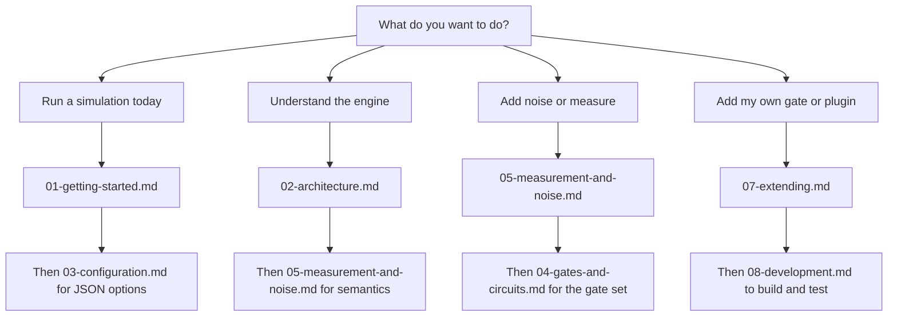

# QForge documentation

QForge is an event-driven quantum computing library that simulates circuits in pure Java 17. These
guides explain how to build circuits, pick a backend, add noise, measure qubits, run quantum
algorithms, and extend the simulator with plugins.

The file names carry a numeric prefix, and that number is the suggested reading order: install and
run first, then the engine internals, then the details of each subsystem. If you want a two-minute
introduction, start with [Getting started](01-getting-started.md). If you want to know how the
engine works internally, start with [Architecture](02-architecture.md).

## Guides

| # | Guide | What it covers | Read time |
| --- | --- | --- | --- |
| 1 | [Getting started](01-getting-started.md) | Tutorial: install, build, run the demos, write your first circuit, load a JSON circuit | 10 min |
| 2 | [Architecture](02-architecture.md) | Simulator lifecycle, event queue ordering, execution pipeline, state representations, backend choice | 15 min |
| 3 | [Configuration](03-configuration.md) | `SimulationConfig` fields and defaults, JSON schema, validation rules, resource limits, noise profiles | 10 min |
| 4 | [Gates and circuits](04-gates-and-circuits.md) | Gate catalog, qubit ordering convention, controlled gates, rotations, custom gates, circuit JSON | 12 min |
| 5 | [Measurement and noise](05-measurement-and-noise.md) | Projective measurement, state collapse, observables, Kraus channels, quantum trajectories, fidelity | 12 min |
| 6 | [Algorithms](06-algorithms.md) | Grover, QFT, QPE, VQE, QNN, QSVM, Shor code, QAOA, Trotter, quantum walks, with demo commands and pass criteria | 15 min |
| 7 | [Extending QForge](07-extending.md) | Plugins, observers, custom gates, custom noise, classical feed-forward control | 12 min |
| 8 | [Development](08-development.md) | Repository layout, tests, Javadoc, coding conventions, release process | 8 min |

## Which guide do I need?

## Conventions used in these guides

- All code targets JDK 17 and the Maven artifact `com.mechalikh:qforge`.
- Java packages live under `com.mechalikh.qforge.*`, which matches the `com.mechalikh:qforge`
  coordinates. The demos stay in the `example` package because they are runnable programs rather
  than library code.
- Qubit index `0` is the most significant bit of a basis-state index, so `|01>` means qubit 0 in
  state 0 and qubit 1 in state 1.
- Gate matrices order their qubits as controls first, then targets. See
  [Gates and circuits](04-gates-and-circuits.md#qubit-ordering-convention).
- Angle parameters are in radians.
- Shell examples use Windows classpath separators (`;`). On Linux or macOS use `:`.

## Other documentation sources

- This guide set is published as a website at
  [https://charafeddinemechalikh.github.io/QForge/](https://charafeddinemechalikh.github.io/QForge/).
  It is built from the `docs` folder on every push to `main`, so the site and these files stay in
  sync.
- [Project README](https://github.com/CharafeddineMechalikh/QForge#readme) for the feature overview
  and quick start.
- [CHANGELOG](https://github.com/CharafeddineMechalikh/QForge/blob/main/CHANGELOG.md) for release
  notes.
- Generated Javadoc: run `mvn javadoc:javadoc` and open
  `target/site/apidocs/index.html`. Every public type in the simulator packages and the example
  programs is documented.
- Runnable examples under `src/example/`, including `src/example/QuantumAlgorithmsDemo.java`.
