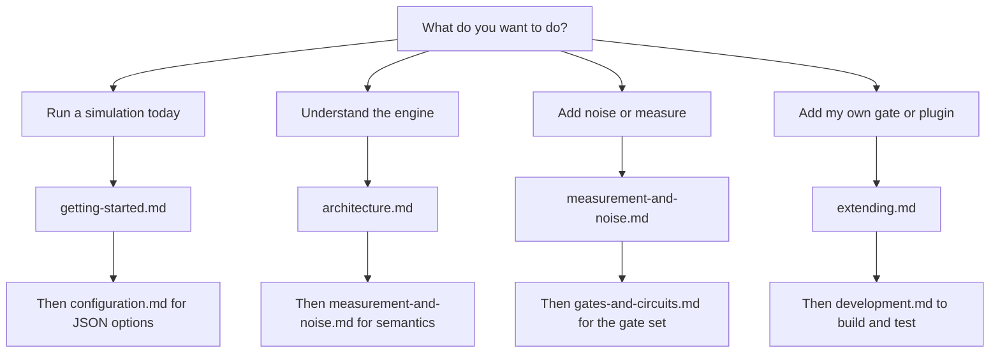

# QuantLab documentation

QuantLab is an event-driven quantum circuit simulator written in pure Java 17. These guides
explain how to build circuits, pick a backend, add noise, measure qubits, run quantum
algorithms, and extend the simulator with plugins.

If you want a two-minute introduction, start with [Getting started](getting-started.md). If you
want to know how the engine works internally, start with
[Architecture](architecture.md).

## Guides

| Guide | What it covers | Read time |
| --- | --- | --- |
| [Getting started](getting-started.md) | Install, build, run the demos, write your first circuit, load a JSON circuit | 10 min |
| [Architecture](architecture.md) | Simulator lifecycle, event queue ordering, execution pipeline, state representations, backend choice | 15 min |
| [Configuration](configuration.md) | `SimulationConfig` fields and defaults, JSON schema, validation rules, resource limits, noise profiles | 10 min |
| [Gates and circuits](gates-and-circuits.md) | Gate catalog, qubit ordering convention, controlled gates, rotations, custom gates, circuit JSON | 12 min |
| [Measurement and noise](measurement-and-noise.md) | Projective measurement, state collapse, observables, Kraus channels, quantum trajectories, fidelity | 12 min |
| [Algorithms](algorithms.md) | Grover, QFT, QPE, VQE, QNN, QSVM, Shor code, QAOA, Trotter, quantum walks, with demo commands and pass criteria | 15 min |
| [Extending QuantLab](extending.md) | Plugins, observers, custom gates, custom noise, classical feed-forward control | 12 min |
| [Development](development.md) | Repository layout, tests, Javadoc, coding conventions, release process | 8 min |

## Which guide do I need?

## Conventions used in these guides

- All code targets JDK 17 and the Maven artifact `com.quantlab:quantlab`.
- Java packages stay under `com.quantum.simulator.*`; the artifact name changed to QuantLab, the
  package names did not.
- Qubit index `0` is the most significant bit of a basis-state index, so `|01>` means qubit 0 in
  state 0 and qubit 1 in state 1.
- Gate matrices order their qubits as controls first, then targets. See
  [Gates and circuits](gates-and-circuits.md#qubit-ordering-convention).
- Angle parameters are in radians.
- Shell examples use Windows classpath separators (`;`). On Linux or macOS use `:`.

## Other documentation sources

- [Project README](../README.md) for the feature overview and quick start.
- [CHANGELOG](../CHANGELOG.md) for release notes.
- Generated Javadoc: run `mvn javadoc:javadoc` and open
  `target/site/apidocs/index.html`. Every public type in the simulator packages and the example
  programs is documented.
- Runnable examples under `src/example/`, including `src/example/QuantumAlgorithmsDemo.java`.
