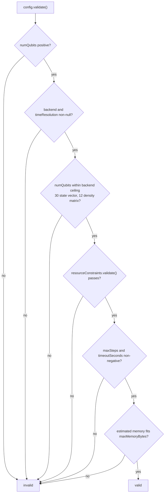
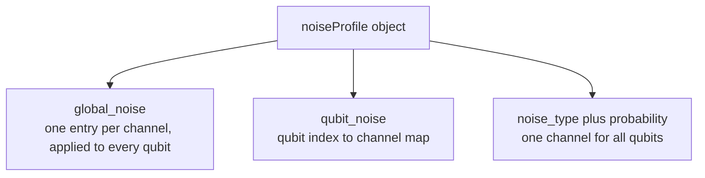

# Configuration

`SimulationConfig` is the single object that decides what a simulator can do: how many qubits it
has, which backend computes them, which noise model is applied, which limits the run must respect,
and whether classical feed-forward is active.

## Defaults

A fresh `new SimulationConfig()` holds:

| Field | Default | Setter |
| --- | --- | --- |
| `name` | `"Simulation"` | `setName(String)` |
| `description` | `""` | `setDescription(String)` |
| `numQubits` | `1` | `setNumQubits(int)` |
| `backend` | `STATE_VECTOR` | `setBackend(SimulationBackend)` |
| `timeResolution` | `NANOSECOND` | `setTimeResolution(TimeResolution)` |
| `resourceConstraints` | 80 percent of max heap, 80 percent of CPUs, 0 GPUs, 1 GiB disk | `setResourceConstraints(ResourceConstraints)` |
| `noiseProfile` | empty `NoiseProfile` | `setNoiseProfile(NoiseProfile)` |
| `gateLibrary` | new `GateLibrary` with the standard factories | `setGateLibrary(GateLibrary)` |
| `maxSteps` | `0`, meaning unlimited | `setMaxSteps(int)` |
| `timeoutSeconds` | `0`, recorded only | `setTimeoutSeconds(double)` |
| `classicalControlEnabled` | `false` | `setClassicalControlEnabled(boolean)` |
| `customParameters` | empty map | `setCustomParameter(String, Object)` |

## Validation rules

`validate()` is called by `QuantumSimulator.initialize` and returns `false` when any of these
holds:



The memory estimate is `16 * 2^n + 1024` bytes for a state vector and `16 * 4^n + 2048` bytes for a
density matrix. Note that the estimate uses `Runtime.maxMemory()` and the available processor count
as ceilings for the constraints themselves, so a `maxMemoryBytes` above the JVM heap maximum is
rejected unless memory overcommit is allowed.

Because the ceiling check and the memory check both run, an initialization failure usually means
one of: too many qubits for the backend, a heap that is smaller than the state needs, or a CPU
limit above `Runtime.availableProcessors()`.

## JSON schema

`loadFromFile(String)` reads a JSON document with these fields:

| Field | Type | Required | Behavior when absent |
| --- | --- | --- | --- |
| `numQubits` | integer | yes, positive | parse fails with `IOException` |
| `backend` | string | yes | parse fails with `IOException` |
| `name` | string | no | default kept |
| `description` | string | no | default kept |
| `timeResolution` | string | no | default kept |
| `maxMemoryBytes` | long | no | constraints unchanged unless positive |
| `maxCPUs` | integer | no | used only with a positive `maxMemoryBytes` |
| `maxGPUs` | integer | no | used only with a positive `maxMemoryBytes` |
| `noiseProfile` | object | no | profile left empty |
| `maxSteps` | integer | no | kept at its current value unless positive |
| `timeoutSeconds` | number | no | kept at its current value unless positive |
| `classicalControlEnabled` | boolean | no | always assigned, so absent means `false` |
| `customParameters` | object | no | merged into the existing map |

Parsing details worth remembering:

- Unknown properties are ignored and `//` plus `/* */` comments are allowed.
- `backend` and `timeResolution` are matched case-insensitively against the enum constant names;
  an unknown value raises `IllegalArgumentException`, which is not wrapped in `IOException`.
- A negative `maxSteps` or `timeoutSeconds` is rejected before any field is assigned.
- `noiseProfile` clears the current profile and then loads what it can parse.
- A single config file cannot define a circuit; circuits live in their own document, see
  [Gates and circuits](gates-and-circuits.md#circuit-json-schema).

`saveToFile(String)` writes all of the fields above except the gate library. An empty noise profile
is serialized as `{}`.

A complete example:

```json
{
  "name": "Noisy Bell pair",
  "description": "Two qubits with single-qubit depolarizing noise",
  "numQubits": 2,
  "backend": "DENSITY_MATRIX",
  "timeResolution": "NANOSECOND",
  "maxMemoryBytes": 1073741824,
  "maxCPUs": 4,
  "maxGPUs": 0,
  "noiseProfile": {
    "qubit_noise": {
      "0": { "depolarizing": 0.01 },
      "1": { "dephasing": 0.005, "amplitude_damping": 0.002 }
    }
  },
  "maxSteps": 100,
  "timeoutSeconds": 30.0,
  "classicalControlEnabled": false,
  "customParameters": {
    "experiment": "bell-noise-scan"
  }
}
```

## Noise profile formats

`NoiseProfile.loadFromMap` accepts three layouts, and they can be combined in one document.



| Layout | Example | Notes |
| --- | --- | --- |
| `global_noise` | `{"depolarizing": 0.001, "dephasing": 0.0005}` | Expands at application time to one single-qubit pass per qubit |
| `qubit_noise` | `{"0": {"depolarizing": 0.01}, "3": {"dephasing": 0.02}}` | Keys are qubit indices as strings |
| simple | `{"noise_type": "dephasing", "probability": 0.01}` | Applies to all qubits |

Accepted channel names, compared after trimming and lowercasing: `depolarizing`,
`depolarizing_noise`, `dephasing`, `dephasing_noise`, `phase_damping`, `amplitude_damping`,
`amplitude_damping_noise`.

Error handling is not uniform, and it is worth knowing before you debug a silent difference:

- In `global_noise` and `qubit_noise`, an unparseable entry is printed to standard error and the
  rest of the profile still loads.
- In the simple layout, an unknown `noise_type` or a non-numeric probability throws.
- `NoiseProfile` is applied after every gate, and never twice for one gate. See
  [Measurement and noise](measurement-and-noise.md#where-noise-is-applied).

## Time resolution

`TimeResolution` maps a unit to nanoseconds: `NANOSECOND(1)`, `MICROSECOND(1_000)`,
`MILLISECOND(1_000_000)`, `SECOND(1_000_000_000)`, `MINUTE`, `HOUR`. The value is stored in the
configuration and serialized, and event timestamps are absolute `java.time.Instant` values, so the
resolution currently labels the time axis rather than rescaling it. Event order comes from the
scheduled instants, not from this field.

## Resource constraints

`ResourceConstraints` is the limit object handed to `ResourceManager`.

| Setting | Default | Constraint |
| --- | --- | --- |
| `maxMemoryBytes` | 80 percent of `Runtime.maxMemory()` | must be positive, and at or below the heap maximum unless overcommit is allowed |
| `maxCPUs` | `max(1, 80 percent of available processors)` | must be positive, and at or below `Runtime.availableProcessors()` unless overcommit is allowed |
| `maxGPUs` | `0` | must not be negative |
| `maxDiskSpaceBytes` | 1 GiB | must not be negative |
| `allowMemoryOvercommit` | `false` | when `true`, `checkMemoryAvailable` always answers yes |
| `allowCPUOvercommit` | `false` | when `true`, `checkCPUAvailable` answers from the limit alone |

The manager tracks explicit requests through `ResourceRequest` and reports live figures with
`getAvailableMemoryBytes()` and `getMemoryUtilization()`. It does not resize the state arrays: the
qubit ceiling in `SimulationConfig.validate()` is what keeps an allocation from being attempted.

## Classical control

`setClassicalControlEnabled(true)` makes `initialize()` build a `ClassicalController`, wire its
event scheduler back into `scheduleEvent`, and call `processEvents(context)` after each dispatched
event.

The controller ships three default rules, and they are honest placeholders:

| Rule | Applies when | Action today |
| --- | --- | --- |
| `ConditionalGateRule` | every measurement | records a priority 100 schedule decision with a `null` event, so nothing is scheduled |
| `FeedbackMeasurementRule` | observable name contains `Z` | returns `null` |
| `AdaptiveNoiseRule` | measurement variance above `0.1` | returns `null` |

Useful behavior is available now through the memory and history APIs, and real feed-forward needs a
custom rule. See [Extending QuantLab](extending.md#classical-feed-forward-control).

```java
ClassicalController controller = simulator.getClassicalController();
controller.storeInMemory("threshold", 0.5);
Object value = controller.getFromMemory("threshold");
int decisions = controller.getDecisionCount();
```

## Programmatic configuration

```java
SimulationConfig config = new SimulationConfig();
config.setName("QAOA MaxCut on a triangle");
config.setNumQubits(3);
config.setBackend(SimulationBackend.DENSITY_MATRIX);
config.setMaxSteps(500);
config.setNoiseProfile(profile);
config.setCustomParameter("layers", 2);

if (!config.validate()) {
    throw new IllegalStateException("Configuration is outside the machine limits");
}
```

## Related guides

- [Architecture](architecture.md#stop-conditions) for how `maxSteps` ends a run.
- [Measurement and noise](measurement-and-noise.md) for profile semantics.
- [Getting started](getting-started.md#3-run-a-json-circuit) for running a configured circuit.
