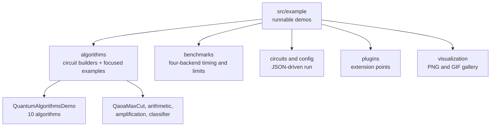

# Examples

`src/example` contains runnable demonstrations of the simulator and a set of circuit builders. This
page is the index: what each entry point does, how to run it, and what it printed in a captured run
on JDK 17. The numbers below are fresh output, not expectations copied from the source.

## Build once

```bash
mvn -q -DskipTests compile
```

Commands use `target/classes` plus `lib/*` for the Jackson jars that the JSON examples need. On Linux
or macOS, replace the `;` classpath separator with `:`.



## Runnable demos

| Example | What it shows | Captured result |
| --- | --- | --- |
| `SimpleStateTest` | Constructing and normalizing a `StateVector` | probabilities 0.5 and 0.5 after normalization |
| `SimpleQuantumSimulationApp` | one qubit, a Bell pair, and 2-qubit Grover | Bell `\|00>`/`\|11>` at 0.5, Grover `\|11>` at 1.0 |
| `QuantumSimulationApp` | five introductory demos with `[OK]` checks | all five checks pass |
| `QuantumAlgorithmsDemo` | ten algorithms, selectable by name | ten sections, nine explicit `SUCCESS` verdicts |
| `algorithms.QaoaMaxCut` | QAOA optimized by Nelder-Mead on a five-node Max-Cut | depth 1 ratio 0.727, depth 2 ratio 0.852 against exact cut 4.5 |
| `algorithms.QuantumArithmeticComplete` | exhaustive adder, multiplier and exponentiation checks | 16/16, 64/64, 49/49 and 225/225 cases pass |
| `algorithms.AmplitudeAmplificationComplete` | Grover amplification for 1, 2 and 3 marked items | success probabilities match the analytic values within 4.77e-15 |
| `algorithms.QuantumClassifierDemo` | variational classifier on thirty Iris flowers | training 0.8000 and test 0.8000 accuracy |
| `benchmarks.BackendBenchmark` | four backends, scaling and measured limits | see [benchmarks/README.md](benchmarks/README.md) |
| `CircuitRunner` | JSON circuit and config on the command line | Bell state from `bell_state_circuit.json` |
| `ComprehensiveSimulationExample` | noise, teleportation, resources, plugins, VQE | five demos, all complete |
| `MachineLearningQuantumControl` | heuristic feedback control loop | best fidelity 0.8125, model not converged |
| `PriorityResourceScheduler` | priority-ordered resource allocation | 4 tasks, 100 percent allocation success |
| `DistributedQuantumSimulation` | four concurrent simulations on a small cluster | only the smallest request fits, success rate 14.29 percent |
| `DebugQuantumSimulationApp` | reflection diagnostic and `run()` versus `step()` | one Hadamard event runs and steps |

### SimpleStateTest

```bash
java -cp "target/classes;lib/*" example.SimpleStateTest
```

```text
=== Simple State Test ===
Initial |0> state: StateVector[1 qubits, dim=2]:
  |0>: 1.000000 (p=1.0000)
Probability |0>: 1.0
Probability |1>: 0.0

Unnormalized (|0> + |1>): StateVector[1 qubits, dim=2]:
  |0>: 0.707107 (p=0.5000)
  |1>: 0.707107 (p=0.5000)
After normalization:
Probability |0>: 0.4999999999999999
Probability |1>: 0.4999999999999999
Sum of probabilities: 0.9999999999999998
```

The last digits show ordinary floating-point rounding; the constructor normalizes the input.

### SimpleQuantumSimulationApp

```bash
java -cp "target/classes;lib/*" example.SimpleQuantumSimulationApp
```

Three demos with no assertions. The Bell state is exactly `(|00> + |11>)/sqrt(2)`, and the 2-qubit
Grover circuit leaves `|11>` with probability 1.0000 and a global phase of -1.

### QuantumSimulationApp

```bash
java -cp "target/classes;lib/*" example.QuantumSimulationApp
```

Five demonstrations with `[OK]` or `[FAIL]` checks: single-qubit gates, a Bell state, Grover,
a 3-qubit QFT, and a bit-flip correction cycle. In the captured run every check printed `[OK]`, the
QFT gave 0.125000 on each of the eight basis states, and the corrected logical qubit returned to
`|0>` with probability 1.0000.

### QuantumAlgorithmsDemo

The canonical algorithm entry point. The first argument selects `GROVER`, `QFT`, `QPE`, `VQE`,
`QNN`, `QSVM`, `SHOR_CODE`, `QAOA`, `TROTTER`, `QUANTUM_WALK`, or `ALL`:

```bash
java -cp "target/classes;lib/*" example.QuantumAlgorithmsDemo ALL
java -cp "target/classes;lib/*" example.QuantumAlgorithmsDemo VQE
```

See [algorithms/README.md](algorithms/README.md) for the measured result of each selector and the
focused examples in their own directories.

### Standalone algorithm demos

Four algorithms have their own entry points and need the Maven dependency classpath, because the
QAOA and classifier demos use the commons-math3 optimizer:

```bash
mvn -B -q dependency:build-classpath -Dmdep.outputFile=target/classpath.txt
CP="target/classes;$(cat target/classpath.txt)"
java -cp "$CP" example.algorithms.QaoaMaxCut
java -cp "$CP" example.algorithms.QuantumArithmeticComplete
java -cp "$CP" example.algorithms.AmplitudeAmplificationComplete
java -cp "$CP" example.algorithms.QuantumClassifierDemo
```

The measured tables are in [algorithms/README.md](algorithms/README.md#standalone-demos). The
classifier reaches 0.8000 test accuracy, not 1.0, and the QAOA depth-two run samples fewer optimal
cuts than depth one despite a higher expected cut; both results are reported as measured.

### BackendBenchmark

```bash
java -cp "target/classes;$(cat target/classpath.txt)" example.benchmarks.BackendBenchmark
```

Times GHZ circuits on all four backends, scales the state vector and tensor network from 10 to 20
qubits, scales the stabilizer from 100 to 1000 qubits, and measures the two documented limits (the
stabilizer rejects `T`, and tensor-network truncation error falls as the bond dimension grows). The
full tables are in [benchmarks/README.md](benchmarks/README.md).

### CircuitRunner

Loads a JSON configuration and a JSON circuit, schedules the gates, and prints the state plus
metrics. It needs the Jackson jars, so run it with `lib/*` on the classpath:

```bash
java -cp "target/classes;lib/*" example.CircuitRunner bell
```

```text
[OK] SIMULATION COMPLETED SUCCESSFULLY
...
[LAB] Quantum State:
  StateVector[2 qubits, dim=4]:
  |0>: 0.707107 (p=0.5000)
  |11>: 0.707107 (p=0.5000)

[TARGET] Measurement Probabilities:
  |00>: 0.5000 (50.0%)
  |11>: 0.5000 (50.0%)
```

The runner knows the names `bell`, `grover`, `qft`, and `teleport`, but only the Bell circuit and
config files are present in this repository. The other three names print that the files are missing
and fall back to the default Bell circuit. See [circuits/README.md](circuits/README.md) and
[config/README.md](config/README.md).

### ComprehensiveSimulationExample

```bash
java -cp "target/classes;lib/*" example.ComprehensiveSimulationExample
```

Five end-to-end demonstrations, all completing in the captured run:

| Demo | Captured result |
| --- | --- |
| Noisy Bell state | 1000 shots: `11` 0.4880, `00` 0.4780, `10` 0.0220, `01` 0.0120 |
| Teleportation with feedback | Bob's probabilities 0.3600 and 0.6400, exactly the prepared state |
| Resource-managed QFT | 36 operations in 51 ms, allocation released afterwards |
| Plugin-monitored GHZ state | `\|000>` 0.5 and `\|111>` 0.5 |
| VQE loop | lowest energy -0.9936308553450764 after 23 iterations |

It writes visualization files under `output/vis_bell_state/`.

### MachineLearningQuantumControl

```bash
java -cp "target/classes;lib/*" example.MachineLearningQuantumControl
```

Three heuristic experiments with an adaptive controller: state preparation, error mitigation, and
parameter optimization. The captured run reached a best preparation fidelity of 0.8125, estimated an
average error of 0.3451 against an injected error of 0.0500 (the estimator overestimates), and found
a best entanglement of 0.7073. The controller reports `model_converged: false`; the program still
ends with a completion line. This is a control-loop demonstration, not a trained model.

### PriorityResourceScheduler

```bash
java -cp "target/classes;lib/*" example.PriorityResourceScheduler
```

Four tasks with HIGH, NORMAL, and LOW priorities share a 4 CPU, 100 MB resource manager from a
two-thread pool. Each task sleeps for one to three seconds, so the completion order varies between
runs even though submission is priority ordered. In the captured run all four allocations succeeded
and the printed order was High, Normal1, Normal2, Low, with simulation runtimes of 13, 8, 8, and 5
ms. Resource statistics show 100 percent allocation success and 0 percent utilization after release.

### DistributedQuantumSimulation

```bash
java -cp "target/classes;lib/*" example.DistributedQuantumSimulation
```

Four simulations request 1, 2, 4, and 8 GB from a cluster with 1 GB of memory, then retry with half
the memory after a rejection. The 1 GB simulation runs; the three larger requests and their
fallbacks are rejected. The final report is success rate 14.29 percent after six failures:

```text
=== FINAL RESOURCE REPORT ===
ResourceStatistics[total=1, failed=6, active=0, success=14.29%, ...]
```

This demonstrates allocation, rejection, and fallback under a deliberately small cluster. It does
not show parallel speedup, and the 30 second monitoring window runs after the short circuits have
already finished.

### DebugQuantumSimulationApp

```bash
java -cp "target/classes;lib/*" example.DebugQuantumSimulationApp
```

A utility rather than a quantum result: it lists the `SimulationContext` methods whose names contain
`state`, runs one Hadamard event with `run()`, then runs it with `step()`. The captured run showed
the state at `0.5`/`0.5` after the full run and a completed step.

## Directory guides

- [algorithms/README.md](algorithms/README.md): the circuit builders, the ten selectors and the four standalone demos
- [benchmarks/README.md](benchmarks/README.md): backend timings, scaling and measured limits
- [bb84/README.md](algorithms/bb84/README.md): key distribution with and without an eavesdropper
- [noise/README.md](algorithms/noise/README.md): depolarizing fidelity sweep
- [oracle/README.md](algorithms/oracle/README.md): Deutsch, Deutsch-Jozsa, and Bernstein-Vazirani
- [shor/README.md](algorithms/shor/README.md): order finding that factors 15
- [teleportation/README.md](algorithms/teleportation/README.md): feed-forward corrections and all four branches
- [plugins/README.md](plugins/README.md): plugin lifecycle, extension points, and limits
- [visualization/README.md](visualization/README.md): the PNG and GIF gallery under `output/quantum_viz/`
- [circuits/README.md](circuits/README.md): the JSON circuit format
- [config/README.md](config/README.md): the JSON configuration format

## Notes

- **Classpath.** The JSON examples need Jackson. Use `lib/*`; `target/classes` alone fails with
  `NoClassDefFoundError: com/fasterxml/jackson/databind/ObjectMapper`.
- **Output files.** `ComprehensiveSimulationExample` writes `output/vis_bell_state/` and the
  visualization suite writes `output/quantum_viz/`; both are ignored by Git.
- **Honest verdicts.** A `FAILED` or "not converged" line is a real result and is kept visible in the
  READMEs rather than hidden.
