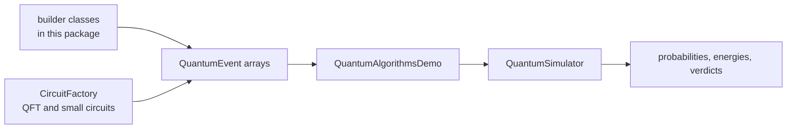

# Quantum algorithm examples

The builders in this package assemble circuits and return them as arrays or lists of `QuantumEvent`;
none of them schedules or runs a simulation. `example.QuantumAlgorithmsDemo` is the runner: it
builds the qubits, schedules the events on a `QuantumSimulator`, runs the circuit, and prints the
final state with a `SUCCESS` or `FAILED` verdict where it can check one.

Five algorithms have their own directory and README with a deeper analysis, because they either
need more circuit structure or deserve a distribution plot:

- [oracle/README.md](oracle/README.md): Deutsch, Deutsch-Jozsa, Bernstein-Vazirani
- [teleportation/README.md](teleportation/README.md): all four Bell-measurement branches
- [bb84/README.md](bb84/README.md): key distribution with an eavesdropper
- [noise/README.md](noise/README.md): depolarizing fidelity sweep
- [shor/README.md](shor/README.md): order finding that factors 15

## Run the demos

```bash
mvn -q -DskipTests compile
java -cp "target/classes;lib/*" example.QuantumAlgorithmsDemo ALL
java -cp "target/classes;lib/*" example.QuantumAlgorithmsDemo VQE
```

On Linux or macOS use `:` instead of `;`. The optional first argument is case insensitive:
`GROVER`, `QFT`, `QPE`, `VQE`, `QNN`, `QSVM`, `SHOR_CODE`, `QAOA`, `TROTTER`, `QUANTUM_WALK`, or
`ALL`.



## Captured results

Fresh output from `QuantumAlgorithmsDemo ALL` on JDK 17.

| Selector | Builder | Measured result |
| --- | --- | --- |
| `GROVER` | `GroversAlgorithm` | `\|111>` probability 0.9453 after 2 iterations |
| `QFT` | `CircuitFactory` (top-level package) | all eight probabilities 0.1250 |
| `QPE` | `QuantumPhaseEstimation` | phase 0.125 with probability 1.000 |
| `VQE` | `VQEAlgorithm` and `VariationalQuantumEigensolver` | -1.879702 Hartree, error 1.94e-07, 267 iterations |
| `QNN` | `QuantumNeuralNetwork` | 100 percent training accuracy after 60 epochs |
| `QSVM` | `QuantumSVM` | training and test accuracy 100 percent, kernel perceptron 1 epoch |
| `SHOR_CODE` | `QuantumErrorCorrection.createShorCode` | probability mass 1.000000 on the eight codewords |
| `QAOA` | `QAOAAlgorithm` | expected cut 0.5258 on a triangle whose maximum is 2 (fixed angles) |
| `TROTTER` | `TrotterSimulation` | fidelity 1.00000000 against the exact exponential |
| `QUANTUM_WALK` | `QuantumWalk` | probability 0.3245 and 0.3328 on the two neighbours |

`QAOA` is the one selector without a `SUCCESS` line. The demo uses fixed angles (`p = 1`,
`gamma = 0.5`, `beta = 0.3`) that are not optimized, so the largest probabilities sit on the
zero-cut states `|000>` and `|111>`; the printed expected cut size is 0.5258 against a maximum of 2.
The demo prints that note itself. Treat it as an unoptimized example of the circuit, not as evidence
that QAOA finds the maximum cut.

## What each builder does

- **`GroversAlgorithm`** (`createGroversCircuit`): Hadamards, then
  `max(1, floor(pi/4 * sqrt(N)))` iterations of a phase oracle and a diffusion operator. The oracle
  flips the marked state with X gates around a multi-controlled Z.
- **`QuantumPhaseEstimation`** (`createPhaseEstimationCircuit`): Hadamards on the estimation
  register, controlled powers `U^(2^(t-1-j))`, then an inverse QFT. Controlled powers are formed by
  matrix exponentiation and are limited to 10 qubits. `createInverseQFT` is public and reusable.
- **`QuantumNeuralNetwork`** (`createQNNCircuit`): data encoding plus variational rotation layers.
  The demo trains it with finite-difference gradients on four samples.
- **`QuantumSVM`**: a ZZ feature map, a swap-test kernel, and a kernel perceptron. The kernel matrix
  in the captured run is symmetric with unit diagonal, as a kernel must be.
- **`QuantumErrorCorrection`** (`createBitFlipCode`, `createPhaseFlipCode`, `createShorCode`):
  encoding circuits only. Syndrome extraction, decoding, and recovery are not included, except that
  the phase-flip helper applies Hadamards as part of its representation.
- **`QAOAAlgorithm`**: one layer per entry of `gamma`, with a CNOT, RZ, CNOT problem unitary per
  edge and an RX mixer per qubit. The caller supplies the angles; nothing is optimized.
- **`TrotterSimulation`**: first-order Trotter steps for a Heisenberg `XX + YY + ZZ` Hamiltonian.
  The demo compares the result with the exact matrix exponential.
- **`QuantumWalk`**: a continuous-time walk on a small line graph, using a package-private graph
  type. The demo starts in the middle and checks that both neighbours receive probability.
- **`VQEAlgorithm`**: the ansatz builder behind the variational eigensolver demo. The optimizer
  itself lives in `com.mechalikh.qforge.classical`.

## Builders without a demo

Two classes are reference material and are not exercised by `QuantumAlgorithmsDemo`:

- **`QuantumAmplitudeAmplification.amplify(...)`** appends oracle and diffusion repetitions to a
  caller-supplied initialization circuit. Its multi-controlled Z inside the diffusion step is a
  simplified decomposition (CZ for two qubits, a short CNOT/RZ sequence for three, a CNOT cascade
  above that), documented as simplified in the source. Because no demo runs it, there is no captured
  output here; validate any circuit built with it against a known case before relying on it.
- **`QuantumArithmetic.createQuantumAdder(...)`** emits the carry and sum CNOTs of a partial
  ripple-carry adder and omits the remaining carry logic. `createQuantumMultiplier(...)` is a
  placeholder that returns an empty circuit. These are sketches, not complete arithmetic.

Neither class is claimed to be correct for arbitrary inputs. They are kept because they show the
intended circuit shape for a future full implementation.

## Notes

- **No simulation in the builders.** They only create events, so they can be unit tested and reused
  with any backend. Running is always the caller's job.
- **Qubit ordering.** Qubit 0 is the most significant bit of the basis-state index throughout the
  demos.
- **Simplified pieces are labelled.** The package documentation and the class Javadoc call out the
  simplified decompositions in amplitude amplification and arithmetic, and the missing decoding in
  the error-correction encoders.
