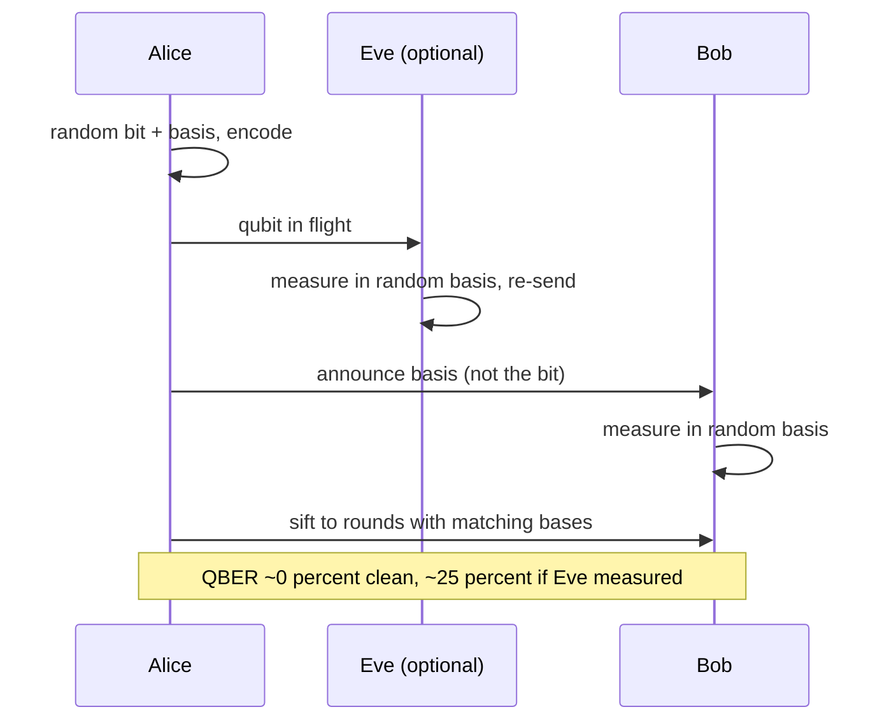

# BB84 quantum key distribution

Two parties grow a shared secret key over a public channel, and any eavesdropper who measures the
qubits leaves a statistical fingerprint. This example runs BB84 end to end and shows the error rate
jumping from zero to roughly a quarter when the channel is intercepted.

## What it does

`BB84` simulates the four steps of the protocol:

1. Alice picks a random bit and a random basis, Z (`{|0>, |1>}`) or X (`{|+, |->}`), and encodes the
   bit. She keeps the bit and basis secret.
2. The qubit travels to Bob. Optionally, Eve measures it in a random basis and re-sends the collapsed
   state (intercept-resend).
3. Bob measures in a random basis of his own.
4. Alice and Bob publicly compare bases and keep only the rounds where they match. That is the
   sifted key.

The four encoded states are first produced by the `STATE_VECTOR` backend, so the encoding runs
through the real simulator. The protocol then samples each measurement from the exact Born
probabilities of the state at that point, which is what a large number of shots would converge to.
Two scenarios use the same Alice and Bob randomness: a clean channel, and a channel with Eve on
every qubit.

## Protocol and the eavesdropper's signature



When Eve guesses the wrong basis, which happens half the time, her measurement collapses the qubit
into a state Alice never prepared. Bob then disagrees with Alice on half of those disturbed rounds.
Half of half is a quarter, so intercept-resend adds about 25 percent to the quantum bit error rate
(QBER). A common security threshold is 11 percent, above which the key is discarded.

## Run it

From the repository root:

```bash
mvn -q -DskipTests compile
java -cp target/classes example.algorithms.bb84.BB84
```

## Expected results

Captured from a run on JDK 17, with 1000 transmissions per scenario and seed 2026:

```text
=== BB84 Quantum Key Distribution ===
Transmissions per scenario: 1000, seed: 2026

Encoded states from the state-vector backend (Z-basis amplitudes):
  bit=0 basis=Z -> [1.0000, 0.0000]
  bit=0 basis=X -> [0.7071, 0.7071]
  bit=1 basis=Z -> [0.0000, 1.0000]
  bit=1 basis=X -> [0.7071, -0.7071]

No eavesdropper:
  sifted bits=490  errors=0  QBER=0.0000
  SUCCESS: sifted keys match exactly

Intercept-resend Eve:
  sifted bits=490  errors=116  QBER=0.2367
  SUCCESS: error rate exceeds the 11% threshold, Eve is detected
```

| Scenario | Sifted bits | Errors | QBER | Expected |
| --- | --- | --- | --- | --- |
| Clean channel | 490 | 0 | 0.0000 | 0 |
| Intercept-resend Eve | 490 | 116 | 0.2367 | about 0.25 |

The sifted count is the same in both scenarios because Alice's and Bob's bases are generated from the
same seed and only the channel changes. The observed QBER of 0.2367 sits close to the theoretical
0.25, with the small gap coming from the finite sample.

## Notes

- **Reproducibility.** Fixed seeds (2026, and a derived seed for Eve) make the run deterministic.
- **Sampling model.** Alice's states are simulated; the measurement outcomes are drawn from their
  Born probabilities. This is the shot statistics a hardware run would produce, without the runtime
  cost of thousands of engine restarts.
- **What the number means.** A QBER above 11 percent means the two parties abort and discard the
  key. At about 25 percent the channel is clearly compromised.
