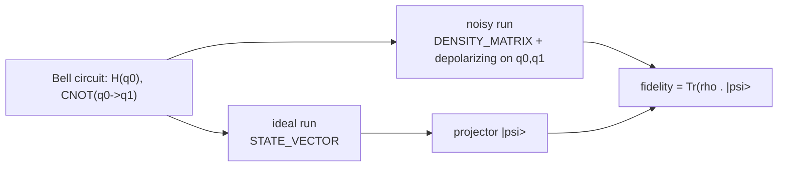

# Depolarizing noise sweep on a Bell state

How quickly does an entangled state lose its identity as noise grows? This example sweeps a
depolarizing error probability on a Bell pair and reports the fidelity to the ideal state at each
point, using the density-matrix backend so the mixed state is represented exactly.

## What it does

`NoiseSweep` prepares a Bell pair `(|00> + |11>)/sqrt(2)` two ways:

1. An **ideal** run on the `STATE_VECTOR` backend, giving a pure target state `|psi>`.
2. A **noisy** run on the `DENSITY_MATRIX` backend, applying an independent single-qubit
   depolarizing channel to each qubit at probability `p`.

It then computes the fidelity `Tr(rho |psi><psi|)` between the noisy mixed state and the ideal pure
state, which is the probability that the noisy state would pass an ideal-state test. The sweep runs
`p` from 0 to 0.75.

## Method



The depolarizing channel here is parameterised by the probability that one of `X`, `Y` or `Z` is
applied. That shrinks each qubit's Bloch vector by `lambda = 1 - 4p/3`, so the physical range ends at
`p = 0.75`, where `lambda = 0`. For a two-qubit Bell state the fidelity has the closed form
`F(p) = (1 + 3 lambda^2) / 4`.

## Run it

From the repository root:

```bash
mvn -q -DskipTests compile
java -cp target/classes example.algorithms.noise.NoiseSweep
```

## Expected results

Captured from a run on JDK 17. The measured fidelity matches the closed form `F(p) = (1 + 3(1-4p/3)^2)/4`
to six decimals:

```text
=== Depolarizing Noise Sweep on a Bell State ===
Ideal state: StateVector[2 qubits, dim=4]:
  |0>: 0.707107 (p=0.5000)
  |11>: 0.707107 (p=0.5000)

  p     fidelity   distance
  0.000  1.000000   0.000000
  0.020  0.960533   0.039467
  0.050  0.903333   0.096667
  0.100  0.813333   0.186667
  0.200  0.653333   0.346667
  0.300  0.520000   0.480000
  0.500  0.333333   0.666667
  0.625  0.270833   0.729167
  0.750  0.250000   0.750000

SUCCESS: fidelity starts at 1, falls monotonically, and reaches 0.25 at p=0.75
```

| p | Fidelity (measured) | Closed form `(1+3l^2)/4` | Distance `1-F` |
| --- | --- | --- | --- |
| 0.000 | 1.000000 | 1.000000 | 0.000000 |
| 0.050 | 0.903333 | 0.903333 | 0.096667 |
| 0.100 | 0.813333 | 0.813333 | 0.186667 |
| 0.200 | 0.653333 | 0.653333 | 0.346667 |
| 0.500 | 0.333333 | 0.333333 | 0.666667 |
| 0.750 | 0.250000 | 0.250000 | 0.750000 |

All numbers above are freshly measured from the run shown. The closed-form column is a formula check
computed from `lambda = 1 - 4p/3`; it is not taken from another source.

## Notes

- **Why 0.25 is the floor.** At `p = 0.75` the state is maximally mixed, and the fidelity of the
  maximally mixed two-qubit state against any pure state is `1/4`.
- **Why the sweep stops at 0.75.** Values above 0.75 would make `lambda` negative, which over-applies
  the channel and pushes the fidelity back up. That is outside the physical depolarizing range.
- **Backend matters.** The ideal run is a state vector; the noisy run must be a density matrix,
  because noise turns a pure state into a mixed one.
- **Config.** Two qubits, `STATE_VECTOR` for the ideal state, `DENSITY_MATRIX` for the noisy state,
  one depolarizing channel per qubit per `p`.
