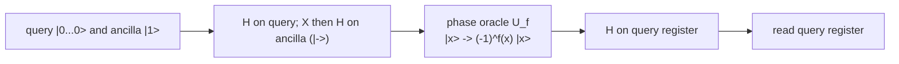

# Oracle algorithms: Deutsch, Deutsch-Jozsa, Bernstein-Vazirani

Three of the smallest algorithms that show a quantum computer beating a classical one on a promise
problem. Each asks a single question of an oracle function and reads the answer straight off the
query register, so they are the gentlest entry point to interference and phase kickback in QForge.

## What it does

`OracleAlgorithms` runs three demos against the same circuit skeleton:

1. **Deutsch's algorithm** decides whether a one-bit function `f: {0,1} -> {0,1}` is constant or
   balanced in one query, where a classical machine may need two. Four oracles are tested: the two
   constant functions and the two balanced ones (`f(x)=x` and `f(x)=NOT x`).
2. **Deutsch-Jozsa** generalises the same decision to a three-bit function, distinguishing a
   constant function from a balanced one in one query.
3. **Bernstein-Vazirani** recovers a hidden three-bit string `s` from an oracle computing
   `f(x) = s . x` (bitwise inner product) in one query.

The shared trick is phase kickback. The ancilla is placed in `|->`, so a phase oracle multiplies
each query state `|x>` by `(-1)^f(x)`. The final Hadamards turn that hidden phase pattern into a
basis state you can read directly.

## Circuit structure



The mapping from the final query register to the verdict:

| Algorithm | Oracle | Final query register | Verdict |
| --- | --- | --- | --- |
| Deutsch | constant (`0` or `1`) | `0` with probability 1 | constant |
| Deutsch | balanced (`x`, `NOT x`) | `1` with probability 1 | balanced |
| Deutsch-Jozsa | constant `f(x)=0` | `000` with probability 1 | constant |
| Deutsch-Jozsa | balanced `f(x)=x0` | `100` with probability 1 | balanced |
| Bernstein-Vazirani | `f(x)=s.x`, `s=101` | `101` with probability 1 | recovered `s` |

## Run it

From the repository root:

```bash
mvn -q -DskipTests compile
java -cp target/classes example.algorithms.oracle.OracleAlgorithms
```

## Expected results

These numbers are the exact state-vector probabilities of the final state, not shot samples, so the
outcomes are deterministic. Captured from a run on JDK 17:

```text
=== Oracle Algorithms: Deutsch, Deutsch-Jozsa, Bernstein-Vazirani ===

1. === Deutsch's Algorithm ===
Separating constant from balanced 1-bit oracles with one query
  f(x) = 0 (constant)      P(query=0)=1.0000 P(query=1)=0.0000 -> constant (SUCCESS)
  f(x) = 1 (constant)      P(query=0)=1.0000 P(query=1)=0.0000 -> constant (SUCCESS)
  f(x) = x (balanced)      P(query=0)=0.0000 P(query=1)=1.0000 -> balanced (SUCCESS)
  f(x) = NOT x (balanced)  P(query=0)=0.0000 P(query=1)=1.0000 -> balanced (SUCCESS)

2. === Deutsch-Jozsa Algorithm ===
Distinguishing constant from balanced 3-bit oracles in one query
  constant f(x)=0     : P(query=000)=1.0000 -> constant (SUCCESS)
  balanced f(x)=x0    : P(query=100)=1.0000 -> balanced (SUCCESS)
  all-zeros mass      : constant=1.0000 balanced=0.00e+00

3. === Bernstein-Vazirani Algorithm ===
Recovering a hidden 3-bit string in one query (secret = 101)
  P(query=101)=1.0000 -> recovered 101 (SUCCESS)
```

A probability of exactly 1.0000 on the listed basis state is the success criterion. Any leakage into
the other basis states would print `FAILED`.

## Notes

- **Qubit ordering.** Qubit 0 is the most significant bit of the basis-state index and the ancilla is
  the least significant qubit. The demos marginalise over the ancilla by reading the probability
  array at `query << 1` and `(query << 1) | 1`.
- **No sampling.** The demos read `getProbabilities()` from the final state vector. That is why every
  figure is exact rather than fluctuating around a binomial.
- **Backend.** All three demos use the `STATE_VECTOR` backend and stay within four qubits, so the
  state vector is small enough to inspect directly.
