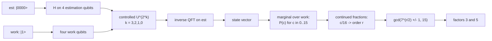

# Shor's algorithm: factoring 15 with order finding

`N = 15` is the smallest number that needs a real quantum subroutine. This example runs the
order-finding core of Shor's algorithm on the simulator, reads the counting register straight from
the final state vector, and turns the measured phase into the factors 3 and 5 with continued
fractions and a gcd. It does not hard-code the answer: the factors come out of the state produced by
the circuit.

## What it does

`ShorFactoring` factors `N = 15` with base `a = 7`, whose multiplicative order modulo 15 is `r = 4`.

1. **Prepare.** Four estimation qubits start in `|0000>`, and the four work qubits hold `|1>` (an
   `X` on the least significant work qubit).
2. **Superpose.** The estimation register goes into a uniform superposition of 16 states.
3. **Controlled powers.** For estimation qubit `j` from 0 to 3, a controlled power `U^(2^(3-j))` is
   applied, where `U|y> = |7y mod 15>` is the modular-multiply permutation on the work register.
   The phase-estimation helper builds these powers by matrix exponentiation.
4. **Inverse QFT.** An inverse Quantum Fourier Transform on the estimation register turns the
   accumulated phases into a readable counting value `c`.
5. **Classical post-processing.** Each `c` with nonzero probability gives a phase estimate `c/16`.
   Continued fractions turn `c/16` into a candidate order, and `gcd(a^(r/2) +/- 1, 15)` turns the
   order into factors.

## Method



The modular multiply is a permutation of the 16 basis states of the work register: `y -> 7y mod 15`
for `0 <= y < 15`, with `15` held fixed as a sentinel so the map stays a bijection. It is loaded as a
single `CustomGate`, and the existing `QuantumPhaseEstimation` helper builds the controlled powers and
the inverse transform, so the same code path as the standalone phase-estimation demo is reused.

## Run it

From the repository root:

```bash
mvn -q -DskipTests compile
java -cp target/classes example.algorithms.shor.ShorFactoring
```

## Expected results

Captured from a run on JDK 17. The counting register concentrates equally on `c = 0, 4, 8, 12`,
each with probability `0.25`, because the order 4 divides 16 exactly and the four values are the
exact phase peaks of `exp(2 pi i c / 16)` for `r = 4`:

```text
=== Shor's Algorithm: factoring N = 15 with a = 7 ===
True order of 7 mod 15 is 4
Estimation register: 4 qubits, work register: 4 qubits

Counting-register distribution (phase = c / 16):
  c= 0  P=0.2500  phase 0, no order information, retry
  c= 4  P=0.2500  order 4 -> gcd(4-1,15)=3, gcd(4+1,15)=5
  c= 8  P=0.2500  continued fraction gives no valid order, retry
  c=12  P=0.2500  order 4 -> gcd(4-1,15)=3, gcd(4+1,15)=5

Probability of a run that yields the factors: 0.50
Recovered factors: [3, 5]
SUCCESS: 15 = 3 x 5

A handful of repeats makes success certain, because each run either
returns the factors or reports that it must be retried.
```

| `c` | Probability | Phase `c/16` | Outcome |
| --- | --- | --- | --- |
| 0 | 0.2500 | 0 | no order information, retry |
| 4 | 0.2500 | 1/4 | order 4, factors 3 and 5 |
| 8 | 0.2500 | 1/2 | continued fraction gives no valid order, retry |
| 12 | 0.2500 | 3/4 | order 4, factors 3 and 5 |

All numbers are freshly measured from the run shown. The exact `0.2500` split is the analytic result
for an order that divides `2^4`; no sampling is involved, because the distribution is read directly
from the state vector.

## Notes

- **Why `c = 0` carries no information.** It corresponds to phase 0, which says nothing about the
  order. The algorithm discards it and reruns.
- **Why `c = 8` fails.** At phase `1/2` the continued-fraction expansion of `1/2` has convergent
  `1/2`, so the first candidate order is 2, but `7^2 mod 15 = 4`, not 1. The next convergent is
  past the denominator bound, so this run reports a retry rather than a wrong answer.
- **Why half the runs succeed.** `c = 4` and `c = 12` each give the true order 4, so a single run
  succeeds with probability `0.50`. A few repeats make the failure probability negligible, because a
  failed run is detected, not silently wrong.
- **Qubit ordering.** Qubit 0 is the most significant bit of the basis-state index. The counting
  value is recovered as `index >> 4` (the estimation register is the high four bits, the work
  register the low four bits).
- **No feed-forward, no shortcuts.** The circuit is a single end-to-end state-vector simulation; the
  classical steps (continued fractions, gcd) run on the measured distribution, the same way a real
  run would. The simulator does not collapse and re-prepare between shots; the full distribution is
  read once and each outcome is reported with its probability.
- **Config.** Eight qubits (`STATE_VECTOR`), base `a = 7`, `N = 15`, four estimation bits, four
  work bits.
