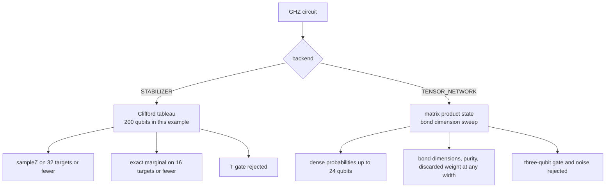

# Backend examples

Two programs show what the stabilizer and tensor-network backends buy and what they cost. The
[benchmark](../benchmarks/README.md) compares all four backends on one circuit and measures wall
clock time; these examples focus on correctness and on the limits a caller runs into.



## Run them

From the repository root, after `mvn -q -DskipTests compile`:

```bash
java -cp "target/classes;lib/*" example.backends.StabilizerExample
java -cp "target/classes;lib/*" example.backends.TensorNetworkExample
```

On Linux or macOS use `:` instead of `;`.

## StabilizerExample

A 200-qubit GHZ state is prepared by one Hadamard and 199 CNOTs, sampled on five spread-out
qubits, and compared with the analytic 0.5 / 0.5 split. The program does a 20-qubit warm-up run
first, so the reported time is not dominated by class loading and JIT compilation.

| Check | Measured |
| --- | --- |
| 200-qubit GHZ, after warm-up | 60.3 ms in the captured run (1798 ms on the first cold run) |
| 500 samples on `q0, q50, q100, q150, q199` | 237 all zeros (0.4740), 263 all ones (0.5260) |
| Exact marginal on `q0, q100, q199` | `000` at 0.500000, `111` at 0.500000 |
| Eight-qubit GHZ against state vector | both `P(0...0) = 0.500000`, max difference `1.11e-16` |
| `T q[0]` | rejected: "Gate 'T' is not supported by the stabilizer backend; only Clifford gates are supported" |

The 237 / 263 split is a random draw, not a fixed property: each run samples with a fresh
`ThreadLocalRandom`, so `RandomGenerator` does not seed it. The exact marginal in the second table
section has no sampling error at all, because it is computed by branching over the tableau.

## TensorNetworkExample

A twelve-qubit circuit of three layers of Hadamards, `T` gates and a CNOT chain is computed
exactly with the state vector backend, then with matrix product states whose bond dimension is
capped at 1, 2, 4, 8 and 64. The error is the largest absolute difference over all 4096 basis
states.

| Bond limit | Discarded weight | Largest bond used | Max `abs(P - P_exact)` |
| --- | --- | --- | --- |
| 1 | 3.368272 | 1 | 0.019342 |
| 2 | 0.660403 | 2 | 0.007385 |
| 4 | 0.217091 | 4 | 0.009296 |
| 8 | 0.000000 | 8 | 0.000000 |
| 64 | 0.000000 | 8 | 0.000000 |

Bond 8 is already exact for this circuit because the circuit never builds more than eight
Schmidt coefficients on any bond. The maximum probability error is not monotonic at very small
bonds (bond 2 is closer than bond 4) even though the discarded weight falls monotonically: the two
truncations project onto different subspaces and their deviations partially cancel. The discarded
weight is the reliable summary; the per-basis maximum is a diagnostic.

The remaining sections measure the hard limits:

| Check | Measured |
| --- | --- |
| Toffoli gate | rejected: "The matrix product state backend supports one and two qubit gates only" |
| 30-qubit GHZ | runs; largest bond 2, purity 1.000000, discarded weight 0.000000 |
| `getProbability(0)` on the 30-qubit state | rejected: dense amplitude access is limited to 24 qubits |

## What the limits mean

- **Stabilizer.** Exact for Clifford gates and Pauli measurements. `sampleZ` packs at most 32
  targets into one `int`, and `outcomeProbabilitiesZ` is exact for at most 16 targets. There is no
  fidelity or entropy because the tableau stores no amplitudes, and Kraus channels are rejected.
- **Tensor network.** One- and two-qubit gates only, no noise. Measurement, fidelity metrics,
  entropy and dense probabilities all need an amplitude array and therefore stop at 24 qubits.
  Above that limit the simulator still evolves the state and the metrics collector still counts
  steps, but the final state can only be summarized by bond dimensions, purity and discarded
  weight. A 30-qubit GHZ therefore runs, but its `P(0...0)` cannot be read.
- **Metrics above 24 qubits.** The collector used to request dense probabilities for its fidelity
  metric on any `AmplitudeAccess` state, which made every matrix product state above 24 qubits
  fail during `run()`. It now checks `AmplitudeAccess.hasDenseAccess()`, which the matrix product
  state reports as false above that width, and skips the sample instead.
- **Timing.** Treat the millisecond figures as order-of-magnitude evidence on one machine. The
  cold run of the 200-qubit GHZ took 1798 ms, and the warm run 60.3 ms, so JIT state matters more
  than the small differences the benchmark reports between backends.
