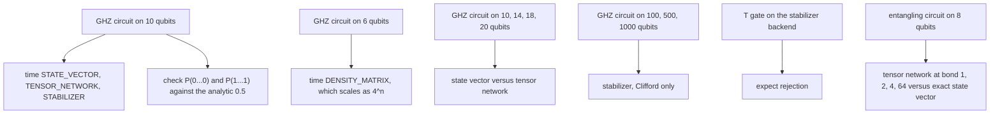

# Backend benchmark

Measure what the four simulation backends cost, check that they agree on a state with a known
answer, and probe the limits that the documentation claims. The benchmark is deliberately small:
it reports wall-clock times for circuits that finish in minutes, not a performance study of large
registers.

## What it measures



Every timing is the best of three runs after one warm-up. The correctness columns are exact state
probabilities, not sampled frequencies, so a mismatch is a bug rather than shot noise.

## Measured results

Captured from one run on the development machine (Windows, JDK 17). Absolute times vary with the
machine and with JIT state; the ratios and the exactness checks are the portable part.

### GHZ state on 10 qubits

| Backend | Time (ms) | `P(0...0)` | `P(1...1)` | Exact |
| --- | --- | --- | --- | --- |
| `STATE_VECTOR` | 4.911 | 0.5000 | 0.5000 | yes |
| `TENSOR_NETWORK` | 9.461 | 0.5000 | 0.5000 | no (truncated) |
| `STABILIZER` | 0.710 | 0.5000 | 0.5000 | yes |

The stabilizer backend is fastest on a Clifford circuit because it stores a tableau instead of
amplitudes. The tensor-network path is slower than the state vector at 10 qubits, where the dense
state is still small enough to be cheap.

### Density matrix

| Backend | Qubits | Time (ms) |
| --- | --- | --- |
| `DENSITY_MATRIX` | 6 | 154.493 |

Density-matrix time grows as `4^n` in storage and roughly `4^n` per gate. Eight qubits already takes
tens of seconds per run because the per-gate fidelity and entropy metrics decompose a
`256 x 256` matrix, so the benchmark keeps this section at six qubits.

### State vector versus tensor network

| Qubits | State vector (ms) | Tensor network (ms) |
| --- | --- | --- |
| 10 | 3.022 | 5.744 |
| 14 | 27.747 | 27.096 |
| 18 | 640.812 | 605.052 |
| 20 | 3311.371 | 2929.282 |

On a GHZ circuit the tensor network has no advantage: GHZ needs bond dimension 2, but the MPS
implementation still pays SVD and bookkeeping costs per gate. The two curves cross only slightly at
20 qubits in this run. A circuit with low entanglement and many qubits, where the state vector
cannot fit in memory, is the case where the tensor network matters.

### Stabilizer scaling

| Qubits | Time (ms) |
| --- | --- |
| 100 | 3.568 |
| 500 | 18.414 |
| 1000 | 42.826 |

Time grows roughly quadratically in the qubit count, which is the `O(n^2)` tableau update. A state
vector at 100 qubits would need `2^100` amplitudes, so this is the only backend that reaches these
widths.

## Limits, measured

The stabilizer backend rejects a `T` gate instead of approximating it:

```text
stabilizer with a T gate -> rejected: Simulation failed: Failed to execute event: T_0:
Gate 'T' is not supported by the stabilizer backend; only Clifford gates are supported
```

Tensor-network truncation is measured against the exact state vector on an 8-qubit entangling
circuit (`H` and `T` layers joined by CNOTs):

| Bond dimension | Relative discarded weight | Max `abs(P - P_exact)` |
| --- | --- | --- |
| 1 | 2.3431 | 0.890415 |
| 2 | 1.0568 | 0.064132 |
| 4 | 0.1190 | 0.019259 |
| 64 | 0.0000 | 0.000000 |

The discarded weight is the accumulated relative weight dropped at each truncation, so a value
above 1 means truncation happened many times and each time discarded a large fraction. The maximum
probability deviation falls as the bond dimension grows and reaches zero at 64, where this circuit
is represented exactly. A high discarded weight is therefore a warning, not a probability.

## Run it

The benchmark needs the Maven runtime classpath because it uses only the library, but building the
classpath keeps the command identical to the other examples:

```bash
mvn -B -q compile dependency:build-classpath -Dmdep.outputFile=target/classpath.txt
java -cp "target/classes;$(cat target/classpath.txt)" example.benchmarks.BackendBenchmark
```

On Linux and macOS replace the `;` with `:`.

## Known limits of the benchmark

- Timings are single-machine wall-clock measurements with no statistical confidence interval.
  Treat differences under roughly 10 percent as noise.
- The GHZ scaling section covers state vector and tensor network only; density matrix and
  stabilizer have their own sections for the reasons above.
- The truncation probe uses one fixed circuit and an exact 8-qubit reference, so it demonstrates
  the direction of the error, not a bound for arbitrary circuits.
- The benchmark prints `SUCCESS` only for the GHZ correctness check. The limit probes print the
  measured rejection or deviation, which is the result, not a failure of the run.
