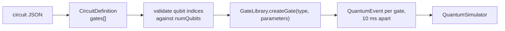

# JSON circuits

`CircuitRunner` reads a circuit document, converts each entry into a gate through the `GateLibrary`,
and schedules the gates 10 ms apart. The loader expects a top level `gates` array.

```bash
mvn -q -DskipTests compile
java -cp "target/classes;lib/*" example.CircuitRunner bell
java -cp "target/classes;lib/*" example.CircuitRunner \
  src/example/config/bell_state_config.json \
  src/example/circuits/bell_state_circuit.json
```

On Linux or macOS use `:` instead of `;`.



## File format

```json
{
  "name": "Bell State Circuit",
  "description": "Creates a Bell state between qubit 0 and 1",
  "gates": [
    {
      "id": "h0",
      "type": "H",
      "targetQubits": [0],
      "description": "Apply Hadamard on qubit 0"
    },
    {
      "id": "cnot01",
      "type": "CNOT",
      "targetQubits": [1],
      "controlQubits": [0],
      "description": "Apply CNOT with control 0 and target 1"
    }
  ]
}
```

| Field | Meaning |
| --- | --- |
| `id` | Event identifier, used in logs |
| `type` | Gate name, matched case-insensitively by `GateLibrary` |
| `targetQubits` | Target qubit indices, at least one |
| `controlQubits` | Control qubit indices, optional |
| `parameters` | Optional map; `angle` drives RX, RY, RZ, and CPHASE |
| `description` | Optional event description |

Supported types are `X`, `Y`, `Z`, `H`, `S`, `T`, `RX`, `RY`, `RZ`, `CNOT`, `CZ`, `SWAP`,
`Toffoli`, and `CPHASE`. Every index is checked against `numQubits`; an out-of-range index fails the
load with a message naming the gate id.

## Files in this directory

| File | Status |
| --- | --- |
| `bell_state_circuit.json` | Works with `CircuitRunner`; two gates, H on qubit 0 and CNOT 0 to 1 |
| `fourier_transform_circuit.json` | Not loadable by the current runner, see below |

Captured Bell run:

```text
Scheduling 2 quantum events...
Running simulation...

==================================================
[OK] SIMULATION COMPLETED SUCCESSFULLY
==================================================

[LAB] Quantum State:
  StateVector[2 qubits, dim=4]:
  |0>: 0.707107 (p=0.5000)
  |11>: 0.707107 (p=0.5000)

[TARGET] Measurement Probabilities:
  |00>: 0.5000 (50.0%)
  |11>: 0.5000 (50.0%)
```

## The Fourier transform file

`fourier_transform_circuit.json` uses an older, richer schema: a top level `operations` array with
`targets` and `controls`, an `initialState` field, a `measurements` array, `classicalOperations`, and
`expectedResults`. The current loader reads `gates` and ignores everything else, so passing this
file explicitly fails with:

```text
Simulation failed: Circuit file contains no gates: src/example/circuits/fourier_transform_circuit.json
```

The file is kept as a reference for the extended schema (initial state, measurement shots,
conditional gates, expected probabilities). It is not executable with `CircuitRunner` today.
`QuantumAlgorithmsDemo QFT` builds the working QFT circuit in Java instead.

## Notes

- **Initial state.** The loader always starts from `|0...0>`; there is no initial-state field in the
  `gates` schema.
- **No measurements or classical control** are read by the loader. `CircuitRunner` prints the final
  state and metrics; it does not collapse the state.
- **Demo names.** `CircuitRunner bell` resolves the two files above. The names `grover`, `qft`, and
  `teleport` are recognized but their files are absent, so they print a warning and fall back to the
  Bell circuit.
- **Timing.** Gates are scheduled 10 ms apart with no parallelism in the loader.
