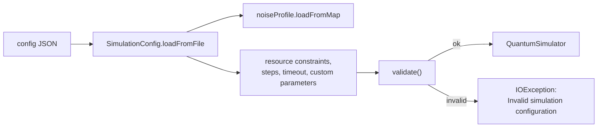

# JSON configurations

`SimulationConfig.loadFromFile` reads a JSON document into a configuration. `CircuitRunner` then
calls `validate()` before running, so a configuration that asks for more memory than the JVM heap
fails before any circuit executes.

```bash
mvn -q -DskipTests compile
java -cp "target/classes;lib/*" example.CircuitRunner \
  src/example/config/bell_state_config.json \
  src/example/circuits/bell_state_circuit.json
```

On Linux or macOS use `:` instead of `;`.



## Fields

| Field | Handling |
| --- | --- |
| `numQubits` | Required and must be positive; must not exceed the backend limit |
| `backend` | Required; `STATE_VECTOR` or `DENSITY_MATRIX` |
| `timeResolution` | Optional; defaults to `NANOSECOND` |
| `maxMemoryBytes`, `maxCPUs`, `maxGPUs` | Build the `ResourceConstraints` when memory is positive |
| `noiseProfile` | Loaded with `NoiseProfile.loadFromMap` |
| `maxSteps` | Applied only when positive; zero keeps the current value |
| `timeoutSeconds` | Applied only when positive |
| `classicalControlEnabled` | Always assigned, so an absent field means false |
| `customParameters` | Merged into the existing map |
| `name`, `description` | Optional labels |

Unknown properties are ignored and JSON comments are allowed. Memory is validated against
`Runtime.getRuntime().maxMemory()` because overcommit is off by default, which is why a 4 GB request
needs `-Xmx4g`.

Noise supports two shapes:

```json
"noiseProfile": {
  "global_noise": { "depolarizing": 0.001 },
  "qubit_noise": {
    "0": { "depolarizing": 0.01, "amplitude_damping": 0.005 }
  }
}
```

```json
"noiseProfile": { "noise_type": "depolarizing", "probability": 0.01 }
```

## Files in this directory

| File | Qubits | Memory | Behaviour |
| --- | --- | --- | --- |
| `bell_state_config.json` | 2 | 1 GB | Loads with the default heap; declares 0.1 percent depolarizing on each qubit |
| `config_example.json` | 4 | 4 GB | Needs `-Xmx4g`; global and per-qubit noise |
| `frouier_transform_config.json` | 5 | 4 GB | Needs `-Xmx4g`; the filename keeps its original spelling |
| `short_config.json` | 2 | default | Simple noise shape: 1 percent depolarizing |

Captured runs with the Bell circuit:

| Config | Command | Measured probabilities |
| --- | --- | --- |
| `bell_state_config.json` | `CircuitRunner bell` | `00` 0.5000, `11` 0.5000 |
| `config_example.json` | `-Xmx4g` plus both paths | `0000` 0.5025, `1100` 0.4975 |
| `frouier_transform_config.json` | `-Xmx4g` plus both paths | `00000` 0.5000, `11000` 0.5000 |
| `short_config.json` | `CircuitRunner short_config.json bell_state_circuit.json` | `00` 0.5000, `11` 0.5000 |

The two 4 GB configurations fail with `Invalid simulation configuration` under the default heap. The
error does not distinguish the cause, but `ResourceConstraints.validate()` rejects a memory limit
above the JVM maximum. Raise the heap to load them.

## Notes

- **The 4 GB files are examples, not requirements.** The Bell simulation itself needs a few bytes;
  the large limit exists to show resource fields and to exercise validation.
- **`frouier_transform_config.json` is not wired to a demo name.** `CircuitRunner qft` looks for
  `qft_config.json`, which is absent, so the file must be passed explicitly. The misspelling is in
  the committed filename.
- **Noise profiles are declarations.** Whether a deviation appears depends on the backend and on
  the events scheduled. The `config_example.json` run above shows a small deviation
  (0.5025 against 0.4975); the Bell configuration run printed the exact 0.5 values.
- **`short_config.json` uses the simple noise shape**, which `NoiseProfile.loadFromMap` expands to
  global noise, rather than the `global_noise`/`qubit_noise` shape used by the other files.
