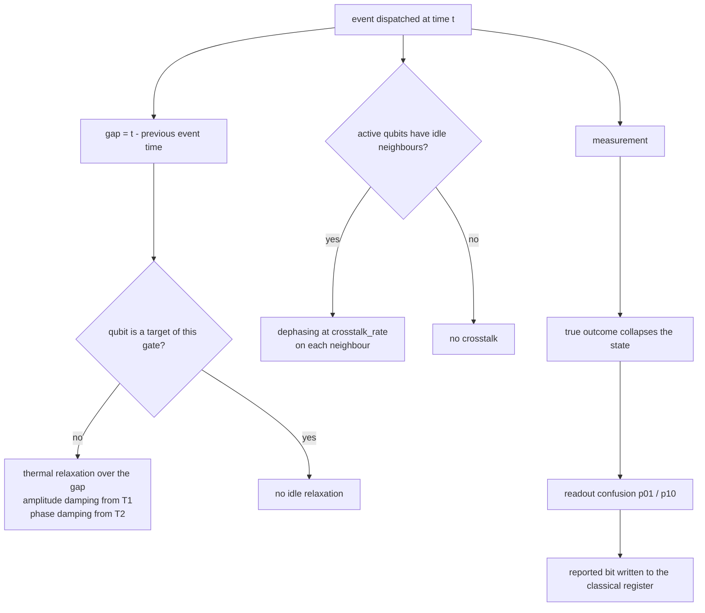

# Device noise

The gate-noise models in the main library attach a Kraus channel to an operation. Device noise
adds the effects that a real machine imposes between operations: a qubit decays while it waits,
an idle neighbour loses coherence when a gate runs next to it, and the readout electronics report
the wrong bit. This example measures each effect alone, against a closed-form expectation, so the
numbers are evidence about one mechanism at a time.



## Run it

From the repository root, after `mvn -q -DskipTests compile`:

```bash
java -cp "target/classes;lib/*" example.noise.DeviceNoiseExample
```

On Linux or macOS use `:` instead of `;`.

## Configuration

All three effects live in one `DeviceNoiseModel`, built from per-qubit arrays. A zero disables a
qubit, and `gate_time_ns` is a nominal duration that is exposed to scheduling code.

```java
DeviceNoiseModel device = new DeviceNoiseModel(
    new double[] {2000.0, 0.0},   // T1 in nanoseconds
    new double[] {2000.0, 0.0},   // T2 in nanoseconds, at most 2 * T1
    new double[] {0.1, 0.0},      // P(read 1 | prepared 0)
    new double[] {0.0, 0.2},      // P(read 0 | prepared 1)
    0.3,                          // crosstalk dephasing rate
    20.0);                        // nominal gate time
config.setDeviceNoise(device);
```

The constructor rejects arrays of different lengths, a positive `T2` above twice `T1`, and any
probability or rate outside `[0, 1]`.

## Measured results

Captured on JDK 17, each effect configured in isolation.

| Effect | Setup | Measured | Expected |
| --- | --- | --- | --- |
| Idle relaxation | `T1 = T2 = 2000 ns`, `q0` in `\|1>`, a gate on `q1` after a 1000 ns gap | `P(q0=1) = 0.606530660` | `exp(-1000/2000) = 0.606530660` |
| Crosstalk, off | `q1` in `\|+>`, one gate on `q0`, rate 0 | `<X> = 1.000000` | 1.0 |
| Crosstalk, on | same circuit, rate 0.3 | `<X> = 0.700000` | `1 - rate = 0.700000` |
| Readout | `q0 = \|0>`, `q1 = \|1>`, `p01 = 0.1` on `q0`, `p10 = 0.2` on `q1`, 4000 shots | see the table below | product of the confusion probabilities |

The readout histogram over 4000 seeded shots:

| Register `c` (bit 0 = `q0`, bit 1 = `q1`) | Measured | Expected |
| --- | --- | --- |
| 0 | 0.1933 | 0.1800 |
| 1 | 0.0193 | 0.0200 |
| 2 | 0.7063 | 0.7200 |
| 3 | 0.0813 | 0.0800 |

The deviations are the sampling error of 4000 binomial draws, on the order of 0.007, not a model
error. The first two sections are exact because they run on the density matrix backend.

## How each effect is defined

- **Idle relaxation.** For a qubit that is not a target of the current event, the exposure is the
  scheduled-time gap since the previous event. The channel is thermal relaxation with
  `p = 1 - exp(-t / T1)` for amplitude damping and `p_phi = 1 - exp(-t / T_phi)` for phase
  damping, where `1 / T_phi = 1 / T2 - 1 / (2 T1)`. A gate that targets the qubit suppresses the
  idle channel for that event; other qubits still receive it. Control qubits are not in the
  target set, so a control qubit does receive idle relaxation.
- **Crosstalk.** After each gate, every idle neighbour (`index - 1` and `index + 1`) of the gate's
  targets and controls is dephased once at `crosstalk_rate`. Dephasing leaves populations alone
  and contracts coherence by `1 - rate`, which is why `<X>` on `q1` falls from 1.0 to 0.7.
- **Readout confusion.** `p01` is the probability of reporting 1 for a qubit prepared in 0, and
  `p10` is the probability of reporting 0 for a qubit prepared in 1. The reported bit is written
  to the classical register; the collapse always uses the true outcome. Readout error applies
  only to computational-basis observables, and the bit is not fed back into the quantum state.

## Notes

- `gate_time_ns` is stored and validated but does not advance event timestamps. Idle exposure is
  still the difference between the timestamps you schedule, so the caller controls the timing.
- The first two sections use the density matrix backend, which applies the channel
  deterministically. The state vector backend samples one Kraus operator per trajectory instead,
  so the same idle window would give a sampled population with binomial spread around the same
  mean.
- Device noise is rejected by the stabilizer and tensor network backends. Use `STATE_VECTOR` or
  `DENSITY_MATRIX`.
- The readout section seeds `RandomGenerator` with a fixed seed, so its histogram is reproducible;
  the small gap from the expected values is the draw, not a different probability model.
