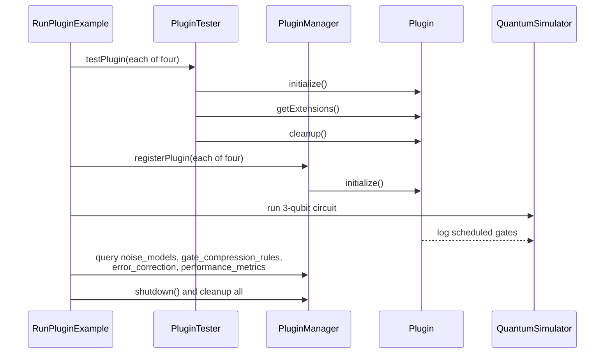

# Plugin system examples

These examples show how the simulator's plugin API is used: registering plugins, running a
simulation while they are active, querying the extension points they advertise, and unloading them.
The plugins are compiled into the example package; nothing is loaded from an external jar.

## Run it

```bash
mvn -q -DskipTests compile
java -cp "target/classes;lib/*" example.plugins.RunPluginExample
```

On Linux or macOS use `:` instead of `;`. Run `example.plugins.PluginSystemExample` directly to
skip the lifecycle tests.

## What the classes do

| Class | Role |
| --- | --- |
| `RunPluginExample` | Entry point: tests each plugin with `PluginTester`, then runs `PluginSystemExample` |
| `PluginSystemExample` | Registers four plugins, runs a circuit, and prints every extension point |
| `PluginTester` | Checks initialize, extension lookup, and cleanup for one plugin |
| `EnhancedPluginManager` | Plugin manager subclass that tracks plugin health |
| `SafePlugin` | Abstract base class with a checked lifecycle |



## Captured results

Fresh run on JDK 17. All four lifecycle tests printed `[OK]`.

```text
=== Testing Plugin: AdvancedNoiseModel ===
    [INFO] AdvancedNoiseModelPlugin initialized with 3 custom noise models
   [OK] Initialization successful
   [OK] noise_models: Available
   [OK] Cleanup successful
[OK] Plugin AdvancedNoiseModel passed all tests!
...
[OK] Plugin PerformanceMonitor passed all tests!
```

Loaded plugins and versions:

```text
QuantumErrorCorrection v1.0.0
AdvancedNoiseModel v2.0.0
PerformanceMonitor v1.0.0
CircuitCompression v1.1.0
```

Extension lists from the same run:

| Extension point | Plugin | Content |
| --- | --- | --- |
| `noise_models` | AdvancedNoiseModel | `cross_talk`, `coherent_noise`, `leakage` |
| `gate_compression_rules` | CircuitCompression | `H H = I`, `X X = I`, `Y Y = I`, `Z Z = I`, `CNOT(a,b) CNOT(a,b) = I` |
| `error_correction` | QuantumErrorCorrection | bit-flip, phase-flip, Shor 9-qubit, Steane 7-qubit |
| `performance_metrics` | PerformanceMonitor | 5 gates, 3 H, 2 CNOT, about 48 ms, about 104 gates per second |

The 3-qubit circuit ends in a uniform superposition of all eight basis states (0.1250 each), with
the coherences the plugin reports.

## Limits

- **The plugins describe, they do not transform.** The noise plugin returns placeholder `NoiseModel`
  instances that do not alter the state, and the compression plugin logs gates without rewriting the
  circuit. The output line "Implementing Toffoli gate via plugin optimizations" is an announcement;
  the circuit that runs is a 3-qubit Hadamard and CNOT ladder, not a Toffoli.
- **Extensions are advertisements.** `getExtensions()` lists names and capabilities so a host can
  inspect them; the examples do not dispatch circuit work through those extension points.
- **The tester checks presence, not content.** `PluginTester` reports an extension as available when
  it is non-null; it does not validate what the extension does.
- **Timing varies.** The performance numbers depend on the machine and are not a benchmark.
- **In-process only.** There is no jar discovery, classpath scanning, or sandboxing in these
  examples; the four plugins are instantiated directly.
