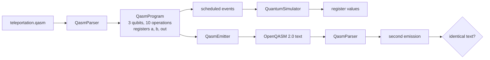

# OpenQASM interchange

This example moves a circuit across the OpenQASM boundary in both directions. It loads a
teleportation program from [teleportation.qasm](teleportation.qasm), parses it into a
`QasmProgram`, builds the configuration from the declared registers, schedules every operation,
and checks that the conditional corrections recover the payload. The parsed program is then
emitted as OpenQASM 2.0, parsed again, emitted a second time, and exercised for 200 shots. The
point is not teleportation, which has its own [example](../algorithms/teleportation/README.md),
but the guarantee that text, simulator and classical registers agree after a round trip.



## Run it

From the repository root, after `mvn -q -DskipTests compile`:

```bash
java -cp "target/classes;lib/*" example.qasm.QasmInterchange
```

On Linux or macOS use `:` instead of `;`.

## What it checks

The source declares three quantum qubits and three one-bit classical registers. Writes use
`creg a[1]`, `creg b[1]` and `creg out[1]`, so the two teleportation corrections can be conditioned
separately. The circuit prepares the payload `|1>` on `q[2]`, builds a Bell pair on `q[0]` and
`q[1]`, performs the Bell-basis rotation, measures into `a` and `b`, applies the conditional
corrections, and measures Bob's qubit into `out`.

## Measured run

Captured on JDK 17 with the source above. The single run's `a` and `b` values depend on the
branch drawn by the measurement, so only the register width and the final `out` value are stable.

| Check | Measured |
| --- | --- |
| Parsed metadata | 3 qubits, 10 operations, registers `{a=1, b=1, out=1}` |
| One run | `a`, `b` from the sampled branch, `out = 1` |
| Round trip | 10 operations to 10 operations, emitted text stable = `true` |
| 200 shots, `out` | `out=1` in every shot, frequency 1.0000 |
| 200 shots, `a` | 0.4250 for 0, 0.5750 for 1 in the captured run |
| 200 shots, `b` | 0.4550 for 0, 0.5450 for 1 in the captured run |
| OpenQASM 3.0 declarations | 2 qubits, one width-2 classical register, 4 operations |
| `reset q[0];` | `reset is not supported by the engine (line 3, column 1)` |

The emitted text for the source is:

```qasm
OPENQASM 2.0;
include "qelib1.inc";
qreg q[3];
creg a[1];
creg b[1];
creg out[1];
x q[2];
h q[0];
cx q[0], q[1];
cx q[2], q[0];
h q[2];
measure q[2] -> a[0];
measure q[0] -> b[0];
if(b==1) x q[1];
if(a==1) z q[1];
measure q[1] -> out[0];
```

The spacing differs from the input (`cx q[0], q[1]` with a space after the comma), but the second
emission is byte for byte identical to the first, which is the property the round-trip check uses.

## Supported subset

- **Gates.** `x`, `y`, `z`, `h`, `s`, `sdg`, `t`, `tdg`, `id`, `rx`, `ry`, `rz`, `u1`, `u2`, `u3`,
  `p`, `cx`, `cz`, `swap`, `ccx` and `cp`. User-defined `gate` declarations are expanded into these
  built-in operations when the program is parsed, so the emitted text contains the expansion and
  not the original definition.
- **Declarations.** `qreg` and `creg` for OpenQASM 2.0; `qubit[n]` and `bit[n]` with the
  `OPENQASM 3.0` header for the 3.0 declaration subset. A whole-register `measure q -> c` is
  expanded into one measurement per qubit.
- **Classical control.** `if(creg==N)` compares the whole register, as OpenQASM 2.0 specifies.
  The parser stores the register mask, so a one-bit register and a three-bit register with the
  same expected value behave differently in exactly the expected way.
- **Rejected on purpose.** `reset`, `opaque`, loops, nested conditions, unsupported includes and
  vendor gates raise `QasmException` with a line and column. Nothing is silently dropped.
- **Emitter limits.** A measurement without a classical target, a measurement of several qubits
  in one statement, or a gate with no OpenQASM spelling is rejected by `QasmEmitter` rather than
  approximated.

## Notes

- The example reads `src/example/qasm/teleportation.qasm` relative to the working directory, so
  run it from the repository root.
- There is no Python bridge. Qiskit or Cirq can exchange text with `QasmParser` and `QasmEmitter`
  through their own OpenQASM 2.0 importers and exporters, subject to the subset above.
- Angles are emitted with six fractional digits by default and trailing zeros are removed. The
  emitter options also control the qelib1 include and the trailing newline.
