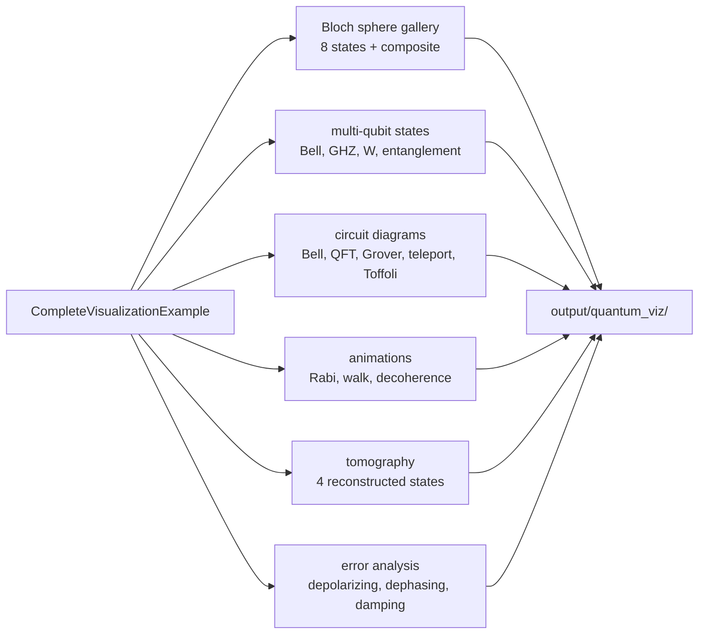

# Visualization examples

Generates a gallery of quantum images with Java2D and the simulator's `VisualizationEngine`: Bloch
spheres, multi-qubit state diagrams, circuit drawings, animated GIFs, tomography plots, and noise
curves. The suite runs on the JVM without a display and writes files to `./output/quantum_viz/`.

## Run it

```bash
mvn -q -DskipTests compile
java -cp "target/classes;lib/*" example.visualization.RunVisualizations
```

On Linux or macOS use `:` instead of `;`. `RunVisualizations` delegates to
`CompleteVisualizationExample` and prints the output directory on success.



## Output

The captured run created 57 files in six subdirectories:

| Directory | Files | Examples |
| --- | --- | --- |
| `bloch_spheres/` | 18 | one PNG and one info text per state, plus `bloch_spheres_composite.png` |
| `multi_qubit/` | 13 | Bell, GHZ, W, and entanglement diagrams |
| `circuits/` | 6 | `circuit_00_Bell_State_Preparation.png` through `circuit_04_Toffoli_Gate_Implementation.png`, plus a timing diagram |
| `animations/` | 7 | `rabi_oscillations.gif`, `quantum_walk.gif`, `decoherence.gif`, plus summary PNGs |
| `tomography/` | 9 | zero, one, plus, and random state reconstructions |
| `error_analysis/` | 4 | depolarizing, dephasing, amplitude damping, and a comparison plot |

Captured progress lines:

```text
1. Generating Bloch Sphere Visualizations...
  Generated: |0> (North Pole)
  Generated: |1> (South Pole)
  ...
  Generated composite image: bloch_spheres_composite.png
...
=== All visualizations completed ===
Output directory: .../output/quantum_viz
```

## What is measured and what is illustrative

- **Bloch spheres and multi-qubit diagrams** are drawn from the states the example prepares.
- **Circuit diagrams** are drawings of the gate sequences listed in the output (Bell, 3-qubit QFT,
  2-qubit Grover, teleportation, Toffoli).
- **Tomography** is not a reconstructed measurement record. The class documentation states that the
  displayed density matrix is the ideal one with small Hermitian noise added.
- **Noise analysis curves** come from closed-form expressions, not simulated noise channels.

Do not use these figures as experimental evidence for tomography or noise. They demonstrate the
rendering API.

## Notes

- **Writes files.** Everything lands under `output/quantum_viz/`, which is ignored by Git. Delete the
  directory to start clean.
- **No GUI.** The images are written through Java2D; no window is opened.
- **Timing and content of the metrics plots vary** between runs.
- **First run creates directories.** `mkdirs()` is called for the output tree.
